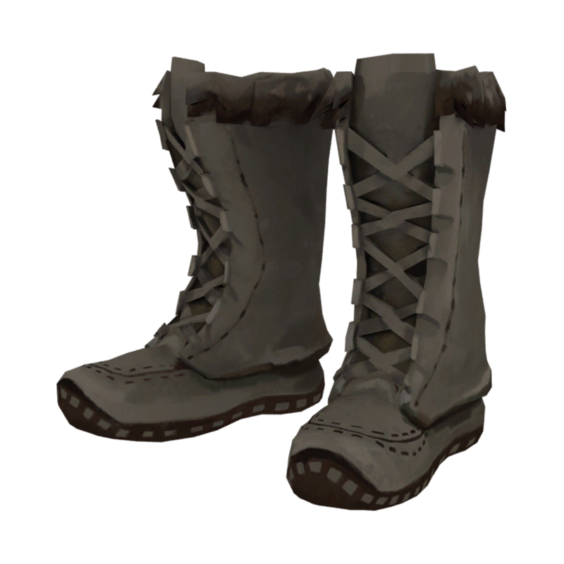

# Mukluks

<table class="infobox">
<caption>Mukluks</caption>
<colgroup>
<col style="width: 50%" />
<col style="width: 50%" />
</colgroup>
<tbody>
<tr>
<td colspan="2"><figure>

<figcaption>Mukluks_icon.png</figcaption>
</figure></td>
</tr>
<tr>
<td colspan="2" class="section">
<strong>General</strong>
</td>
</tr>
<tr>
<td>
Item Type
</td>
<td>
Clothing|-
</td>
</tr>
<tr>
<td colspan="2" class="section">
<strong>Statistics</strong>
</td>
</tr>
<tr>
<td>
Weight
</td>
<td>
1.50 kg(3.3 lbs)
</td>
</tr>
<tr>
<td>
Warmth bonus
</td>
<td>
2.5 °C(4.5 °F)
</td>
</tr>
<tr>
<td>
Windproof bonus
</td>
<td>
2.0 °C(3.6 °F)
</td>
</tr>
<tr>
<td>
Waterproof bonus
</td>
<td>
40%
</td>
</tr>
<tr>
<td>
Protection
</td>
<td>
5%
</td>
</tr>
<tr>
<td>
Mobility
</td>
<td>
-3%
</td>
</tr>
<tr>
<td>
Harvest
</td>
<td>
2 × <a href="./Cured%20Leather.md" class="wikilink" title="Cured leather">Cured leather</a> 
90 minutes
</td>
</tr>
<tr>
<td>
Repair
</td>
<td>
1 × <a href="./Cured%20Leather.md" class="wikilink" title="Cured leather">Cured leather</a>, 
1 × <a href="./Cloth.md" class="wikilink" title="Cloth">Cloth</a> 
90 minutes 
50% condition
</td>
</tr>
</tbody>
</table>

<table>
<colgroup>
<col style="width: 33%" />
<col style="width: 33%" />
<col style="width: 33%" />
</colgroup>
<tbody>
<tr>
<td style="vertical-align: top; font-size: 3em; color: #5d5980; padding-right: 10px">
“
</td>
<td>
Manufactured boot inspired by the traditional hunter's footwear. Designed for mobility and warmth using leather and fur. You can stay warm and move quickly.

&#10;

In-game description

</td>
<td style="vertical-align: bottom; font-size: 3em; color: #5d5980; padding-left: 10px">
”
</td>
</tr>
</tbody>
</table>

**Mukluks** are a type of <a href="./Clothing.md" class="wikilink" title="footwear">footwear</a> in *<a href="./The%20Long%20Dark.md" class="wikilink" title="The Long Dark">The Long Dark</a>*.

## Overview

Mukluks are high tier boots and one of the rarest items in *The Long Dark*. Few containers have Mukluks in their loot table, most notable being Safes and similar high-loot tier locations. Mukluks cannot spawn on Interloper.

Possible spawn locations are:

- <a href="./Signal%20Hill.md" class="wikilink" title="Signal Hill">Signal Hill</a>
- <a href="./Trapper%27s%20Homestead.md" class="wikilink" title="Trapper&#39;s Homestead">Trapper's Homestead</a> <a href="./Safe.md" class="wikilink" title="Safe">Safe</a>
- <a href="./Carter%20Hydro%20Dam.md" class="wikilink" title="Carter Hydro Dam">Carter Hydro Dam</a> <a href="./Safe.md" class="wikilink" title="Safe">Safe</a>
- <a href="./Trapper%27s%20Homestead.md" class="wikilink" title="Trapper&#39;s Homestead">Trapper's Homestead</a>
- <a href="./Old%20Spence%20Family%20Homestead.md" class="wikilink" title="Old Spence Family Homestead">Old Spence Family Homestead</a>
- <a href="./Hunting%20Lodge.md" class="wikilink" title="Hunting Lodge">Hunting Lodge</a>
- <a href="./Hibernia%20Processing.md" class="wikilink" title="Hibernia Processing Safe">Hibernia Processing Safe</a>
- <a href="./Draft%20Dodger%27s%20Cabin.md" class="wikilink" title="Draft Dodger&#39;s Cabin">Draft Dodger's Cabin</a>
- <a href="./Maintenance%20Yard.md" class="wikilink" title="Maintenance Yard">Maintenance Yard</a>
- <a href="./Milton%20Credit%20Union.md" class="wikilink" title="Milton Credit Union">Milton Credit Union</a> in the locked safe (Survival)
- <a href="./Lonely%20Lighthouse.md" class="wikilink" title="Lonely Lighthouse">Lonely Lighthouse</a>
- <a href="./Angler%27s%20Den.md" class="wikilink" title="Angler&#39;s Den">Angler's Den</a>
- <a href="./Foreman%27s%20Retreat.md" class="wikilink" title="Foreman&#39;s Retreat">Foreman's Retreat</a>
- <a href="./Mindful%20Cabin.md" class="wikilink" title="Mindful Cabin">Mindful Cabin</a>
- <a href="./Concentrator.md" class="wikilink" title="Concentrator Offices Safe">Concentrator Offices Safe</a>
- <a href="./Station%20Bunkhouse.md" class="wikilink" title="Station Bunkhouse Safe">Station Bunkhouse Safe</a>

Mukluks are similar to the <a href="./Deerskin%20Boots.md" class="wikilink" title="Deerskin Boots">Deerskin Boots</a> in stats, offering the same warmth and windchill bonus but are 0.5 kg lighter. However, Mukluks are 10 percent less waterproof, have -3% stamina (vs -5%), and offer 2% less protection from wildlife.

<table class="gallery">
<colgroup>
<col style="width: 50%" />
<col style="width: 50%" />
</colgroup>
<tbody>
<tr>
<td><figure>

<figcaption>Clothing model icon</figcaption>
</figure></td>
<td><figure>

<figcaption>Clothing model icon</figcaption>
</figure></td>
</tr>
</tbody>
</table>

## Update history

- UPDATE **19 December 2016 (<a href="./The%20Long%20Dark%20%E2%80%94%20Early%20Access%20Changelog.md#0.386" class="wikilink" title="Update">Update</a>):**
  - Added to game

**Lua execution error in Module:Navbox function navbox** <a href="ru:%D0%A3%D0%BD%D1%82%D1%8B" class="wikilink" title="ru:Унты">ru:Унты</a>

