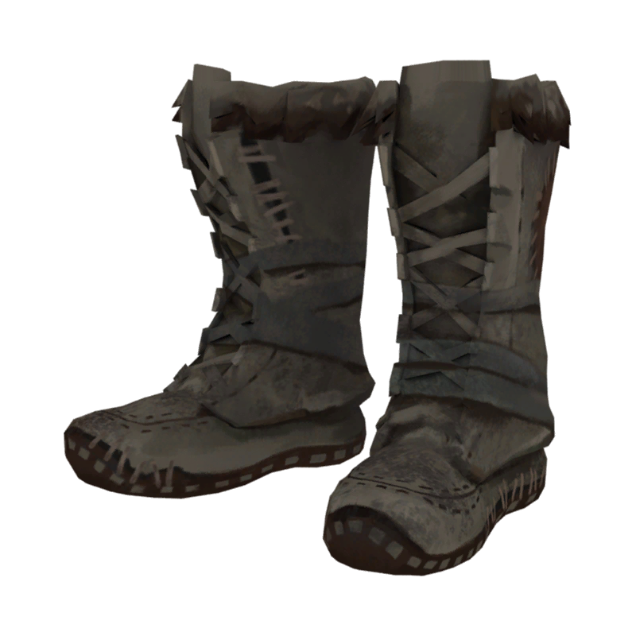

# Mukluks

**Categories:** Clothing, Pages with update history, Story items · **Source:** [Fandom](https://thelongdark.fandom.com/wiki/Mukluks)

**Mukluks**

[Mukluks icon](../assets/Mukluks_icon.png)

**General**

**Item Type:** Clothing

**Statistics**

**Weight:** [Weight icon](../assets/Weight_icon.png)1.50 kg(3.3 lbs)

**Warmth bonus:** [Temp icon](../assets/Temp_icon.png)2.5 °C(4.5 °F)

**Windproof bonus:** [Windproofness icon](../assets/Windproofness_icon.png)2.0 °C(3.6 °F)

**Waterproof bonus:** [Waterproofness icon](../assets/Waterproofness_icon.png)40%

**Protection:** [Protection icon](../assets/Protection_icon.png)5%

**Mobility:** [Mobility icon](../assets/Mobility_icon.png)-3%

**Harvest:** 2 × [Cured leather](./Cured%20Leather.md) 90 minutes

**Repair:** 1 × [Cured leather](./Cured%20Leather.md), 1 × [Cloth](./Cloth.md) 90 minutes 50% condition

> “**Manufactured boot inspired by the traditional hunter's footwear. Designed for mobility and warmth using leather and fur. You can stay warm and move quickly.**”
>
> — In-game description

**Mukluks** are a type of [footwear](./Clothing.md) in _[The Long Dark](./The%20Long%20Dark.md)_.

## Overview

Mukluks are high tier boots and one of the rarest items in _The Long Dark_. Few containers have Mukluks in their loot table, most notable being Safes and similar high-loot tier locations. Mukluks cannot spawn on Interloper.

Possible spawn locations are:

- [Signal Hill](./Signal%20Hill.md)
- [Trapper's Homestead](./Trapper%27s%20Homestead.md) [Safe](./Safe.md)
- [Carter Hydro Dam](./Carter%20Hydro%20Dam.md) [Safe](./Safe.md)
- [Trapper's Homestead](./Trapper%27s%20Homestead.md)
- [Old Spence Family Homestead](./Old%20Spence%20Family%20Homestead.md)
- [Hunting Lodge](./Hunting%20Lodge.md)
- [Hibernia Processing Safe](./Hibernia%20Processing.md)
- [Draft Dodger's Cabin](./Draft%20Dodger%27s%20Cabin.md)
- [Maintenance Yard](./Maintenance%20Yard.md)
- [Milton Credit Union](./Milton%20Credit%20Union.md) in the locked safe (Survival)
- [Lonely Lighthouse](./Lonely%20Lighthouse.md)
- [Angler's Den](./Angler%27s%20Den.md)
- [Foreman's Retreat](./Foreman%27s%20Retreat.md)
- [Mindful Cabin](./Mindful%20Cabin.md)
- [Concentrator Offices Safe](./Concentrator.md)
- [Station Bunkhouse Safe](./Station%20Bunkhouse.md)

Mukluks are similar to the [Deerskin Boots](./Deerskin%20Boots.md) in stats, offering the same warmth and windchill bonus but are 0.5 kg lighter. However, Mukluks are 10 percent less waterproof, have -3% stamina (vs -5%), and offer 2% less protection from wildlife.

## Update history

- UPDATE **19 December 2016 ([Update](./The%20Long%20Dark%20%E2%80%94%20Early%20Access%20Changelog.md#0.386)):**
  - Added to game
