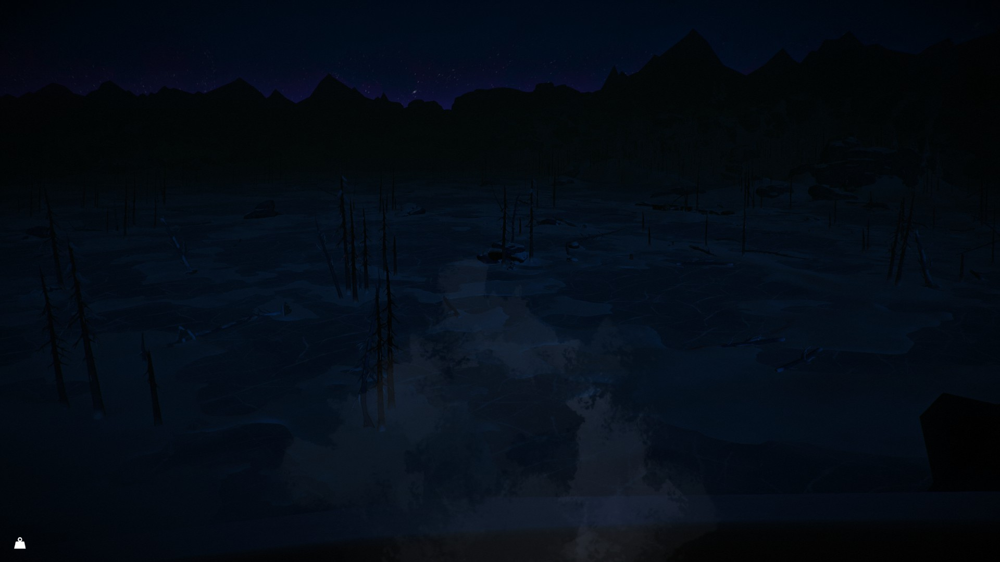
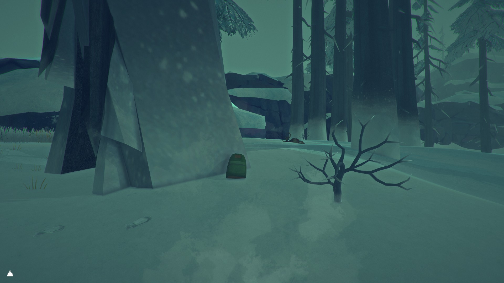
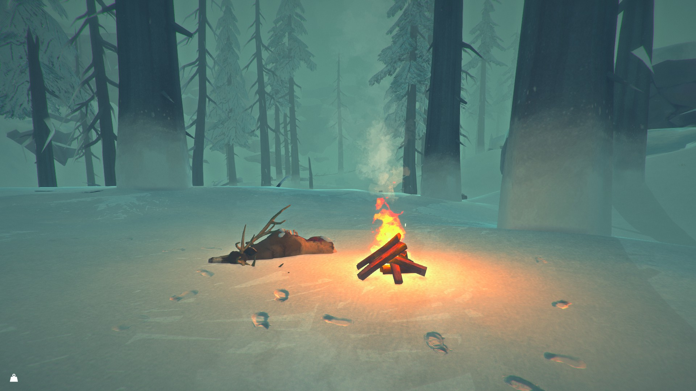

# Muskeg Overlook

**Categories:** Locations, Locations in Forlorn Muskeg, Outdoor locations · **Source:** [Fandom](https://thelongdark.fandom.com/wiki/Muskeg_Overlook)

**Muskeg Overlook**

[Muskeg Overlook](../assets/Muskeg_Overlook.jpg)

**Location**

[Muskeg Overlook Location](../assets/Muskeg_Overlook_Location.png)

**Region:** [Forlorn Muskeg](./Forlorn%20Muskeg.md)

**Type:** Outdoors

## Overview

Muskeg Overlook is a large clearing with a single access point. A shortwave radio tower (the eastern-most in the region) is well visible at the top from certain angles. In the area, there may be a [deer](./Deer.md) carcass, a backpack (which may contain rare food like [MRE](./Military-Grade%20MRE.md) or clothing), and a hollow tree, as well as plants such as [Old Man's Beard Lichen](./Old%20Man%27s%20Beard%20Lichen.md), [rose hips](./Rose%20Hip.md), [Reishi Mushroom](./Reishi%20Mushroom.md) and a single [burdock](./Burdock.md) plant. The overlook also includes an area with several [rabbits](./Rabbit.md) and occasionally a flock of [ptarmigans](./Ptarmigan.md). This point provides visibility of much of the region. The paths of several [wolves](./Wolf.md) lead around the area. It is possible to "Mountain goat" down the cliff where the railing meets the cliff face to take a shortcut towards [Abandoned Camp](./Abandoned%20Camp.md) and eventually [Mystery Lake](./Mystery%20Lake%20%28region%29.md) with only a minor risk of sprains.

One of the [transmitter](./Transmitters.md) towers can also be found here, a [Car Battery](./Car%20Battery.md) and possibly a [Replacement Fuse](./Replacement%20Fuse.md) as well as one [Wire Bundle](./Wires.md) can be found in a supply bin underneath the tower. When the tower is active during the [Aurora](./Aurora.md), its signals spread across Forlorn Muskeg, [Broken Railroad](./Broken%20Railroad.md), and [Bleak Inlet](./Bleak%20Inlet.md).

A downed helicopter (which can easily be found using the [Handheld Shortwave Radio](./Handheld%20Shortwave%20Radio.md)) can be found a short distance south of the tower, and a lockbox can be found near that. Notable loot includes a possible [Go! Energy Drink](./Go!%20Energy%20Drink.md) inside the helicopter, a [Prybar](./Prybar.md), and a small amount of food.

## Gallery

