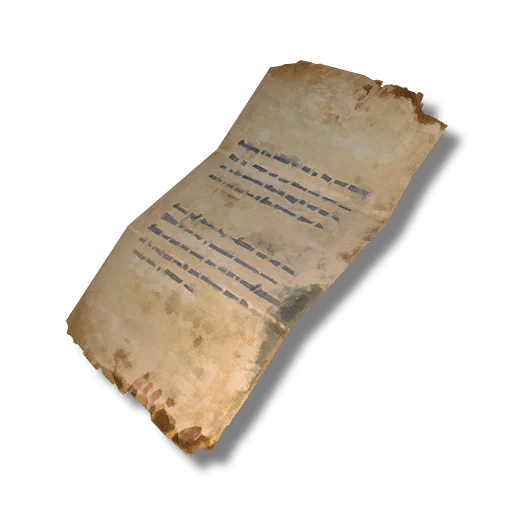

# Mysterious Note

**Categories:** Collectibles, Pages with update history · **Source:** [Fandom](https://thelongdark.fandom.com/wiki/Mysterious_Note)

**Mysterious Note**

_Mysterious\_Note\_icon.png_

**Release:** [6 October 2021](./The%20Long%20Dark%20%E2%80%94%20Changelog.md#1.95)

**Wintermute:** [Episode 4](./Episode%204%20-%20Fury%2C%20Then%20Silence.md) - [Convict Caches](./Convict%20Caches.md)

**Properties**

**Item type:** [Collectibles](./Collectibles.md)

**Stackable:** No

**Examine:** Note with locations of a few hidden caches.

**Values**

**Weight:** 0.00 kg (0 lbs)

**Actions**

**Backpack:** Examine

**On ground:** Take It, Read Text, Leave It

**Mysterious Note** is a [Collectible](./Collectibles.md) note found in [Episode 4](./Episode%204%20-%20Fury%2C%20Then%20Silence.md) of the [Wintermute](./Wintermute.md) story. It is found in a [Metal Container](./Metal%20Container.md) at [Cook's Farm](./Cook%27s%20Farm.md). It is part of the side mission [Convict Caches](./Convict%20Caches.md).

## Transcript

_The following text is transcribed from **Mysterious Note**_

**If you all made it this far, you've still got a ways to go. But there's help.

Look for these supplies on the way. This is all you're gonna get from me. I'd wish you luck but there's none left to go around.

\[hand-sketched map with supply locations\]**

## Update history

- UPDATE **6 October 2021 ([Update](./The%20Long%20Dark%20%E2%80%94%20Changelog.md#1.95)):**
  - Added to game.
