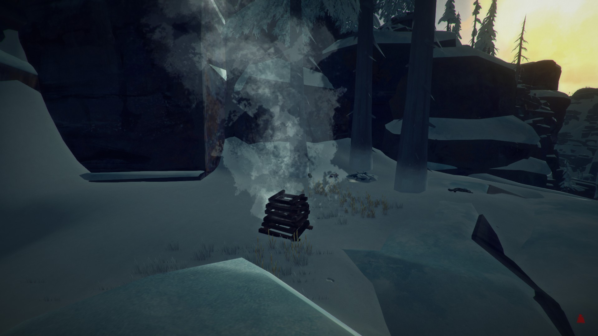

# Mysterious Signal Fire

**Mysterious Signal Fire**

| Property | Details |
| --- | --- |
|  |  / *20180909115732\_1.jpg* |
| **Location** |  |
|  |  / *Mysterious\_Signal\_Fire\_Location.png* |
| Region | [Hushed River Valley](./Hushed%20River%20Valley.md)\|- |
| **General** |  |
| Type | Outdoors\|- |
