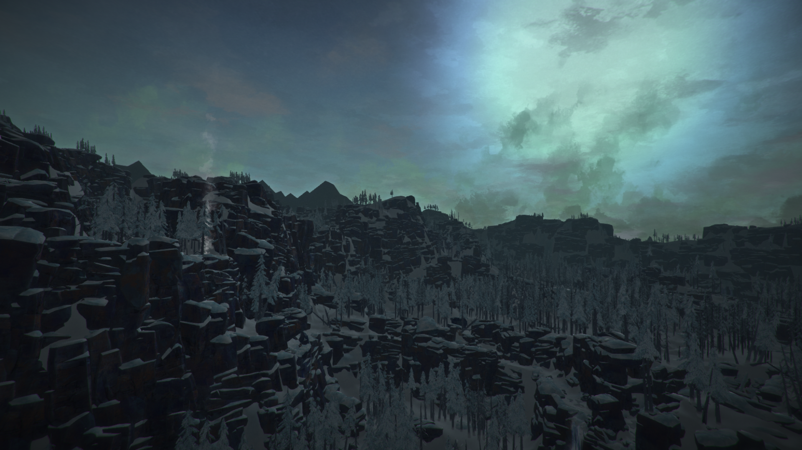
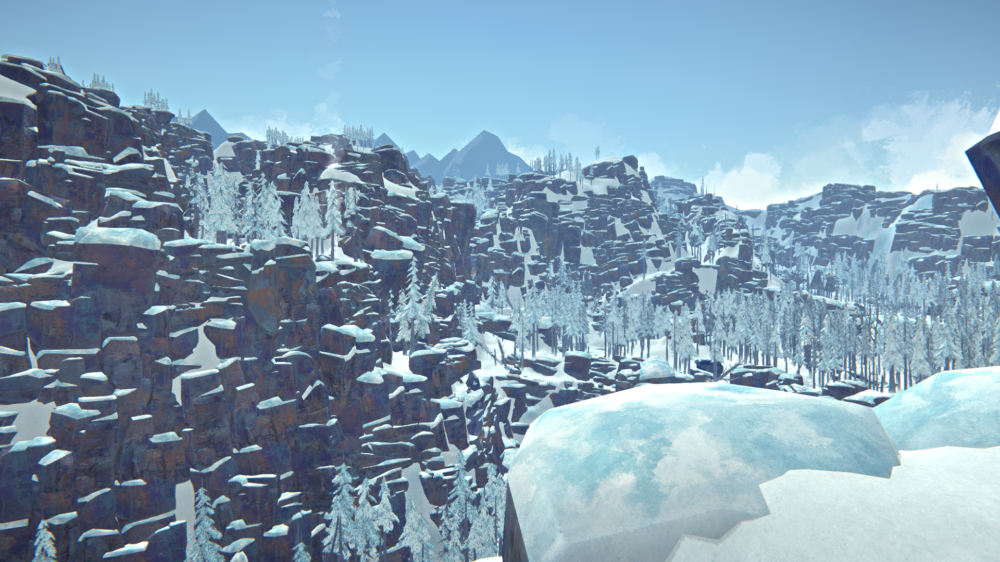
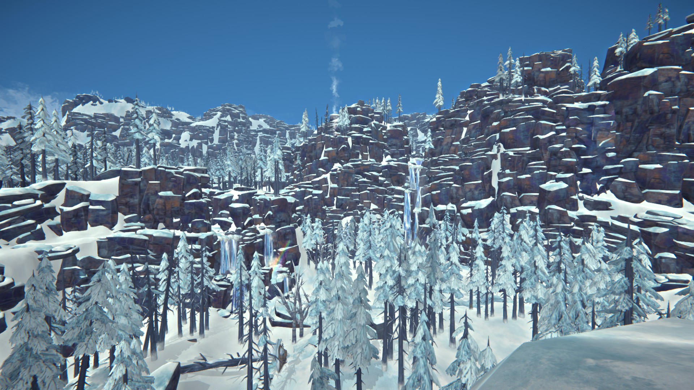

# Mysterious Signal Fire

**Categories:** Locations, Locations in Hushed River Valley, Outdoor locations, Sheltered locations · **Source:** [Fandom](https://thelongdark.fandom.com/wiki/Mysterious_Signal_Fire)

**Contents**

- [Overview](#overview-1)
- [Overview](#overview-1)
- [Trivia](#trivia)
- [Gallery](#gallery)

**Mysterious Signal Fire**

[20180909115732 1](../assets/20180909115732_1.jpg)

**Location**

[Mysterious Signal Fire Location](../assets/Mysterious_Signal_Fire_Location.png)

**Region:** [Hushed River Valley](./Hushed%20River%20Valley.md)

**General**

**Type:** Outdoors

## Overview

It can spawn in one of two different locations:

- South of the ice cave entrance by [Mammoth Falls](./Mammoth%20Falls.md), overlooking [Long Shot Falls](./Long%20Shot%20Falls.md) and the lower valley, or
- Above [Many Falls Vista](./Many%20Falls%20Vista.md) to the north. This site can be accessed by ice cave, or by climbing the rope that would lead to [Lonely Cave](./Lonely%20Cave.md) in the central portion of the valley.

The exact location of the fire may differ in each game, but it can usually be reached via one of the [Ice Cave](./Ice%20Cave.md) systems or by [Mountaineering Rope](./Mountaineering%20Rope.md), though walls of [Scrub Brush](./Scrub%20Brush.md) may block the way. One can tell which location it spawned in by looking for the smoke signal's location in the valley.

## Overview

The Signal Fire generally sits beside a camp containing a [Snow Shelter](./Snow%20Shelter.md), a burnt out [Campfire](./Campfire.md), possibly a corpse, and some useful food or clothing items. A [Moose-Hide Satchel](./Moose-Hide%20Satchel.md) can be found hanging from a branch in the area, except in Interloper experiences. The signal fire is one of the few places where man-made objects are likely to be found in the region.

The Signal Fire provides no warmth since it is almost burned out. Try to go to this location towards the end of your time in region, as the smoke can help serve as a useful landmark for orientating your position.

## Trivia

- Originally the signal fire was just a giant [Campfire](./Campfire.md) when Hushed River Valley was first released. The model was eventually replaced with a pyre when [Episode 3: Crossroads Elegy](./Episode%203%20-%20Crossroads%20Elegy.md) was released (similar to the one in front of the [Community Hall](./Community%20Hall.md)).
- Aside from seemingly recent [Frozen Corpses](./Frozen%20Corpse.md), this signal fire is the only evidence that another human could still be alive on the Island in [Survival Mode](./Survival%20Mode.md), though the producer of the signal fire is never found.

## Gallery

_Looking at the mysterious signal fire from [Pensive Vista](./Pensive%20Vista.md)._

_Looking at the mysterious signal fire from [Many Falls Vista](./Many%20Falls%20Vista.md)._

