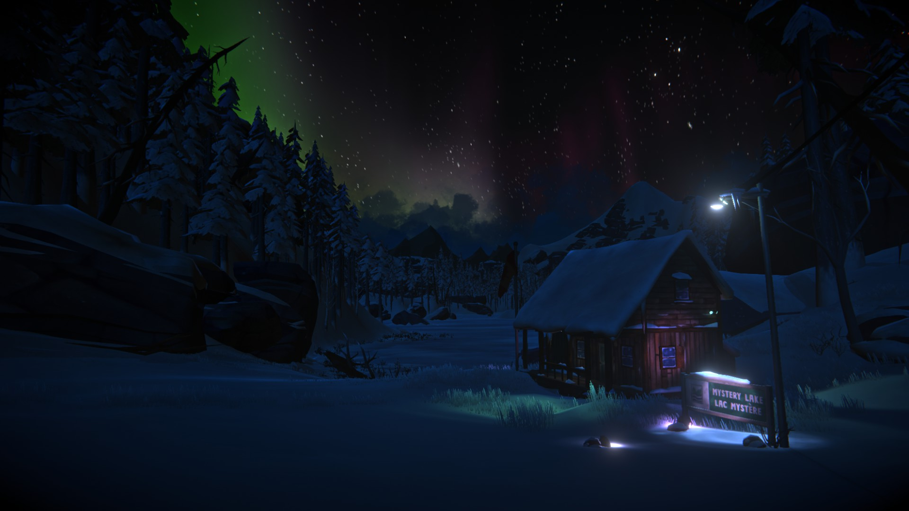
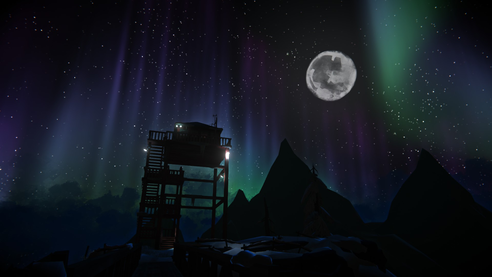

# Mystery Lake \(location\)

**Categories:** Lakes, Locations, Locations in Mystery Lake · **Source:** [Fandom](https://thelongdark.fandom.com/wiki/Mystery_Lake_%28location%29)

**Mystery Lake (location)**

| Property | Details |
| --- | --- |
|  | [The Long Dark Lake Overview](../assets/The_Long_Dark_Lake_Overview.png) |
| **Location** |  |
|  | [Mystery Lake (location) Location](../assets/Mystery_Lake_%28location%29_Location.png) |
| Region |  |
| Sublocations | [Fishing huts](./Fishing%20Hut.md) |
| **General** |  |
| Type |  |

_For the region, see [Mystery Lake (region)](./Mystery%20Lake%20%28region%29.md)._

**Mystery Lake** is a large lake located to the south-east of the [Mystery Lake region](./Mystery%20Lake%20%28region%29.md) in _[The Long Dark](./The%20Long%20Dark.md)_.

## Overview

Mystery Lake is a good location for collecting supplies due to the abundance of cabin and huts around the lake.

A [Camp Office](./Camp%20Office.md) is located at the north-western tip of the lake between the lake and the rail road tracks, this building has an abundance of supplies and is a contender for one of the best base locations in the region.

There are two collections of [lake cabins](./Lake%20Cabins.md) on the south and south-eastern end of the lake, usually one cabin out of each collection is burnt down, but there is still a large amount of supplies to be found in each.

Further up past the triple lake cabins a [Lone Lake Cabin](./Lone%20Lake%20Cabin.md) quietly sits abandoned.

There is the occasional [wolf](./Wolf.md) (usually two or 4) as well as a [bear](./Bear.md) on the lake which makes exploring slightly risky sometimes. You can harvest the cattails from lake edge as a food and tinder source. Several [fishing huts](./Fishing%20Hut.md) (each with a stove, cupboard and fishing hole) are scattered over the frozen lake and a small strip of land sits in the middle of the lake. Over all Mystery Lake is a great location for supplies. A [Rifle](./Hunting%20Rifle.md) may spawn near a corpse behind [Lone Lake Cabin](./Lone%20Lake%20Cabin.md).

