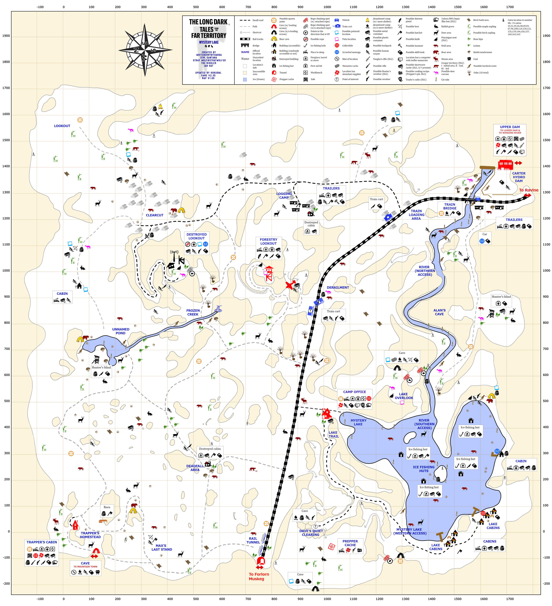
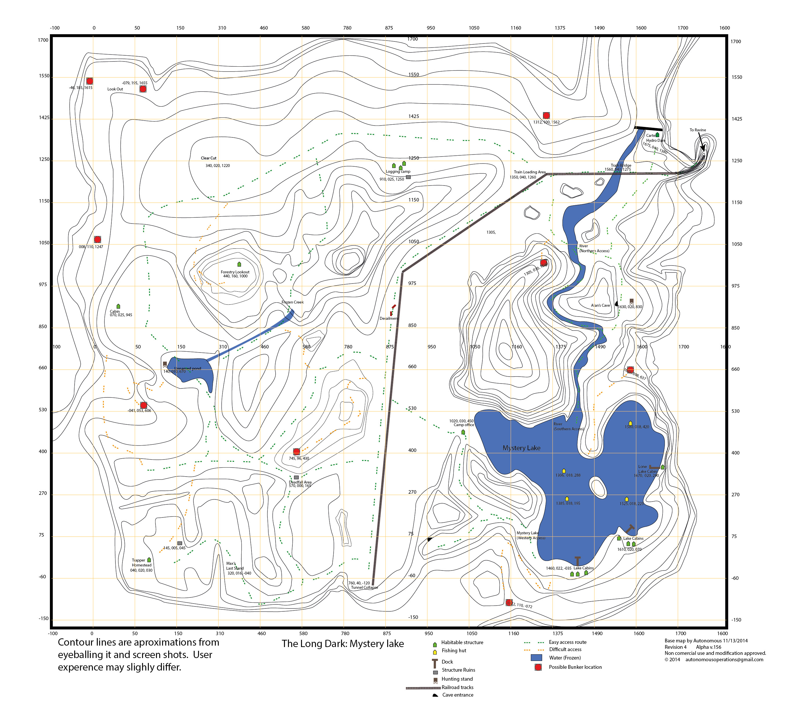

# Mystery Lake \(region\)

**Categories:** Regions · **Source:** [Fandom](https://thelongdark.fandom.com/wiki/Mystery_Lake_%28region%29)

**Contents**

- [Entrances](#entrances)
- [Description](#description)
- [Base locations](#base-locations)
- [Camp Office](#camp-office)
- [Trapper's Homestead](#trapper-s-homestead)
- [Carter Hydro Dam](#carter-hydro-dam)
- [Locations](#locations)
- [Unmarked Locations](#unmarked-locations)
- [Miscellaneous Locations](#miscellaneous-locations)
- [Maps](#maps)
- [Gallery](#gallery)

**Mystery Lake (region)**

| Property | Details |
| --- | --- |
|  | [No picture](../assets/No_picture.png) |
| **Location on [Great Bear Island](./Great%20Bear%20Island.md)** |  |
|  | [No picture](../assets/No_picture.png) |
| **Details** |  |

_For the location, see [Mystery Lake (location)](./Mystery%20Lake%20%28location%29.md)._

> “**Ideal for new players. A balance between wilderness and man-made shelters, resources, and wildlife.**”
>
> — - In game description

**Mystery Lake** is 1st [Region](./Region.md) available for play in [Survival Mode](./Survival%20Mode.md) and one of the primary starting regions in _[The Long Dark](./The%20Long%20Dark.md)_. The region is named after [Mystery Lake](./Mystery%20Lake%20%28location%29.md), a lake serving as the reservoir for the [Carter Hydro Dam](./Carter%20Hydro%20Dam.md). A railway crosses the region and is mainly used in the summers supporting the local timber operation and lakeside recreation.

The region connects to [Forlorn Muskeg](./Forlorn%20Muskeg.md) on the southern end of the railroad and to [Mountain Town](./Mountain%20Town.md) in the southwest via a cave near the [Trapper's Homestead](./Trapper%27s%20Homestead.md). The railroad leads into [The Ravine](./The%20Ravine.md) at the northeast edge of the map and continues into the [Coastal Highway](./Coastal%20Highway.md) region. The [Carter Hydro Dam](./Carter%20Hydro%20Dam.md) near the northeast end of the railroad provides a transition to the [Pleasant Valley](./Pleasant%20Valley.md) region.

## Entrances

Mystery Lake has four main entrances.

- [The Ravine](./The%20Ravine.md) entrance can be found near [Carter Hydro Dam](./Carter%20Hydro%20Dam.md) and is commonly used for traveling to and from the [Coastal Highway](./Coastal%20Highway.md).
- The entrance to the [Winding River](./Winding%20River.md) transition zone can be reached by traveling through [Carter Hydro Dam](./Carter%20Hydro%20Dam.md); the transition zone can be used to access [Pleasant Valley](./Pleasant%20Valley.md).
- The [Rail Tunnel](./Rail%20Tunnel.md) entrance can be used to reach [Forlorn Muskeg](./Forlorn%20Muskeg.md).
- A cave near the [Trapper's Homestead](./Trapper%27s%20Homestead.md) connects to a [rope climbing](./Rope%20Climbing.md) recreation area of the [Mountain Town](./Mountain%20Town.md) region.

## Description

As described in "[Mystery Lake & Area](./Mystery%20Lake%20%26%20Area.md)" from [Episode 2](./Episode%202%20-%20Luminance%20Fugue.md), the region of Mystery Lake is an alpine valley, averaging 1,200 meters above sea level, centered around its [namesake lake](./Mystery%20Lake%20%28location%29.md). The lake itself is surrounded by forested hills, and there is much passive wildlife in the area. While there are [wolves](./Wolf.md) and [bears](./Bear.md), they are much less common here than in other regions. Temperatures are not as mild here as they are in [Coastal Highway](./Coastal%20Highway.md), however, they are by no means as cold as around [Timberwolf Mountain](./Timberwolf%20Mountain.md) or [Ash Canyon](./Ash%20Canyon.md). The region offers plenty of shelter, with cabins and trailers scattered throughout the forested hills, as well as [Ice Fishing](./Ice%20Fishing.md) and lots of foraging. Beyond the lake and hills, mountains surround the region on the west and south sides, while the foothills of the Inner Island Range can be seen on the region's north and east, forming a barrier through which players cannot travel.

The [Trans-Island Railway Line](./Trans-Island%20Railway%20Line.md) cuts through the region, entering the region from [Forlorn Muskeg](./Forlorn%20Muskeg.md) via the [Rail Tunnel](./Rail%20Tunnel.md). Along the way, it passes by [Camp Office](./Camp%20Office.md), the [Derailment](./Derailment.md), the [Train Loading Area](./Train%20Loading%20Area.md), and [Carter Hydro Dam](./Carter%20Hydro%20Dam.md). Just past Carter, the tracks enter [The Ravine](./The%20Ravine.md), and eventually lead to [Coastal Highway](./Coastal%20Highway.md). These tracks can be extremely useful in inclement weather, as they enable players to travel around without getting lost.

Overall, Mystery Lake is generally considered one of, if not _the_ easiest region to survive in, though some argue that Coastal Highway is even easier, despite its higher predator density. Mystery Lake is also in the center of Great Bear Island in-game, and well-prepared players will be able to reach most other in-game regions within a day's travel, though travelling to some regions, such as [Blackrock](./Blackrock.md), may make for a _long_ day's travel. Players who own [Tales from the Far Territory](./Tales%20from%20the%20Far%20Territory.md) should be aware that Mystery Lake does spawn cougars, and plan accordingly.

## Base locations

Although there are at least a dozen shelters available in the region, three locations are particularly popular [Safehouses](./Safehouse.md) amongst players:

### [Camp Office](./Camp%20Office.md)

This location is very central in the region, and, given that Mystery Lake is near the middle of Great Bear Island, is one of the most central locations overall. It offers a [Work Bench](./Work%20Bench.md), nearby [Ice Fishing](./Ice%20Fishing.md), hunting, and trapping, along with two stoves and lots of space to store gear. Given these features, it's no wonder that Camp Office is one of the most popular base locations of all. The one disadvantage of living here is that there are a moderate number of wolves in the area.

### [Trapper's Homestead](./Trapper%27s%20Homestead.md)

The Trapper's Homestead has much more secure surroundings (aside from a bear) and a bed, stove, workbench, together with loads of storage. Although there's good hunting and trapping in the area, it does suffer from the disadvantage of being rather far away from most of the other key locations in Mystery Lake. The nearby connector cave to [Mountain Town](./Mountain%20Town.md) allows to cure [Cabin fever risk](./Cabin%20Fever%20Risk.md) and supplies [Coal](./Coal.md).

### [Carter Hydro Dam](./Carter%20Hydro%20Dam.md)

Arguably the largest base location in the game, the dam offers almost limitless storage space, multiple workbenches, a fire barrel, and access to both [Winding River](./Winding%20River.md) and [The Ravine](./The%20Ravine.md). There's no bed available, however, one can bring a [Bedroll](./Bedroll.md) or sleep in the trailers outside. The largest hazard of living here are live wires during the Aurora, which can badly burn players who aren't careful.

## Locations

There are many accessible locations within Mystery Lake, including:

- [Alan's Cave](./Alan%27s%20Cave.md)
- [Camp Office](./Camp%20Office.md)
- [Carter Hydro Dam](./Carter%20Hydro%20Dam.md)
- [Clearcut](./Clearcut.md)
- [Dave's Quiet Clearing](./Dave%27s%20Quiet%20Clearing.md)
- [Deadfall Area](./Deadfall%20Area.md)
- [Derailment](./Derailment.md)
- [Destroyed Lookout](./Destroyed%20Lookout.md)
- [Forestry Lookout](./Forestry%20Lookout.md)
- [Frozen Creek](./Frozen%20Creek.md)
- [Ice Fishing Huts](./Ice%20Fishing%20Huts.md)

- [Lake Overlook](./Lake%20Overlook.md)
- [Lake Trail](./Lake%20Trail.md)
- [Logging Camp](./Logging%20Camp.md)
- [Max's Last Stand](./Max%27s%20Last%20Stand.md)
- [Rail Tunnel](./Rail%20Tunnel.md)
- To Cave System (Transition to [Mountain Town](./Mountain%20Town.md))
- To Forlorn Muskeg (Transition to [Forlorn Muskeg](./Forlorn%20Muskeg.md))
- To Ravine (Transition to [The Ravine](./The%20Ravine.md))
- [Train Loading Area](./Train%20Loading%20Area.md)
- [Trapper's Homestead](./Trapper%27s%20Homestead.md)
- [Unnamed Pond](./Unnamed%20Pond.md)

### Unmarked Locations

There are a few unmarked locations that appear in the [Journal](./Journal.md) when visited.

- [Lake Cabins](./Lake%20Cabins.md)
- [Lookout (Mystery Lake location)](./Lookout%20%28Mystery%20Lake%20location%29.md)
- [Mystery Lake (Western Access)](./Mystery%20Lake%20%28Western%20Access%29.md)
- [Mystery Lake (location)](./Mystery%20Lake%20%28location%29.md)
- [River (Northern Access)](./River%20%28Northern%20Access%29.md)
- [River (Southern Access)](./River%20%28Southern%20Access%29.md)
- [Train Bridge](./Train%20Bridge.md)

The inside of Trapper's Homestead is labeled Trapper's Cabin.

### Miscellaneous Locations

- 1 [Prepper Cache](./Prepper%20Cache.md) on a mountain close to Dave's Quiet Clearing
- The inside of [Trapper's Homestead](./Trapper%27s%20Homestead.md) is labeled Trapper's Cabin.
- 5 Cabins at [Lake Cabins](./Lake%20Cabins.md) (including [Lone Lake Cabin](./Lone%20Lake%20Cabin.md)) can be entered near Mystery Lake.
- 3 Trailers at [Logging Camp](./Logging%20Camp.md).
- 1 lone Cabin east of Unnamed Pond.
- 2 Hunting Blinds are located at Unnamed Pond and across from Alan's Cave.
- 3 [Warm Caves](./Warm%20Cave.md) near:
  - Lake Overlook
  - Mystery Lake (Western Access)
  - Close to the Prepper's Cache.
- A [crashed plane](./Plane%20Crashes.md) can be found below the Lookout near the tracks.

## Maps

## Gallery

