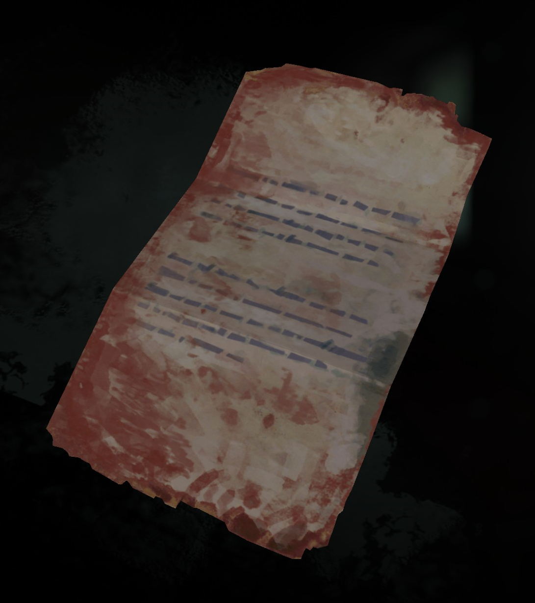
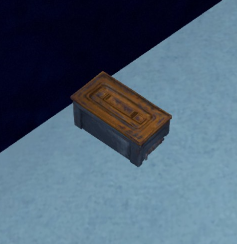

# Mystery Lake Supply Caches

**Contents**

- [Objectives](#Objectives)
- [Loot](#Loot)
- [Walkthrough](#Walkthrough)
- [Transcripts](#Transcripts)
- [Gallery](#Gallery)

<table class="infobox">
<caption>Mystery Lake Supply Caches</caption>
<colgroup>
<col style="width: 50%" />
<col style="width: 50%" />
</colgroup>
<tbody>
<tr>
<td colspan="2"><figure>

<figcaption>One of the hidden supply caches.</figcaption>
</figure></td>
</tr>
<tr>
<td>
Episode
</td>
<td>
<a href="./Episode%202%20-%20Luminance%20Fugue.md" class="wikilink" title="Episode 2">Episode 2</a>|-
</td>
</tr>
<tr>
<td>
Current
</td>
<td>
Mystery Lake Supply Caches
</td>
</tr>
<tr>
<td>
Next
</td>
<td>
<a href="./Aurora%20Hatch.md" class="wikilink" title="Aurora Hatch">Aurora Hatch</a>
</td>
</tr>
<tr>
<td>
Region
</td>
<td>
<a href="./Mystery%20Lake%20%28disambiguation%29.md" class="wikilink" title="Mystery Lake">Mystery Lake</a> 
<a href="./Forlorn%20Muskeg.md" class="wikilink" title="Forlorn Muskeg">Forlorn Muskeg</a> 
<a href="./Broken%20Railroad.md" class="wikilink" title="Broken Railroad">Broken Railroad</a>
</td>
</tr>
</tbody>
</table>

**Template:spoiler**

<table>
<colgroup>
<col style="width: 33%" />
<col style="width: 33%" />
<col style="width: 33%" />
</colgroup>
<tbody>
<tr>
<td style="vertical-align: top; font-size: 3em; color: #5d5980; padding-right: 10px">
“
</td>
<td>
There are several supply caches hidden around Mystery Lake. Most are left by hunters or campers. Some are left by off-grid "preppers" waiting for the government to fall, or the end of the world, or some such nonsense.

&#10;

In-game description

</td>
<td style="vertical-align: bottom; font-size: 3em; color: #5d5980; padding-left: 10px">
”
</td>
</tr>
</tbody>
</table>

**Mystery Lake Supply Caches** is a side mission in <a href="./Episode%202%20-%20Luminance%20Fugue.md" class="wikilink" title="Episode 2">Episode 2</a> of the <a href="./Wintermute.md" class="wikilink" title="story">story</a>. There are six caches to be found in total. To unlock the individual tasks, one has to find a corresponding note or letter first.

## Objectives

- Find the cache near the old <a href="./Hunting%20Lodge.md" class="wikilink" title="Hunting Lodge">Hunting Lodge</a> in the <a href="./Broken%20Railroad.md" class="wikilink" title="Broken Railroad region">Broken Railroad region</a>.
- Find the cache at the end of the ravine in the Broken Railroad region.
- Find the cache in the <a href="./Clearcut.md" class="wikilink" title="Clear Cut">Clear Cut</a> in Mystery Lake.
- Find the cache under some tree roots in the <a href="./Forlorn%20Muskeg.md" class="wikilink" title="Forlorn Muskeg">Forlorn Muskeg</a>.
- Find the cache in <a href="./Alan%27s%20Cave.md" class="wikilink" title="Alan&#39;s Cave">Alan's Cave</a> in Mystery Lake.
- Find the cache near the entrance to Forlorn Muskeg region from <a href="./Mystery%20Lake%20%28region%29.md" class="wikilink" title="Mystery Lake">Mystery Lake</a>.

## Loot

- The cache near the old Hunting Lodge.
  - ~30% condition <a href="./Mukluks.md" class="wikilink" title="Mukluks">Mukluks</a> and more.
- The cache at the end of the ravine.
  - <a href="./Climbing%20Socks.md" class="wikilink" title="Climbing Socks">Climbing Socks</a>, <a href="./Wool%20Longjohns.md" class="wikilink" title="Wool Longjohns">Wool Longjohns</a>, <a href="./Flare.md" class="wikilink" title="Flare">Flare</a>, <a href="./Water%20%28Potable%29.md" class="wikilink" title="Water">Water</a>, and <a href="./Sewing%20Kit.md" class="wikilink" title="Sewing Kit">Sewing Kit</a>.
- The cache in the Clear Cut.
  - 2 <a href="./Tomato%20Soup.md" class="wikilink" title="Tomato Soup">Tomato Soup</a>, <a href="./Lantern%20Fuel.md" class="wikilink" title="Lantern Fuel">Lantern Fuel</a>, <a href="./Antiseptic.md" class="wikilink" title="Antiseptic">Antiseptic</a>, and an <a href="./Energy%20Bar.md" class="wikilink" title="Energy Bar">Energy Bar</a>.
- The cache under some tree roots.
  - A worn <a href="./Balaclava.md" class="wikilink" title="Balaclava">Balaclava</a>, a <a href="./Firestriker.md" class="wikilink" title="Firestriker">Firestriker</a>, 1 <a href="./Accelerant.md" class="wikilink" title="Accelerant">Accelerant</a>, and a mouldy <a href="./Granola%20Bar.md" class="wikilink" title="Granola Bar">Granola Bar</a>.
- The cache in Alan's Cave.
  - Food and water
- The cache near the entrance to Forlorn Muskeg region from Mystery Lake.
  - 3 <a href="./Accelerant.md" class="wikilink" title="Accelerant">Accelerant</a>, <a href="./Pinnacle%20Peaches.md" class="wikilink" title="Pinnacle Peaches">Pinnacle Peaches</a>, and a <a href="./Tinder%20Plug.md" class="wikilink" title="Tinder Plug">Tinder Plug</a>.

## Walkthrough

To find the caches, you first have to find the matching note or letter. These can be found in the following places:

- At the backside of the stairs at the entry of the <a href="./Hunting%20Lodge.md" class="wikilink" title="Hunting Lodge">Hunting Lodge</a>; leading towards the Hunting Lodge cache. This cache contains a letter which unlocks the quest <a href="./Aurora%20Hatch.md" class="wikilink" title="Aurora Hatch">Aurora Hatch</a>.
- At a corpse leaning on the logs of a crashed log wagon of the log train in Forlorn Muskeg, near the entrance to the Broken Railroad region; leading towards the ravine cache.
- On the desk inside one of the lake cabins (the one next to the cabin for which you need the key \#2); leading towards the Clear Cut cache.
- Inside a pickup truck next to a yellow train/engine near the collapsed bridge in the Broken Railroad region; leading towards the tree root cache.
- On a metal desk on the second floor of the Carter Hydro Dam; leading towards the cache in Alan's Cave.
- On the table inside the new Forestry Lookout; leading towards the cache near the entrance to Forlorn Muskeg.

## Transcripts

*Whenever Mackenzie finds a Hidden Cache, he will say a variation of these lines:*

- Mackenzie: "I knew I'd find something here."
- Mackenzie: "There you are."
- Mackenzie: "I've been looking for you."
- Mackenzie: "Well well...what have we here."
- Mackenzie: "Found it!"
- Mackenzie: "Ah ha...here it is."

## Gallery

<table class="gallery">
<colgroup>
<col style="width: 50%" />
<col style="width: 50%" />
</colgroup>
<tbody>
<tr>
<td><figure>

<figcaption>One of the hidden supply caches.</figcaption>
</figure></td>
<td><figure>

<figcaption>One of the notes which lead towards the caches.</figcaption>
</figure></td>
</tr>
</tbody>
</table>

**Lua execution error in Module:Navbox function navbox**

