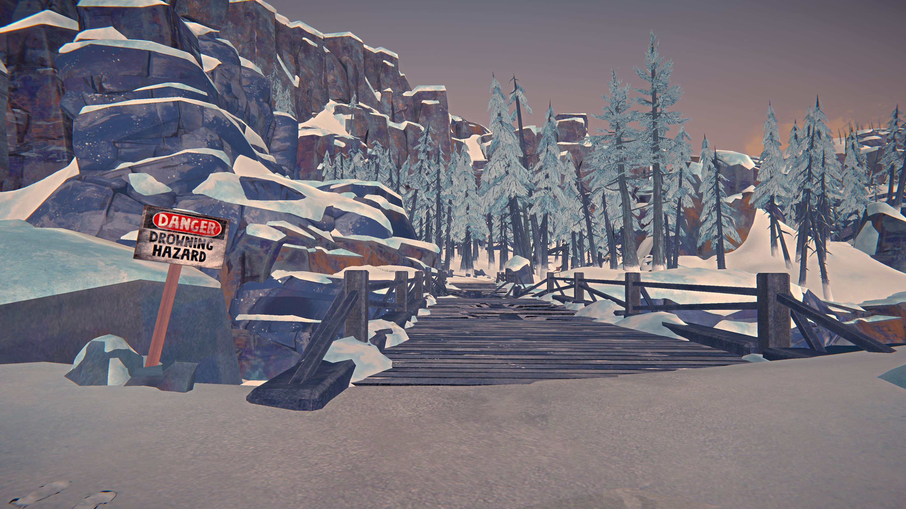
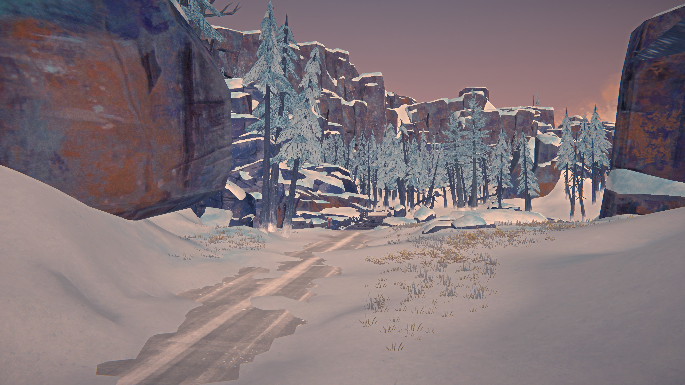
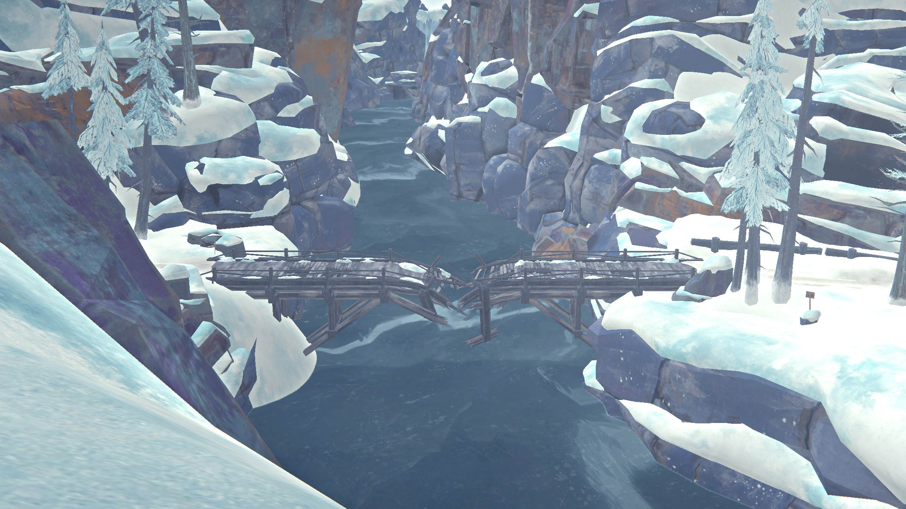

# Narrow Bridge

**Categories:** Blackrock, Landmarks, Locations, Locations in Blackrock, Outdoor locations · **Source:** [Fandom](https://thelongdark.fandom.com/wiki/Narrow_Bridge)

**Narrow Bridge**

[Narrow Bridge](../assets/Narrow_Bridge.jpg)

**Location**

[Narrow Bridge Location](../assets/Narrow_Bridge_Location.png)

Region

**Location:** Crosses the non-frozen river near the Old Substation

**General**

**Type:** Landmark

## Gallery

