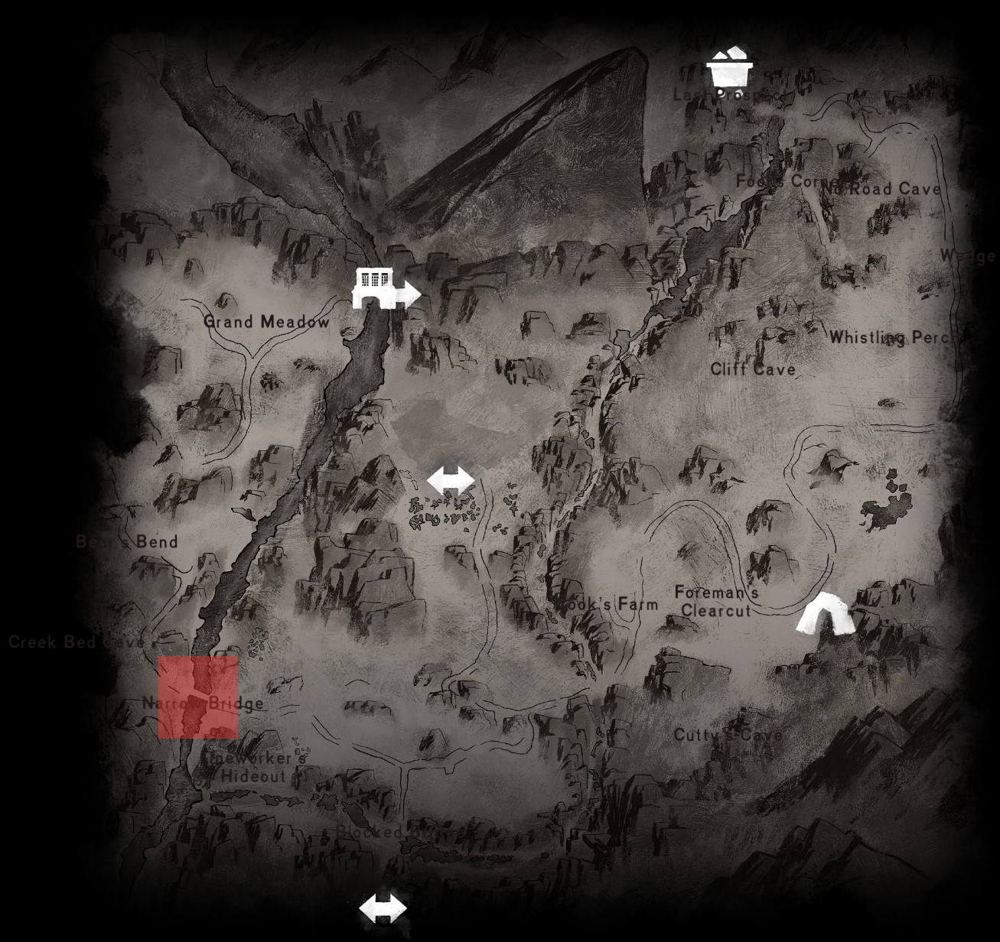

# Narrow Bridge

**Narrow Bridge**

| Property | Details |
| --- | --- |
|  |  / *Narrow\_Bridge.jpg* |
| **Location** |  |
|  |  / *Narrow\_Bridge\_Location.png* |
| Region |  |
| Location | Crosses the non-frozen river near the Old Substation |
| **General** |  |
| Type | Landmark\|- |
