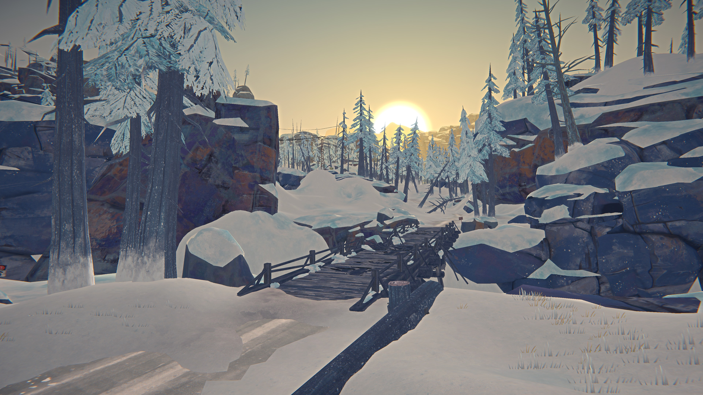
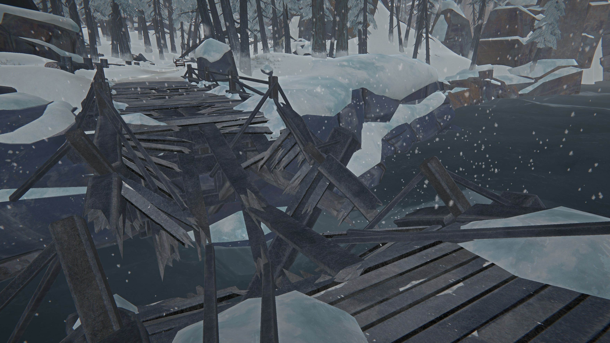

# Narrow Bridge

**Categories:** Blackrock, Landmarks, Locations, Locations in Blackrock, Outdoor locations · **Source:** [Fandom](https://thelongdark.fandom.com/wiki/Narrow_Bridge)

**Narrow Bridge**

_Narrow\_Bridge.jpg_

**Location**

_Narrow\_Bridge\_Location.png_

Region

**Location:** Crosses the non-frozen river near the Old Substation

**General**

**Type:** Landmark

## Gallery

_Narrow Bridge, looking west_

_Sunrise over Narrow Bridge_

_Narrow Bridge at a distance_

_Narrow Bridge sideways from above, looking south_

_Detail of Narrow Bridge's collapsed center section_
