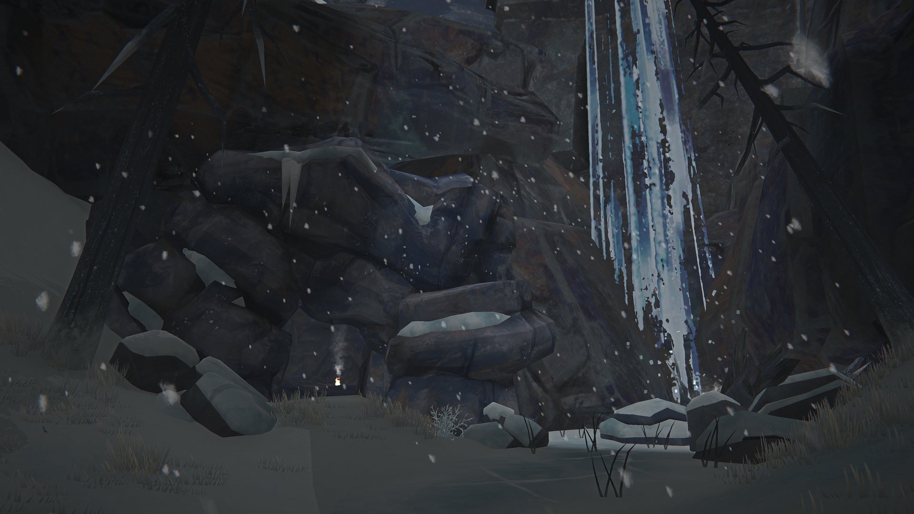

# Narrow Falls Cave

**Narrow Falls Cave**

| Property | Details |
| --- | --- |
|  |  / *NarrowFallsCave\_1080p.png* |
| **Location** |  |
|  |  / *Narrow\_Falls\_Cave\_Location.png* |
| Region | [Ash Canyon](./Ash%20Canyon.md)\|- |
| Type | Cave\|- |
