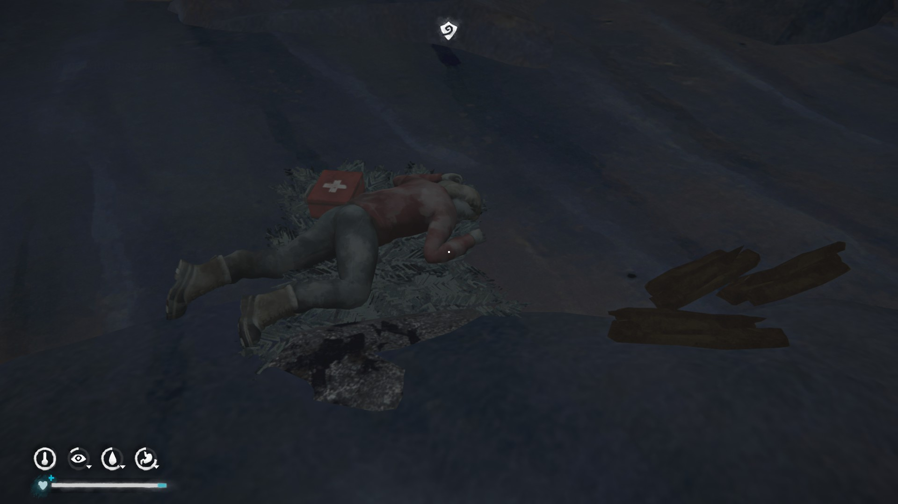

# Narrow Falls Cave

**Categories:** Caves, Locations, Locations in Ash Canyon, Sheltered locations, Waterfalls · **Source:** [Fandom](https://thelongdark.fandom.com/wiki/Narrow_Falls_Cave)

**Narrow Falls Cave**

| Property | Details |
| --- | --- |
| | [NarrowFallsCave 1080p](../assets/NarrowFallsCave_1080p.png) |
| **Location** | |
| | [Narrow Falls Cave Location](../assets/Narrow_Falls_Cave_Location.png) |
| Region | [Ash Canyon](./Ash%20Canyon.md) |
| **General** | |
| Type | Cave |
| | Provides some shelter |

**Narrow Falls Cave** is a small cave in [Ash Canyon](./Ash%20Canyon.md) located next to a waterfall, presumably called Narrow Falls. It's located a short distance east (as the crow flies) of [Miner's Folly](./Miner%27s%20Folly.md).

## Overview

The cave is not very big but it provides decent shelter and a good warmth bonus on the back of it. Some chunks of [coal](./Coal.md) may spawn inside as well as some pieces of firewood, and there is also a [First aid kit](./First%20Aid%20Kit.md) which may contain [bandages](./Bandage.md), [antiseptic](./Antiseptic.md), [energy bars](./Energy%20Bar.md), etc. There is a Tuffet bed, but it can't be used by the player, since it's occupied by a [frozen corpse](./Frozen%20Corpse.md), who might yield high tier [clothing](./Clothing.md), such as the rare [Cowichan Sweater](./Cowichan%20Sweater.md).

The place is safe from predators but also quite secluded, nearest [wildife](./Wildlife.md) being closer to [Angler's Den](./Angler%27s%20Den.md), so there seems to be no special reason to stay here instead of the nearby Cabin.

## Gallery

