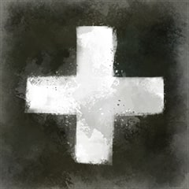

# Natural Healer

<table class="infobox">
<caption>Natural Healer</caption>
<colgroup>
<col style="width: 50%" />
<col style="width: 50%" />
</colgroup>
<tbody>
<tr>
<td colspan="2"><figure>

<figcaption>Natural_Healer_icon.png</figcaption>
</figure></td>
</tr>
<tr>
<td colspan="2"></td>
</tr>
<tr>
<td>
Description
</td>
<td>
Healed yourself using all types of natural medicines (single game)
</td>
</tr>
</tbody>
</table>

**Natural Healer** is an <a href="./The%20Long%20Dark%20%E2%80%94%20Achievements.md" class="wikilink" title="achievement">achievement</a> in *<a href="./The%20Long%20Dark.md" class="wikilink" title="The Long Dark">The Long Dark</a>*.

## Guide

This achievement is obtained after applying three types of natural first aid to three different <a href="./Afflictions.md" class="wikilink" title="afflictions">afflictions</a> in a single game, and will often be obtained through normal gameplay. This achievement is ironically harder on Pilgrim due to the fact that animals will not attack the player unless provoked. This makes it harder to have <a href="./Blood%20Loss.md" class="wikilink" title="Blood Loss">Blood Loss</a> and <a href="./Broken%20Ribs.md" class="wikilink" title="Broken Ribs">Broken Ribs</a> inflicted.

The types of natural medicines and the afflictions they treat are:

<table>
<colgroup>
<col style="width: 50%" />
<col style="width: 50%" />
</colgroup>
<tbody>
<tr>
<td>
<strong>First aid</strong>
</td>
<td>
<strong>Treatment for</strong>
</td>
</tr>
<tr>
<td>
<a href="./Old%20Man%27s%20Beard%20Wound%20Dressing.md" class="wikilink" title="Old Man&#39;s Beard Wound Dressing">Old Man's Beard Wound Dressing</a>
</td>
<td>
• <a href="./Afflictions.md#Infection_Risk" class="wikilink" title="Infection Risk">Infection Risk</a>
</td>
</tr>
<tr>
<td>
‎Reishi Tea
</td>
<td rowspan="2">
• <a href="./Afflictions.md#Food_Poisoning" class="wikilink" title="Food Poisoning">Food Poisoning</a>
</td>
</tr>
<tr>
<td>
<a href="./Burdock%20Tea.md" class="wikilink" title="Burdock Tea">Burdock Tea</a>
</td>
</tr>
<tr>
<td>
<a href="./Rose%20Hip%20Tea.md" class="wikilink" title="Rose Hip Tea">Rose Hip Tea</a>
</td>
<td>
• <a href="./Afflictions.md#Sprained_Ankle" class="wikilink" title="Sprained Ankle">Sprained Ankle</a> 
• <a href="./Afflictions.md#Sprained_Wrist" class="wikilink" title="Sprained Wrist">Sprained Wrist</a>
</td>
</tr>
</tbody>
</table>

See the individual pages for details on how to craft the medicines.

## Game history

This achievement was introduced on 1 April 2015 in <a href="./The%20Long%20Dark%20%E2%80%94%20Changelog.md#0.212" class="wikilink" title="version 0.212">version 0.212</a>.

**Lua execution error in Module:Navbox function navbox**

