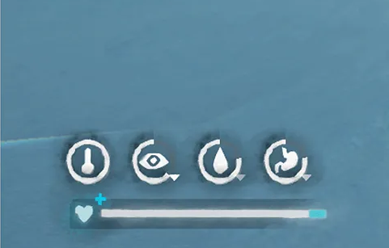

# Needs

**Categories:** Gameplay · **Source:** [Fandom](https://thelongdark.fandom.com/wiki/Needs)

**Contents**

- [User Interface](#user-interface)
- [Warmth](#warmth)
- [Fatigue](#fatigue)
- [Hunger](#hunger)
- [Thirst](#thirst)

Warmth, Fatigue, Thirst, and Hunger represent **Needs** that must be satisfied during the course of the game.

Failure to meet any of the Needs will cause the survivor to begin losing [Condition](./Condition.md) (the primary health bar) at steady rates, eventually weakening them to the point of [death](./Condition.md) if not properly handled. Failing to satisfy [Warmth](./Warmth.md) will cause the fastest Condition loss, and each additional unmet need adds to the rate of loss.

As long as all four Needs are met (non-empty), the survivor will heal passively 25% each day, or just over 1% every hour. Any unmet Need will disable the accelerated recovery during [Sleep](./Sleep.md).

## User Interface

The four Needs are displayed on the [Survival Overlay](./Survival%20Overlay.md) as white circular meters (formerly shaped like icons representing each Need). Satisfaction of a Need fills its respective meter. Arrows beside the bar indicate the direction and rate of progression; the more arrows in one direction, the faster the movement in that direction is.

As Needs deteriorate past certain points, the description to the right of the bar changes. When a Need meter has emptied, its icon turns red. Each stage of decay may be accompanied by voice line complaints from the survivor or relevant physiological system (e.g., a grumbling stomach as the hunger meter depletes).

| Warmth | Fatigue | Hunger | Thirst |
| --- | --- | --- | --- |
| Warm | Rested | Full | Slaked |
| Chilled | Winded | Peckish | Dry-mouth |
| Cold | Tired | Hungry | Thirsty |
| Numb | Drained | Ravenous | Parched |
| Freezing | Exhausted | Starving | Dehydrated |

## [Warmth](./Warmth.md)

 [Warmth](./Warmth.md) is a measure of the temperatures the player is exposed to. The player's warmth drains when the temperature the character experiences dips below 0°C (32°F) and is regained when it is above. Exposure to the elements is the main reason for loss of warmth and can be countered by staying indoors, having good clothing, being near a fire, and by consuming certain hot foods and drinks. Warmth will also deplete instantly if you come into contact with freezing water. When warmth is depleted, condition starts to steadily drop and can kill within a few game hours. This makes warmth the most critical need to satisfy.

Warmth is satisfied by maintaining a [feels like](./Feels%20Like.md) temperature above freezing (0°C or 32°F) over time. [Hot](./Warming%20Up.md) foods or drinks such as recently cooked or warmed up [pork and beans](./Pork%20and%20Beans.md) or [herbal tea](./Herbal%20Tea.md) will also decrease your cold by 20% as well as apply the [warming up](./Warming%20Up.md) attribute. Warmth drains in cold areas - the colder it is, the faster it will drain. The drain rate is accelerated by wet or freezing clothes and is completely drained after the player falls into freezing water. Visually warmth in the environment is represented by rising steam (as from boiling water) and icicles on cliffs, which may hint at a nearby cave.\[Dubious\]

When the warmth bar is empty you begin freezing and condition begins to drain rapidly. The rate of drain is constant at -20% each hour regardless of how far below freezing the character is currently. 'Feels like' temperature must be brought above 0°C (32°F) to stop the condition decreasing, and higher temperatures restore warmth faster. The affliction [hypothermia](./Hypothermia.md) will set in after 2 hours of freezing, doubling the rate to -40% per hour. Surviving more than 3 hours freezing is unlikely.

## [Fatigue](./Fatigue.md)

 [Fatigue](./Fatigue.md) is the measure of how tired the character is. Fatigue constantly drains but can be replenished by sleeping or by using certain items. As the character tires, Fatigue begins to affect the ability to move, aim weapons, and struggle. When completely depleted, fatigue will begin to lower the player's condition, and the player will be unable to sprint or climb ropes.

Fatigue is satisfied by [sleep](./Sleep.md) or by drinking [cups of coffee](./Cup%20of%20Coffee.md). It drains based on activity level, types of actions performed, and weight. Using an [emergency stim](./Emergency%20Stim.md) will completely restore fatigue for a brief period, but fatigue will drop to zero once the effect wears off.

When fatigue falls below 'tired', the player's recommended weight capacity will rapidly diminish from 30kg down to 15kg (or 66lb down to 33lb). When the fatigue bar is empty, condition begins to drain. The rate of drain is fixed at 1% per hour.

## [Hunger](./Hunger.md)

 [Hunger](./Hunger.md) is a measure of how many calories the player consumes and expends. The character's hunger is restored by consuming calories, which come in the form of foods and drinks. The character will begin to lose condition when their hunger is completely depleted.

When no more calories are in the calorie store, condition drains at a rate of 1% each hour. Dying of starvation will therefore take a little while and, if starting from 100% condition, will require more than 4 game days. Living without eating food every day is a game strategy known as Hibernation.

To fill the hunger bar, 2500 calories are required.

## [Thirst](./Thirst.md)

 [Thirst](./Thirst.md) is a measure of how many liquids the player consumes and expends. Despite being surrounded by snow, liquids can be difficult to acquire and are particularly heavy. The thirst need is fulfilled by consuming water or particular foods and drinks (e.g., [tins of sardines](./Tin%20of%20Sardines.md) or [Reishi tea](./Reishi%20Tea.md)). Failing to fill this need will result in steady condition loss.

When no more water is in the thirst bar, condition drains at a rate of 50% each day (approximately 2% per hour).

Dying of thirst will take 2 days when starting with 100% condition, which is half the time it would take to die from starvation. Most tasks can be performed while dehydrated, so a player can opt to only quench the thirst need before a restorative sleep as a strategy to conserve water.

To fill the thirst bar, 0.66 liters (0.17 gallons) of water is required.
