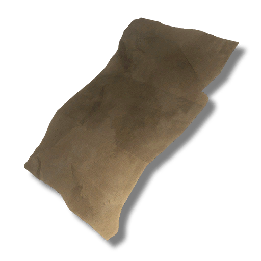

# Neighbour's Note

**Categories:** Collectibles, Pages with update history · **Source:** [Fandom](https://thelongdark.fandom.com/wiki/Neighbour's_Note)

**Neighbour's Note**

**Wintermute:** [Episode 1](./Episode%201%20-%20Do%20Not%20Go%20Gentle.md) - [Milton Supply Caches](./Milton%20Supply%20Caches.md)

**Properties**

**Item type:** [Collectibles](./Collectibles.md)

**Stackable:** No

**Examine:** A note from a neighbour found in the Farmhouse.

**Values**

**Weight:** 0.00 kg (0 lbs)

**Actions**

**Backpack:** Examine

**On ground:** Take It, Read Text, Leave It

**Neighbour's Note** is a [Collectible](./Collectibles.md) item found in [Episode 1](./Episode%201%20-%20Do%20Not%20Go%20Gentle.md) of [Wintermute](./Wintermute.md).

It is found on a the refrigerator inside the [Paradise Meadows Farm](./Paradise%20Meadows%20Farm.md) house.

## Transcript

_The following text is transcribed from **Neighbour's Note**_

Hey Martin,

We found Molly! Alice was so relieved. Thanks for helping us look. Looks like this time maybe a wolf went after her. They (sic) seem to be more and more since the quake, and closer to town -- fewer people to keep them in check I guess. Molly's hurt but I think she'll make it. Watch out because the wolves might come after your dog too. I know how you feel about wildlife and that you wouldn't shoot a wolf even if you had to, but I hear they don't like loud noises. Roadside flare might do the trick. Stay safe and come visit us when you can. It's not good to spend too much time on your own.

-- John

## Trivia

Neighbour's Note displays a different physical model compared to the one that appears in the Collections menu. as displayed below.

## Update history

- UPDATE **1 August 2017 ([Update](./The%20Long%20Dark%20%E2%80%94%20Changelog.md#1.00)):**
  - Added to game.
