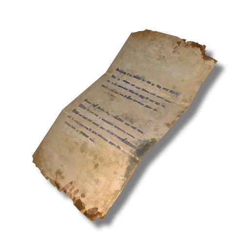

# Newspaper Clipping 2

<table class="infobox">
<caption>Newspaper Clipping 2</caption>
<colgroup>
<col style="width: 50%" />
<col style="width: 50%" />
</colgroup>
<tbody>
<tr>
<td colspan="2"><figure>

<figcaption>Newspaper_Clipping_2_icon.png</figcaption>
</figure></td>
</tr>
<tr>
<td>
Release
</td>
<td>
<a href="./The%20Long%20Dark%20%E2%80%94%20Changelog.md#1.95" class="wikilink" title="6 October 2021">6 October 2021</a>
</td>
</tr>
<tr>
<td>
Wintermute
</td>
<td>
<a href="./Episode%204%20-%20Fury%2C%20Then%20Silence.md" class="wikilink" title="Episode 4">Episode 4</a>
</td>
</tr>
<tr>
<td colspan="2" class="section">
<strong>Properties</strong>
</td>
</tr>
<tr>
<td>
Item type
</td>
<td>
<a href="./Collectibles.md" class="wikilink" title="Collectibles">Collectibles</a>|-
</td>
</tr>
<tr>
<td>
Stackable
</td>
<td>
No
</td>
</tr>
<tr>
<td>
Examine
</td>
<td>
A piece of old newsprint, cracked and yellowed with age.
</td>
</tr>
<tr>
<td colspan="2" class="section">
<strong>Values</strong>
</td>
</tr>
<tr>
<td>
Weight
</td>
<td>
0.00 kg (0 lbs)
</td>
</tr>
<tr>
<td colspan="2" class="section">
<strong>Actions</strong>
</td>
</tr>
<tr>
<td>
Backpack
</td>
<td>
Examine
</td>
</tr>
<tr>
<td>
On ground
</td>
<td>
Take It, Read Text, Leave It
</td>
</tr>
</tbody>
</table>

**Newspaper Clipping** is a <a href="./Collectibles.md" class="wikilink" title="Collectible">Collectible</a> note found in <a href="./Episode%204%20-%20Fury%2C%20Then%20Silence.md" class="wikilink" title="Episode 4">Episode 4</a> of the <a href="./Wintermute.md" class="wikilink" title="Wintermute">Wintermute</a> story. It is found in the room by the <a href="./Blackrock%20Gate%20Key.md" class="wikilink" title="Blackrock Gate Key">Blackrock Gate Key</a>, where the first <a href="./Noisemaker.md" class="wikilink" title="Noisemaker">Noisemaker</a> is found, on the corkboard.

## Transcript

The following text is transcribed from **Newspaper Clipping**

---

Five men, all serving life sentences at Blackrock Penitentiary, reportedly escaped the prison grounds last month.

Authorities revealed the escape in a leaked memo acquired by a coalition of media outlets currently investigating Canadian correctional facilities. Of the five, one returned on his own, one was found dead by pursuing officers, and three remain missing.

Prison officials seemed confident all three also died navigating the rough terrain that surrounds the notorious prison, according to the leaked memo.

---

## Update history

- UPDATE **6 October 2021 (<a href="./The%20Long%20Dark%20%E2%80%94%20Changelog.md#1.95" class="wikilink" title="Update">Update</a>):**
  - Added to game.

**Lua execution error in Module:Navbox function navbox**

