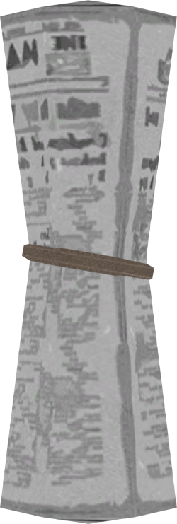

# Newsprint Roll

**Categories:** Fire Starting · **Source:** [Fandom](https://thelongdark.fandom.com/wiki/Newsprint_Roll)

**Contents**

- [Overview](#overview)
- [Products](#products)
- [Trivia](#trivia)
- [Gallery](#gallery)

**Newsprint Roll**

_Newsprint\_Roll\_icon.png_

**General**

**Item Type:** Fire Starting

**Firestarting Slot:** Tinder

**Statistics**

**Weight:** 0.10 kg(0.22 lbs)

> “**Newsprint Roll. Can be used as tinder.**”
>
> — In-game description

**Newsprint Roll** is a material item that can be used as tinder.

## Overview

Newsprint rolls fill the role of tinder, which is used for [Fire Starting](./Fire%20Starting.md).

Newsprint rolls weigh 0.10 kg per unit, twice the weight of a [Tinder Plug](./Tinder%20Plug.md). However, it can be broken down into 4 Tinder plugs, which together weigh a full 0.20 kg. A newspaper roll is thus the most efficient tinder to carry if wanting to start more than one fire.

Like all other types of tinder, it does not increase the chance to successfully light a fire.

## Products

| Item | Skills | Materials |
| --- | --- | --- |
| &lt;a href="Tinder Plug"&gt;Tinder Plug&lt;/a&gt; | None | - 1 × &lt;a href="Newsprint Roll"&gt;Newsprint Roll&lt;/a&gt; |

## Trivia

- A single newsprint roll weighs 0.10kg. However, if you [harvest](./Harvesting.md) the item, you get 0.20kg of tinder plugs, doubling the weight. Harvesting should be delayed until tinder is required.
- Newspaper Rolls can sometimes be found inside of [Mailboxes](./Mailbox.md).

## Gallery

_Old model._
