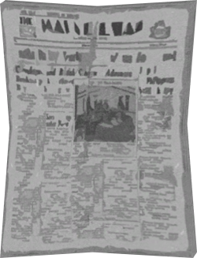

# Newsprint

**Categories:** Fire Starting · **Source:** [Fandom](https://thelongdark.fandom.com/wiki/Newsprint)

**Newsprint**

[Newsprint icon](../assets/Newsprint_icon.png)

**General**

**Item Type:** Fire Starting

**Firestarting Slot:** Tinder

**Statistics**

**Weight:** [Weight icon](../assets/Weight_icon.png)0.10 kg(0.22 lbs)

> “**Newsprint. Can be used as tinder.**”
>
> — In-game description

A **newsprint** is a material that can be used as tinder.

<!-- #Overview -->
​

<!-- #overview -->
## Overview

Newsprints fill the role of tinder, which is used for [fire starting](./Fire%20Starting.md). Newsprints are heavier than most other types of tinder, at 0.10 kg. Newsprints can be harvested to receive two [tinder plugs](./Tinder%20Plug.md), doubling the number of total uses while being the same weight. Like all other types of tinder, it does not increase the chance to successfully light a fire.

<!-- #Products -->
​

<!-- #products -->
## Products

| Item | Skills | Materials |
| --- | --- | --- |
| [Tinder Plug](./Tinder%20Plug.md) | None | - 1 × [Newsprint](./Newsprint.md) |

<!-- #Gallery -->
​

<!-- #gallery -->
## Gallery

[ru:Газета](https://ru.wikipedia.org/wiki/%D0%93%D0%B0%D0%B7%D0%B5%D1%82%D0%B0)
