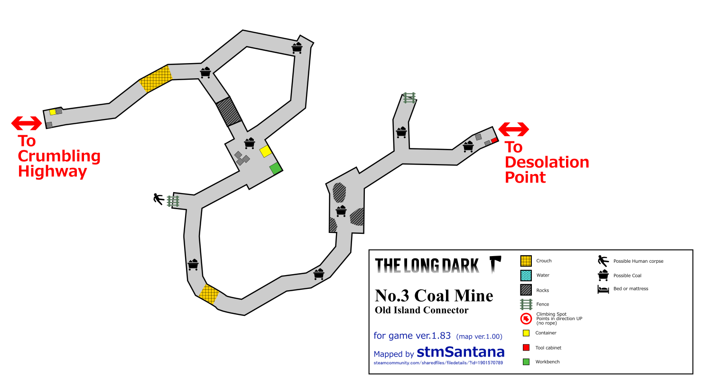

# No\. 3 Coal Mine

**Categories:** Caves, Indoor locations, Locations, Locations in Coastal Highway, Locations in Crumbling Highway, Locations in Desolation Point, Locations with a workbench, Transition zones · **Source:** [Fandom](https://thelongdark.fandom.com/wiki/No._3_Coal_Mine)

**No. 3 Coal Mine**

\[\[File: /  / _Abandoned\_Mine\_No.3\_(West)\_interior.jpg_

250px\]\]

**Location**

Region

[Coastal Highway](./Coastal%20Highway.md)

Location

**General**

Type

Cave

_workbench\_icon\_green.png_

## Overview

No. 3 Coal Mine contains a substantial amount of [Coal](./Coal.md)--a type of fuel that is used in conjunction with the [Furnace](./Furnace.md) and a [Heavy Hammer](./Heavy%20Hammer.md) to craft certain metal items.

A [Work Bench](./Work%20Bench.md) can be found near the center of the mine.

### Navigating

The mine is a dark place with several tunnels splitting off in different directions. Anyone venturing into the mine should bring a light source such as a [Flare](./Flare.md) or fueled [Storm Lantern](./Storm%20Lantern.md).

## Gallery

_A view of Abandoned Mine No. 3 (West) in Crumbling Highway._

_A view of Abandoned Mine No. 3 (East Access) in Desolation Point._

_Map-Mine-No3-100.png_
