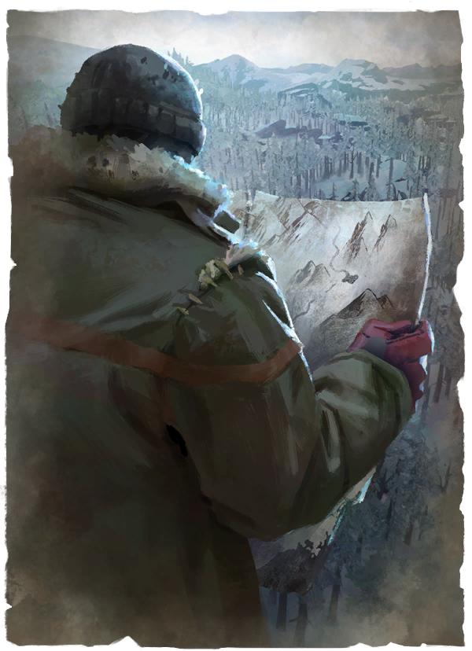
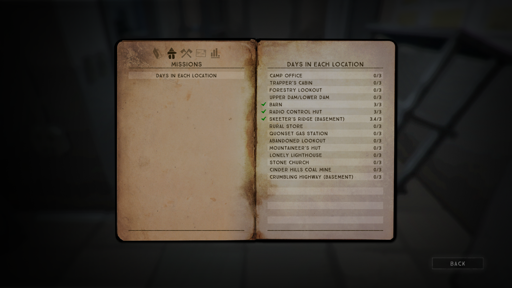

# Nomad

**Contents**

- [Overview](#Overview)
- [Journal](#Journal)
- [Other information](#Other_information)
- [Locations](#Locations)
- [Gallery](#Gallery)

<table class="infobox">
<caption>Nomad</caption>
<colgroup>
<col style="width: 50%" />
<col style="width: 50%" />
</colgroup>
<tbody>
<tr>
<td colspan="2"><figure>

<figcaption>Challenge_Nomad.png</figcaption>
</figure></td>
</tr>
<tr>
<td colspan="2" class="section">
<strong>Details</strong>
</td>
</tr>
<tr>
<td>
Regions
</td>
<td>
<a href="./Mystery%20Lake%20%28region%29.md" class="wikilink" title="Mystery Lake">Mystery Lake</a>, <a href="./Pleasant%20Valley.md" class="wikilink" title="Pleasant Valley">Pleasant Valley</a>, <a href="./Coastal%20Highway.md" class="wikilink" title="Coastal Highway">Coastal Highway</a>, <a href="./Timberwolf%20Mountain.md" class="wikilink" title="Timberwolf Mountain">Timberwolf Mountain</a>, <a href="./Desolation%20Point.md" class="wikilink" title="Desolation Point">Desolation Point</a>
</td>
</tr>
<tr>
<td>
Difficulty
</td>
<td>
3
</td>
</tr>
<tr>
<td>
Date Added
</td>
<td>
June 2016
</td>
</tr>
</tbody>
</table>

<table>
<colgroup>
<col style="width: 33%" />
<col style="width: 33%" />
<col style="width: 33%" />
</colgroup>
<tbody>
<tr>
<td style="vertical-align: top; font-size: 3em; color: #5d5980; padding-right: 10px">
“
</td>
<td>
The world has changed. The only way to survive is to keep moving. 
Survive for 3 days each in 15 specific locations across the game world.

&#10;

Main Menu description

</td>
<td style="vertical-align: bottom; font-size: 3em; color: #5d5980; padding-left: 10px">
”
</td>
</tr>
</tbody>
</table>

**Nomad** is one of eight <a href="./Challenge.md" class="wikilink" title="challenges">challenges</a> in <a href="./The%20Long%20Dark.md" class="wikilink" title="The Long Dark"><em>The Long Dark</em></a>.

## Overview

<table>
<colgroup>
<col style="width: 33%" />
<col style="width: 33%" />
<col style="width: 33%" />
</colgroup>
<tbody>
<tr>
<td style="vertical-align: top; font-size: 3em; color: #5d5980; padding-right: 10px">
“
</td>
<td>
Spend 3 days each location in your journal.

&#10;

Journal Objective

</td>
<td style="vertical-align: bottom; font-size: 3em; color: #5d5980; padding-left: 10px">
”
</td>
</tr>
</tbody>
</table>

The Nomad challenge is one of eight challenges in the Long Dark. It requires the player to spend three entire days in each location listed in their journal. The locations are not located in any one region, but are scattered between the many different regions, spanning the world. The game difficulty is Voyageur.

Prior knowledge of the game world will make this challenge exceptionally easier.

### Journal

The journal automatically tracks how long the player has been at each location in increments of a tenth of a day. Once the player has been at any location for three days, a notification will appear at the top right of the screen stating that the location is complete, and a green checkmark will appear next to the location in the journal. When the final location is complete, the challenge immediately ends, and the player cannot go back and look at the journal.

### Other information

- The locations can be visited in any order.
- There is no time limit to complete the challenge.
- To complete the challenge in a timely way requires to plan ahead, so that the player does not have to double back to regions, to stay at locations they missed.
- It is not necessary to prepare for three complete consecutive days inside a location in one sitting - the timer does not reset if the player leaves. But it only advances during time spent inside the required location.
- The <a href="./Stone%20Church.md" class="wikilink" title="Stone Church">Stone Church</a> provides very little protection from the elements and is by far the hardest location to survive.
- Be aware that the "Barn" is the big red one at <a href="./Pleasant%20Valley%20Outbuildings.md" class="wikilink" title="Pleasant Valley Outbuildings">Pleasant Valley Outbuildings</a>.
- There is no danger of <a href="./Cabin%20Fever.md" class="wikilink" title="Cabin Fever">Cabin Fever</a>, as the overall difficulty of the challenge uses Voyageur settings.
- In early 2021 it took six days instead of the intended three, due to a bug. Since 2021-04-29 this should be fixed.

## Locations

 \[Missing image: 20191118161857_1.jpg\] Current (Crossroads Elegy) journal entry The locations you need to spend 3 days in are listed in your journal. They are:

| Region | Location | Mission Title |
|----|----|----|
| <a href="./Mystery%20Lake%20%28region%29.md" class="wikilink" title="Mystery Lake">Mystery Lake</a> | <a href="./Camp%20Office.md" class="wikilink" title="Camp Office">Camp Office</a> | Camp Office |
| Mystery Lake | <a href="./Trapper%27s%20Homestead.md" class="wikilink" title="Trapper&#39;s Homestead">Trapper's Homestead</a> | Trapper's Cabin |
| Mystery Lake | <a href="./Forestry%20Lookout.md" class="wikilink" title="Forestry Lookout">Forestry Lookout</a> | Forestry Lookout |
| Mystery Lake | <a href="./Carter%20Hydro%20Dam.md" class="wikilink" title="Carter Hydro Dam">Carter Hydro Dam</a> | Upper Dam/Lower Dam |
| <a href="./Pleasant%20Valley.md" class="wikilink" title="Pleasant Valley">Pleasant Valley</a> | <a href="./Pleasant%20Valley%20Outbuildings.md" class="wikilink" title="Pleasant Valley Outbuildings">Pleasant Valley Outbuildings</a> | Barn |
| Pleasant Valley | <a href="./Signal%20Hill.md" class="wikilink" title="Signal Hill">Signal Hill</a> | Radio Control Hut |
| Pleasant Valley | <a href="./Skeeter%27s%20Ridge.md" class="wikilink" title="Skeeter&#39;s Ridge">Skeeter's Ridge</a> | Skeeter's Ridge (Basement) |
| Pleasant Valley | <a href="./Thomson%27s%20Crossing.md" class="wikilink" title="Rural Crossroads">Rural Crossroads</a> | Rural Store |
| <a href="./Coastal%20Highway.md" class="wikilink" title="Coastal Highway">Coastal Highway</a> | <a href="./Quonset%20Garage.md" class="wikilink" title="Quonset Gas Station">Quonset Gas Station</a> | Quonset Garage |
| Coastal Highway | <a href="./Abandoned%20Lookout.md" class="wikilink" title="Abandoned Lookout">Abandoned Lookout</a> | Abandoned Lookout |
| <a href="./Timberwolf%20Mountain.md" class="wikilink" title="Timberwolf Mountain">Timberwolf Mountain</a> | <a href="./Mountaineer%27s%20Hut.md" class="wikilink" title="Mountaineer&#39;s Hut">Mountaineer's Hut</a> | Mountaineer's Hut |
| <a href="./Desolation%20Point.md" class="wikilink" title="Desolation Point">Desolation Point</a> | <a href="./Lonely%20Lighthouse.md" class="wikilink" title="Lonely Lighthouse">Lonely Lighthouse</a> | Lonely Lighthouse |
| Desolation Point | <a href="./Stone%20Church.md" class="wikilink" title="Stone Church">Stone Church</a> | Stone Church |
| <a href="./Cinder%20Hills%20Coal%20Mine.md" class="wikilink" title="Cinder Hills Coal Mine">Cinder Hills Coal Mine</a> | <a href="./Abandoned%20Mine.md" class="wikilink" title="Abandoned Mine">Abandoned Mine</a> | Cinder Hills Coal Mine |
| <a href="./Crumbling%20Highway.md" class="wikilink" title="Old Island Connector">Old Island Connector</a> | <a href="./Abandoned%20Harris%20Home.md" class="wikilink" title="Abandoned Harris Home">Abandoned Harris Home</a> | Crumbling Highway (Basement) |

## Gallery

<table class="gallery">
<colgroup>
<col style="width: 33%" />
<col style="width: 33%" />
<col style="width: 33%" />
</colgroup>
<tbody>
<tr>
<td><figure>
[Missing image: nomad_endscreen.jpg]
<figcaption>The screen displayed at the completion of the challenge</figcaption>
</figure></td>
<td><figure>

<figcaption>The badge awarded upon completing the challenge</figcaption>
</figure></td>
<td><figure>
[Missing image: Nomad_Art.jpg]
<figcaption>Fan art</figcaption>
</figure></td>
</tr>
</tbody>
</table>

**Lua execution error in Module:Navbox function navbox**<a href="ru:%D0%9A%D0%BE%D1%87%D0%B5%D0%B2%D0%BD%D0%B8%D0%BA" class="wikilink" title="ru:Кочевник">ru:Кочевник</a> <a href="es:Nomada" class="wikilink" title="es:Nomada">es:Nomada</a>

