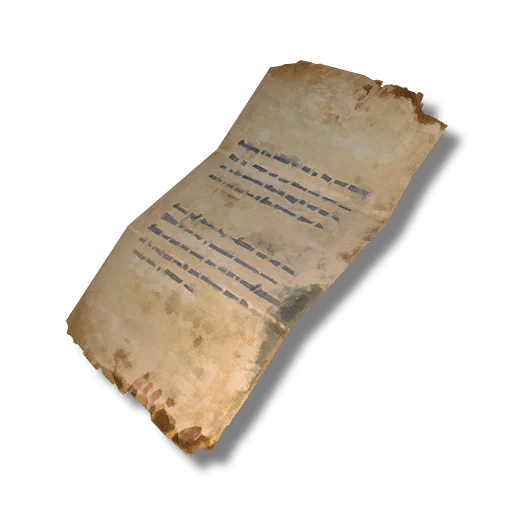

# Notebook Page

**Categories:** Collectibles, Pages with update history · **Source:** [Fandom](https://thelongdark.fandom.com/wiki/Notebook_Page)

**Notebook Page**

| Property | Details |
| --- | --- |
|  |  / _Notebook\_Page\_icon.png_ |
| Release | [6 October 2021](./The%20Long%20Dark%20%E2%80%94%20Changelog.md#1.95) |
| Wintermute | [Episode 4](./Episode%204%20-%20Fury%2C%20Then%20Silence.md) - [Blackrock Rumours](./Blackrock%20Rumours.md) |
| **Properties** |  |
| Item type | [Collectibles](./Collectibles.md)\|- |
| Stackable | No |
| Examine | A torn, waterstained scrap of paper. |
| **Values** |  |
| Weight | 0.00 kg (0 lbs) |
| **Actions** |  |
| Backpack | Examine |
| On ground | Take It, Read Text, Leave It |

**Notebook Page** is a [Collectible](./Collectibles.md) found in [Episode 4](./Episode%204%20-%20Fury%2C%20Then%20Silence.md) of the [Wintermute](./Wintermute.md) story as part of the [Blackrock Rumours](./Blackrock%20Rumours.md) side mission. It is found on the [Dead Prison Guard](./Dead%20Prison%20Guard.md) Murphy in the ravine near [Jailer's Residence](./Jailer%27s%20Residence.md).

## Transcript

_The following text is transcribed from **Notebook Page**_

**...something decent this time. Prices climbing.

Check possible bleed off down by that low creek -- warm day melts the shallow ice?

Red gold or something better? Gotta try.**

## Update history

- UPDATE **6 October 2021 ([Update](./The%20Long%20Dark%20%E2%80%94%20Changelog.md#1.95)):**
  - Added to game.
