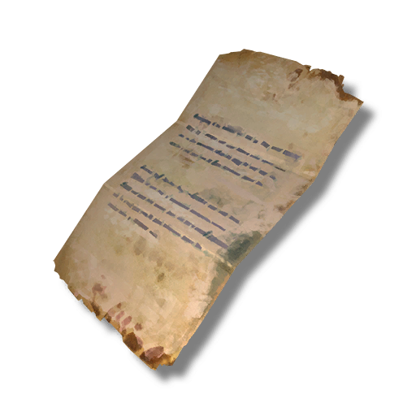
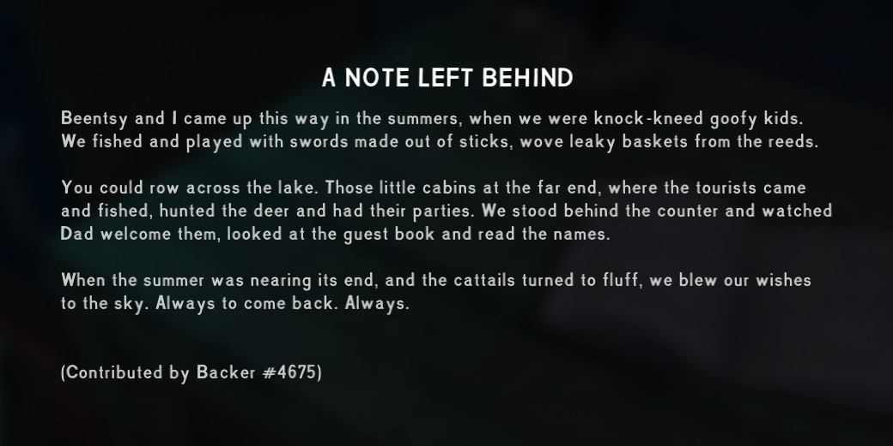

# Notes

**Categories:** Collectibles · **Source:** [Fandom](https://thelongdark.fandom.com/wiki/Notes)

**Contents**

- [A Note Left Behind](#a-note-left-behind)
- [Desolation Point](#desolation-point)
- [Climber's Journal Page](#climbers-journal-page)
- [Timberwolf Mountain](#timberwolf-mountain)
- [Other Notes](#other-notes)
- [Ash Canyon](#ash-canyon)
- [Bleak Inlet](#bleak-inlet)
- [Blackrock](#blackrock)
- [Forsaken Airfield](#forsaken-airfield)
- [Zone of Contamination](#zone-of-contamination)
- [Sundered Pass](#sundered-pass)
- [Transfer Pass](#transfer-pass)
- [Mystery Lake (region)](#mystery-lake-region)
- [Mountain Town](#mountain-town)
- [Tales from the Far Territory](#tales-from-the-far-territory)
- [Signal Void](#signal-void)
- [Buried Echoes](#buried-echoes)
- [Last Horizon](#last-horizon)
- [History](#history)
- [Gallery](#gallery)
- [References](#references)

 **Notes** are [Collectibles](./Collectibles.md) found scattered around the map in [Survival Mode](./Survival%20Mode.md). The notes are in-keeping with the game's setting: Some are letters, written as if the authors had been visiting [Great Bear Island](./Great%20Bear%20Island.md), while others are poems. Some notes stand alone, others tell a continuing story.

Notes found while playing [Tales from the Far Territory](./Tales%20from%20the%20Far%20Territory.md) are also stored here.

There are currently 102 notes in total to find.

## [A Note Left Behind](./A%20Note%20Left%20Behind.md)

[Pleasant Valley](./Pleasant%20Valley.md)

- [Pleasant Valley Farmstead](./Pleasant%20Valley%20Farmstead.md) - Inside the house to the table right of the [Stove](./Stove.md).

- [Pleasant Valley Outbuildings](./Pleasant%20Valley%20Outbuildings.md) - Inside the red barn on the table metal table near the [Truck](./Truck.md).

[Mystery Lake](./Mystery%20Lake%20%28region%29.md)

- [Camp Office](./Camp%20Office.md) - on the table on the top floor next to the bunk beds.

- [Trapper's Homestead](./Trapper%27s%20Homestead.md) - beside the armchair

- [Lone Lake Cabin](./Lone%20Lake%20Cabin.md) - outside on the front porch

[Forlorn Muskeg](./Forlorn%20Muskeg.md)

- [Old Spence Family Homestead](./Old%20Spence%20Family%20Homestead.md) - on bed on the loft above the [Forge](./Forge.md).

[Old Island Connector](./Crumbling%20Highway.md)

- [Abandoned Harris Home](./Abandoned%20Harris%20Home.md) - outside in the car.

### [Desolation Point](./Desolation%20Point.md)

- [Hibernia Processing](./Hibernia%20Processing.md) - Downstairs on the [Work Bench](./Work%20Bench.md).

- [Lonely Lighthouse](./Lonely%20Lighthouse.md) - 2nd floor windowsill.

[Coastal Highway](./Coastal%20Highway.md)

- [Abandoned Lookout](./Abandoned%20Lookout.md)

- [Quonset Garage](./Quonset%20Garage.md) - Table in the back.

- [Rockfall](./Rockfall.md) - in the backseat of the car on the bridge.

## Climber's Journal Page

### [Timberwolf Mountain](./Timberwolf%20Mountain.md)

- [Mountaineer's Hut](./Mountaineer%27s%20Hut.md) - on the [Work Bench](./Work%20Bench.md) - [Climber's Journal Page](./Climber%27s%20Journal%20Page.md)

## Other Notes

### [Ash Canyon](./Ash%20Canyon.md)

- [Angler's Den](./Angler%27s%20Den.md) - [Diary Page](./Diary%20Page.md)

- [Gold Mine](./Gold%20Mine.md) - by the [Technical Backpack](./Technical%20Backpack.md) - [Notebook Page (Survival 2)](./Notebook%20Page%20%28Survival%202%29.md)

- [Climber's Cave](./Climber%27s%20Cave.md) - [Notebook Page (Survival)](./Notebook%20Page%20%28Survival%29.md)

- [Miner's Folly](./Miner%27s%20Folly.md) - On the table to the left inside the bunkhouse - [Mining Log Page](./Mining%20Log%20Page.md)

### [Bleak Inlet](./Bleak%20Inlet.md)

- [Echo One Radio Tower](./Echo%20One%20Radio%20Tower.md) - in the control hut - [Communication Report](./Communication%20Report.md)

- [Last Resort Cannery](./Last%20Resort%20Cannery.md) - [The Technician's Notebook](./The%20Technician%27s%20Notebook.md)

- [Last Resort Cannery](./Last%20Resort%20Cannery.md) - [Cannery Memo](./Cannery%20Memo.md)

### [Blackrock](./Blackrock.md)

- [Blackrock Prison](./Blackrock%20Prison.md) yard - on the [Keypad](./Keypad.md) door next to the [Steam Tunnels](./Steam%20Tunnels.md) entrance - [Blackrock Memo](./Blackrock%20Memo.md)

- [Blackrock Prison](./Blackrock%20Prison.md) yard - in the guard tower behind the infirmary - [Note (Survival)](./Note%20%28Survival%29.md)

- [Blackrock Prison](./Blackrock%20Prison.md) interior - 2nd floor, under a desk in room no. 200 - [Page](./Page.md)

- [Blackrock Prison](./Blackrock%20Prison.md) interior - 1st floor, in the guard room next to cell no. 11 - [Note (Survival 2)](./Note%20%28Survival%202%29.md)

- [Last Prospect](./Last%20Prospect.md) - in the mine, floor 2, the lockers next to the mattress - [Handwritten Note (Survival)](./Handwritten%20Note%20%28Survival%29.md)

### [Forsaken Airfield](./Forsaken%20Airfield.md)

- [Control Tower](./Control%20Tower.md) - at the top - [Note (Forsaken Airfield)](./Note%20%28Forsaken%20Airfield%29.md)

- [Cargomaster's Trailer](./Cargomaster%27s%20Trailer.md). In the back of the trailer under the lockers - [Paper](./Paper.md)

- [Justy's Hovel](./Justy%27s%20Hovel.md) - on a table as soon as you enter the front door - [Page (2)](./Page%20%282%29.md)

- [Junker's Paddock](./Junker%27s%20Paddock.md) - on the floor of the junked truck - [Journal Page](./Journal%20Page.md)

- [Main Hangar Basement](./Hangar%20Basement.md) - on a table on the right upon entering - [Memo (Survival)](./Memo%20%28Survival%29.md)

- [Main Hangar](./Main%20Hangar.md) - Right side corner office next to the stairs. Inside an overturned filing cabinet, far left side of the room. - [Stained Paper](./Stained%20Paper.md)

- [Mindful Cabin](./Mindful%20Cabin.md) - under the stairs in some Loose Boards behind the left shelves, behind the potted plant. - [Faded Paper](./Faded%20Paper.md)

### [Zone of Contamination](./Zone%20of%20Contamination.md)

- [Pump House](./Pump%20House.md) - "[Langston Mine Memo](./Langston%20Mine%20Memo.md)" on the right under the shelves.
- [Idle Camp](./Idle%20Camp.md) - in the left worker barracks. - [Mining Newsletter](./Mining%20Newsletter.md)

### [Sundered Pass](./Sundered%20Pass.md)

- [Final Refuge](./Final%20Refuge.md) - on the shelf. - [Note (Sundered Pass)](./Note%20%28Sundered%20Pass%29.md)
- [Weather Station](./Weather%20Station.md) - in the radar dome building, northwest corner floor. -[Bloody note](./Bloody%20note.md)
- [Ambler's Lake](./Ambler%27s%20Lake.md) [Fishing Hut](./Fishing%20Hut.md) - [Naturalist Notebook 2](./Naturalist%20Notebook%202.md)

### [Transfer Pass](./Transfer%20Pass.md)

- Coal tower near [Vacant Depot](./Vacant%20Depot.md) - on the shelf - [Naturalist Notebook 1](./Naturalist%20Notebook%201.md)

### [Mystery Lake (region)](./Mystery%20Lake%20%28region%29.md)

- [Camp Office](./Camp%20Office.md) inside front door - [Cougar Warning Flyer](./Cougar%20Warning%20Flyer.md)
- [Camp Office](./Camp%20Office.md) table next to the Radio - [A page from an old newsletter.](./A%20page%20from%20an%20old%20newsletter..md)

### [Mountain Town](./Mountain%20Town.md)

- [Milton Park](./Milton%20Park.md) inside front door - [Cougar Warning Flyer (2)](./Cougar%20Warning%20Flyer%20%282%29.md)

## [Tales from the Far Territory](./Tales%20from%20the%20Far%20Territory.md)

### [Signal Void](./Signal%20Void.md)

-  [Field 31 Operation Memo](./Field%2031%20Operation%20Memo.md)
-  [Security Chief's Log 6](./Security%20Chief%27s%20Log%206.md)
-  [Security Chief's Log 14](./Security%20Chief%27s%20Log%2014.md)
-  [Security Chief's Log 23](./Security%20Chief%27s%20Log%2023.md)
-  [Security Chief's Log 29](./Security%20Chief%27s%20Log%2029.md)
-  [Interview Transcript 4](./Interview%20Transcript%204.md)
-  [Interview Transcript 12](./Interview%20Transcript%2012.md)
-  [Interview Transcript 14](./Interview%20Transcript%2014.md)
-  [Interview Transcript 17](./Interview%20Transcript%2017.md)

### [Buried Echoes](./Buried%20Echoes.md)

### [Last Horizon](./Last%20Horizon.md)

## History

- The first 13 notes (A Note Left Behind) were written by the game's Kickstarter backers and were added to the game's first [regions](./Region.md) as a reward for certain levels of pledges.
  - [Climber's Journal Page](./Climber%27s%20Journal%20Page.md) was the only one that was authored by [Hinterland](./Hinterland%20Studio%20Inc..md).
- When [Bleak Inlet](./Bleak%20Inlet.md) was added to the game with the **Errant Pilgrim** update in the year 2019, it included 3 new notes authored by Hinterland.
- When [Ash Canyon](./Ash%20Canyon.md) was added to the game with the **Hesitant Prospect** update in the year 2020, it included 4 new notes authored by Hinterland.
- When [Blackrock](./Blackrock.md) was added to the game with the **Perilous Constraint** update in the year 2021, it included 5 new notes authored by Hinterland.
- When [Forsaken Airfield](./Forsaken%20Airfield.md) was added to the game as part of the Part 1 [Tales From The Far Territory Expansion](./Tales%20from%20the%20Far%20Territory.md) update, it added 7 new notes authored by Hinterland.
- When the [Zone of Contamination](./Zone%20of%20Contamination.md) was added to the game as part of the Part 4 Tales from the Far Territory update, it added 2 new notes authored by Hinterland.
- When the [Sundered Pass](./Sundered%20Pass.md) was added to the game as part of the Part 5 Tales from the Far Territory update, it added 2 new notes authored by Hinterland.
- When the Tales From The Far Territory Part 6 Broken Silence was added to the game, it added 5 new notes authored by Hinterland.

## Gallery

_A\_Note\_Left\_Behind.jpg_

## References

&lt;div class="references-small" ;"&gt;
