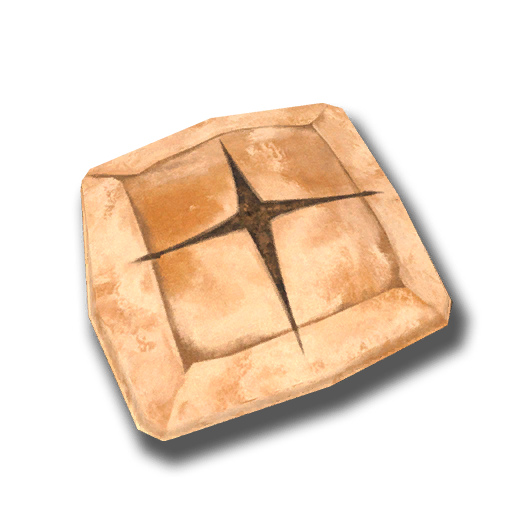

# Nourished

**Categories:** Afflictions, DLC Content, Pages with update history · **Source:** [Fandom](https://thelongdark.fandom.com/wiki/Nourished)

**Contents**

- [Overview](#overview)
- [Maximum Condition benefit (+5%/+10%)](#maximum-condition-benefit-510)
- [Maximum Stamina benefit (+15%)](#maximum-stamina-benefit-15)
- [Update history](#update-history)

**Nourished**

**Release:** [21 June 2023](./The%20Long%20Dark%20%E2%80%94%20Changelog.md#2.17)

**Update:** 2.17

**Properties**

**Category:** [Afflictions](./Afflictions.md)

**Caused By:** Consume [Food And Drink](./Food%20And%20Drink.md)

**Effect:** Positive

**Type:** Benefit

**Benefit Duration:** 3 Hours

**DLC-Exclusive content.** This content requires the [Tales from the Far Territory](./Tales%20from%20the%20Far%20Territory.md) addon to be installed before it can be seen or used in regular gameplay.

 **Nourished** is a unique [Affliction](./Afflictions.md) in _[The Long Dark](./The%20Long%20Dark.md)_ only encountered in [Survival Mode](./Survival%20Mode.md) when consuming certain [Cooking](./Cooking.md) Recipes. It was added in the Part 3 update to the [Tales from the Far Territory](./Tales%20from%20the%20Far%20Territory.md).

## Overview

> “**You feel sustained after eating a meal.**”

Nourished is acquired from consuming certain recipes that gives a so-called "Max Stat Buff", temporarily increasing either the survivor's maximum [Condition](./Condition.md) by 5%-10% for 3 hours, depending on the food consumed, or their maximum [Stamina](./Stamina.md) by 15% for 3 hours. Gaining either of these benefits will apply the Nourished affliction.

### Maximum Condition benefit (+5%/+10%)

Consuming certain recipes increases the survivor's maximum Condition by 5% or 10% for 3 hours, depending on the food consumed. This effect can raise the maximum Condition to 110%, and the Affliction's bonus stacks with [Well Fed's](./Well%20Fed.md) extra 5% Condition, making the highest attainable Condition peak at 115%.

The following foods, when consumed, grant the Nourished Affliction and the +5% maximum Condition benefit:

-  [Last Resort Soup](./Last%20Resort%20Soup.md)
-  [Vagabond Soup](./Vagabond%20Soup.md)

The following foods, when consumed, grant the Nourished Affliction and the +10% maximum Condition benefit:

-  [Breyerhouse Pie](./Breyerhouse%20Pie.md)
-  [Camber Flight Porridge](./Camber%20Flight%20Porridge.md)
-  [Dockworker's Pie](./Dockworker%27s%20Pie.md)
-  [Lily's Pancakes](./Lily%27s%20Pancakes.md)
-  [Porter's Soup](./Porter%27s%20Soup.md)
-  [Ranger Stew](./Ranger%20Stew.md)

The effect of this Affliction does not stack, and each new application will not override the previous Affliction. Partially eating the previously mentioned foods only adds a partial amount of Nourished duration.

### Maximum Stamina benefit (+15%)

Consuming certain recipes increases the survivor's maximum Stamina by 15% for 3 hours. The following recipes, when consumed, grant the Nourished Affliction as well as the +15% maximum Stamina benefit as a side effect:

-  [Pemmican Bar](./Pemmican%20Bar.md)
-  [Prepper's Pie](./Prepper%27s%20Pie.md)
-  [Stalker's Pie](./Stalker%27s%20Pie.md)

The effect of this Affliction does not stack, and each new application will not override the previous Affliction, even though it refreshes the duration of it. Partially eating the previously mentioned foods only adds a partial amount of Nourished duration.

## Update history

- UPDATE **June 21, 2023 ([Update](./The%20Long%20Dark%20%E2%80%94%20Changelog.md#2.17)):**
- Added to game.
