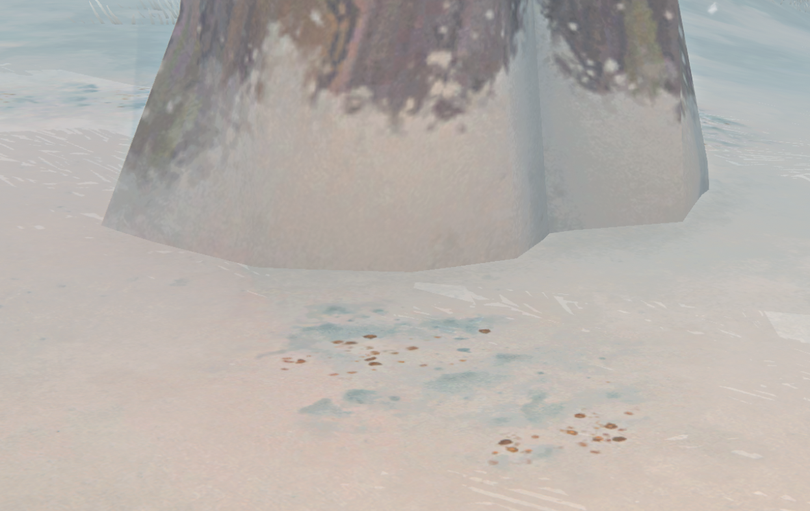

# Oak Tree

**Categories:** Interactable objects, Pages with update history · **Source:** [Fandom](https://thelongdark.fandom.com/wiki/Oak_Tree)

**Contents**

- [Locations](#locations)
- [Coastal Highway](#coastal-highway)
- [Forsaken Airfield](#forsaken-airfield)
- [Hushed River Valley](#hushed-river-valley)
- [Mountain Town](#mountain-town)
- [Mystery Lake](#mystery-lake)
- [Timberwolf Mountain](#timberwolf-mountain)
- [Transfer Pass](#transfer-pass)
- [Zone of Contamination](#zone-of-contamination)
- [Update history](#update-history)

**Oak Tree**

| Property | Details |
| --- | --- |
|  | [Oak tree in Mystery Lake on a foggy day](../assets/Oak_tree_in_Mystery_Lake_on_a_foggy_day.png) |
| Release | 2.10 |
| Story item | No |
| **Advanced data** |  |
| Object key | GAMEPLAY\_FileCabinet |

**Oak Trees** are stationary environmental objects in [_The Long Dark_](./The%20Long%20Dark.md). They serve as the primary source of [Acorns](./Acorns.md) for the player, which can be identified as brownish speckled patches near the base of each tree. Each oak tree will always contain at least 1 or 3 acorn patches for the player to harvest, with some having been already uncovered before the player arrives. Once uncovered, acorns do not respawn.

## Locations

Oak Trees can be found in the Following locations.

### Coastal Highway

- Near the trailer near [Coastal Townsite](./Coastal%20Townsite.md) and [Silent Clearing](./Silent%20Clearing.md)
- Near the trailer south of [Train Unloading](./Train%20Unloading.md)

### Forsaken Airfield

- Near [Junker's Paddock](./Junker%27s%20Paddock.md)
- Along the road between Junker's Paddock and [Field 31](./Field%2031.md)

### Hushed River Valley

- Near the entrance to the south eastern most Ice Cave entrance, in the mountains

### Mountain Town

- Many are found near [Picnic Area](./Picnic%20Area.md)
- At the bottom of the rope climb leading to [Mystery Lake](./Mystery%20Lake%20%28region%29.md)

### Mystery Lake

- Along various points of the [Trans-Island Railway Line](./Trans-Island%20Railway%20Line.md)

### Timberwolf Mountain

- In the hills above [Crystal Lake](./Crystal%20Lake.md) and below [Tail Section](./Tail%20Section.md)

### Transfer Pass

- All over the railroad and mountains of the Region

### Zone of Contamination

- Found only near the region connection to Transfer Pass

_[Acorns](./Acorns.md) can be found in the interactable areas at the base of oak trees._

## Update history

- UPDATE **30 March 2023 ([Update](./The%20Long%20Dark%20%E2%80%94%20Changelog.md#2-09-2-10-tftft-part-two-signal-void)):**
  - Added to game.
