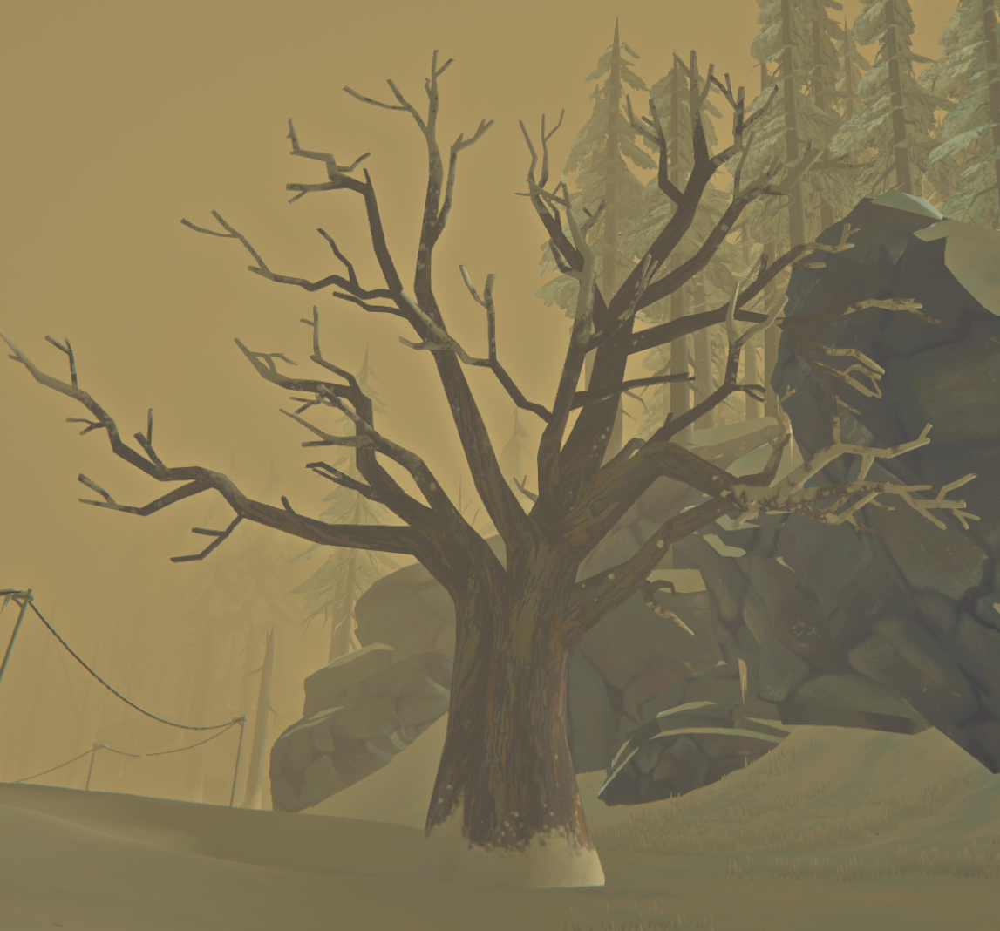

# Oak Tree

**Contents**

- [Locations](#Locations)
- [Coastal Highway](#Coastal_Highway)
- [Forsaken Airfield](#Forsaken_Airfield)
- [Hushed River Valley](#Hushed_River_Valley)
- [Mountain Town](#Mountain_Town)
- [Mystery Lake](#Mystery_Lake)
- [Timberwolf Mountain](#Timberwolf_Mountain)
- [Transfer Pass](#Transfer_Pass)
- [Zone of Contamination](#Zone_of_Contamination)
- [Update history](#Update_history)

<table class="infobox">
<caption>Oak Tree</caption>
<colgroup>
<col style="width: 50%" />
<col style="width: 50%" />
</colgroup>
<tbody>
<tr>
<td colspan="2"><figure>

<figcaption>Oak_tree_in_Mystery_Lake_on_a_foggy_day.png</figcaption>
</figure></td>
</tr>
<tr>
<td>
Release
</td>
<td>
2.10
</td>
</tr>
<tr>
<td>
Story item
</td>
<td>
No
</td>
</tr>
<tr>
<td colspan="2" class="section">
<strong>Advanced data</strong>
</td>
</tr>
<tr>
<td>
Object key
</td>
<td>
GAMEPLAY_FileCabinet
</td>
</tr>
</tbody>
</table>

**Oak Trees** are stationary environmental objects in <a href="./The%20Long%20Dark.md" class="wikilink" title="The Long Dark"><em>The Long Dark</em></a>. They serve as the primary source of <a href="./Acorns.md" class="wikilink" title="Acorns">Acorns</a> for the player, which can be identified as brownish speckled patches near the base of each tree. Each oak tree will always contain at least 1 or 3 acorn patches for the player to harvest, with some having been already uncovered before the player arrives. Once uncovered, acorns do not respawn.

## Locations

Oak Trees can be found in the Following locations.

### Coastal Highway

- Near the trailer near <a href="./Coastal%20Townsite.md" class="wikilink" title="Coastal Townsite">Coastal Townsite</a> and <a href="./Silent%20Clearing.md" class="wikilink" title="Silent Clearing">Silent Clearing</a>
- Near the trailer south of <a href="./Train%20Unloading.md" class="wikilink" title="Train Unloading">Train Unloading</a>

### Forsaken Airfield

- Near <a href="./Junker%27s%20Paddock.md" class="wikilink" title="Junker&#39;s Paddock">Junker's Paddock</a>
- Along the road between Junker's Paddock and <a href="./Field%2031.md" class="wikilink" title="Field 31">Field 31</a>

### Hushed River Valley

- Near the entrance to the south eastern most Ice Cave entrance, in the mountains

### Mountain Town

- Many are found near <a href="./Picnic%20Area.md" class="wikilink" title="Picnic Area">Picnic Area</a>
- At the bottom of the rope climb leading to <a href="./Mystery%20Lake%20%28region%29.md" class="wikilink" title="Mystery Lake">Mystery Lake</a>

### Mystery Lake

- Along various points of the <a href="./Trans-Island%20Railway%20Line.md" class="wikilink" title="Trans-Island Railway Line">Trans-Island Railway Line</a>

### Timberwolf Mountain

- In the hills above <a href="./Crystal%20Lake.md" class="wikilink" title="Crystal Lake">Crystal Lake</a> and below <a href="./Tail%20Section.md" class="wikilink" title="Tail Section">Tail Section</a>

### Transfer Pass

- All over the railroad and mountains of the Region

### Zone of Contamination

- Found only near the region connection to Transfer Pass

<table class="gallery">
<colgroup>
<col style="width: 50%" />
<col style="width: 50%" />
</colgroup>
<tbody>
<tr>
<td><figure>

<figcaption><a href="./Acorns.md" class="wikilink" title="Acorns">Acorns</a> can be found in the interactable areas at the base of oak trees.</figcaption>
</figure></td>
<td><figure>
[Missing image: Oak_trees_Transfer_Pass.jpg]
<figcaption>A line of oak trees in Transfer Pass</figcaption>
</figure></td>
</tr>
</tbody>
</table>

## Update history

- UPDATE **30 March 2023 (<a href="./The%20Long%20Dark%20%E2%80%94%20Changelog.md#2.10" class="wikilink" title="Update">Update</a>):**
  - Added to game.

**Lua execution error in Module:Navbox function navbox**

