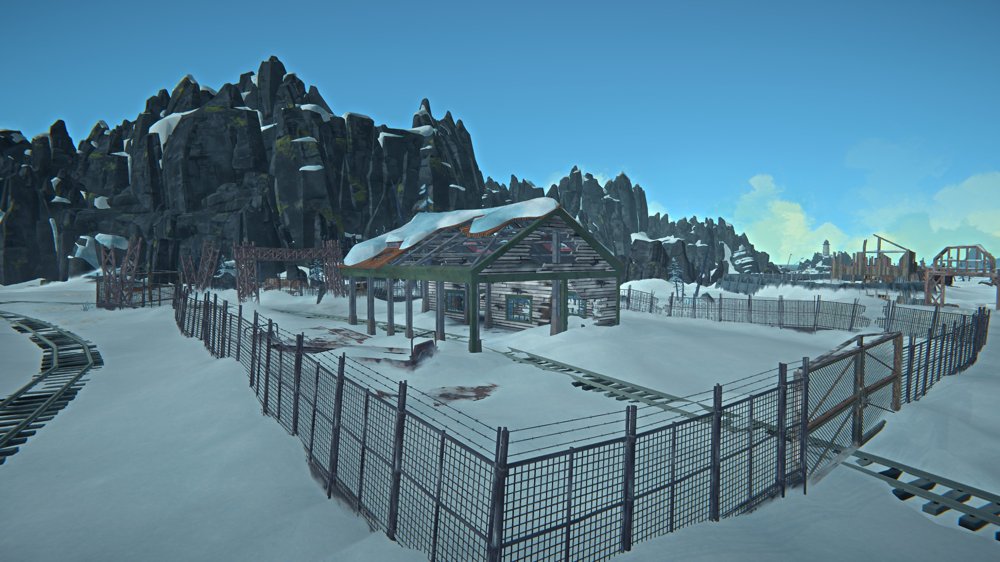

# Obstructed Transit

| Column 1 | Column 2 | Column 3 |
| --- | --- | --- |
|  / *Seal\_icon.png* | **DLC-Exclusive content.** / This content requires the [Iron Road](./Iron%20Road.md) addon to be installed before it can be seen or used in regular gameplay. | \|} / **Obstructed Transit** / \| Property \| Details \| / \| --- \| --- \| / \| \[\[File: / \\|  / *Perimeter* \\|  / *Interior* \\| / \\| --- \\| --- \\| \| 250px\]\] \| / \|  / *Perimeter* \|  / *Interior* \| / \| **Location** \|  \| / \| \[Missing image: Obstructed\_Transit\_Location.png\] / *Obstructed\_Transit\_Location.png* \|  \| / \| Region \| [Port Remnant](./Port%20Remnant.md)\\|- / Location \| / \| Description \| A train station pickup terminal long fallen into ruin and completely surrounded by a chain link fence. \| / \| **General** \|  \| / \| Firebox \| [Fire Barrel](./Fire%20Barrel.md) \| / \|  \| Has no shelter\\|} **Obstructed Transit** is a location in [Port Remnant](./Port%20Remnant.md). / ## Overview / This location is a train station with a chain link fence completely surrounding the location. Several holes can be found in the fences, but cannot be crouched under to enter the terminal. As a result, access to the location will be locked when first arriving in Port Remnant. / The only way to properly enter this location is to acquire the [Prototype Train](./Prototype%20Train.md) and run a full circle around the various Track Section regions of Anna Island before finally returning to Port Remnant and ramming through the chained gates on the tracks. / Inside are up to 10 cans of [Whale Oil Cans](./Whale%20Oil%20Can.md), [Wax Cylinder 16](./Wax%20Cylinder%2016.md), [Simple Tools](./Simple%20Tools.md), 2 [Brake Shoes](./Brake%20Shoe.md), a [Prybar](./Prybar.md), and 1 very rare [Fresh Leather](./Fresh%20Leather.md).**Lua execution error in Module:Navbox function navbox** \| |
| \[\[File: / \|  / *Perimeter* \|  / *Interior* \| / \| --- \| --- \| | 250px\]\] |  |
|  / *Perimeter* |  / *Interior* |  |
| **Location** |  |  |
| \[Missing image: Obstructed\_Transit\_Location.png\] / *Obstructed\_Transit\_Location.png* |  |  |
| Region | [Port Remnant](./Port%20Remnant.md)\|- | Location |
| Description | A train station pickup terminal long fallen into ruin and completely surrounded by a chain link fence. |  |
| **General** |  |  |
| Firebox | [Fire Barrel](./Fire%20Barrel.md) |  |
|  | Has no shelter\|} **Obstructed Transit** is a location in [Port Remnant](./Port%20Remnant.md). / ## Overview / This location is a train station with a chain link fence completely surrounding the location. Several holes can be found in the fences, but cannot be crouched under to enter the terminal. As a result, access to the location will be locked when first arriving in Port Remnant. / The only way to properly enter this location is to acquire the [Prototype Train](./Prototype%20Train.md) and run a full circle around the various Track Section regions of Anna Island before finally returning to Port Remnant and ramming through the chained gates on the tracks. / Inside are up to 10 cans of [Whale Oil Cans](./Whale%20Oil%20Can.md), [Wax Cylinder 16](./Wax%20Cylinder%2016.md), [Simple Tools](./Simple%20Tools.md), 2 [Brake Shoes](./Brake%20Shoe.md), a [Prybar](./Prybar.md), and 1 very rare [Fresh Leather](./Fresh%20Leather.md).**Lua execution error in Module:Navbox function navbox** |  |
