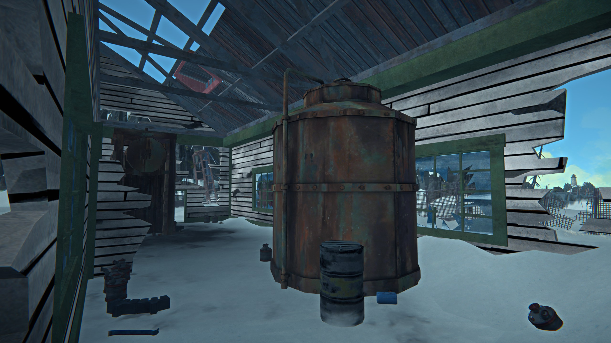

# Obstructed Transit

**Categories:** DLC Content, Locations, Locations in Port Remnant, Outdoor locations · **Source:** [Fandom](https://thelongdark.fandom.com/wiki/Obstructed_Transit)

**DLC-Exclusive content.**

This content requires the [Iron Road](./Iron%20Road.md) addon to be installed before it can be seen or used in regular gameplay.

**Obstructed Transit**

\[\[File:

250px\]\]

**Location**

[Missing image: Obstructed\_Transit\_Location.png]

_Obstructed\_Transit\_Location.png_

Region

[Port Remnant](./Port%20Remnant.md)|-

Location

Description

A train station pickup terminal long fallen into ruin and completely surrounded by a chain link fence.

**General**

Firebox

[Fire Barrel](./Fire%20Barrel.md)

Has no shelter **Obstructed Transit** is a location in [Port Remnant](./Port%20Remnant.md).

## Overview

This location is a train station with a chain link fence completely surrounding the location. Several holes can be found in the fences, but cannot be crouched under to enter the terminal. As a result, access to the location will be locked when first arriving in Port Remnant.

The only way to properly enter this location is to acquire the [Prototype Train](./Prototype%20Train.md) and run a full circle around the various Track Section regions of Anna Island before finally returning to Port Remnant and ramming through the chained gates on the tracks.
