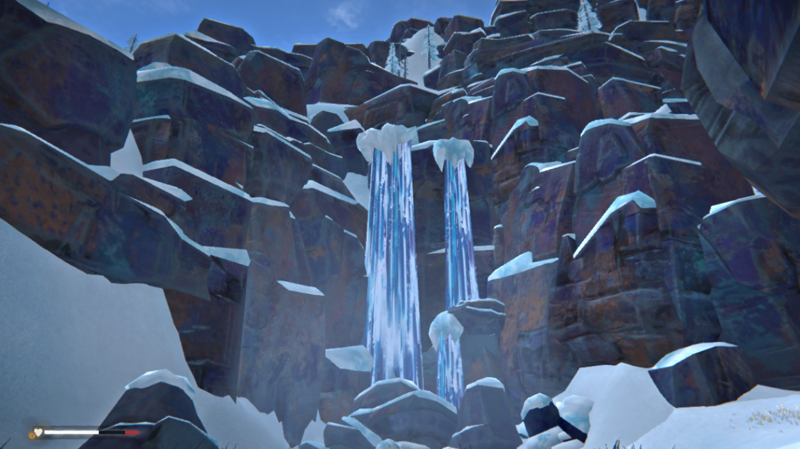

# Offset Falls

**Offset Falls**

| Property | Details |
| --- | --- |
|  |  / *20190302003955\_1.jpg* |
| **Location** |  |
|  |  / *Offset\_Falls\_Location.png* |
| Region | [Hushed River Valley](./Hushed%20River%20Valley.md)\|- |
| Description | Two waterfalls. |
| **General** |  |
| Type | Outdoors\|- |
