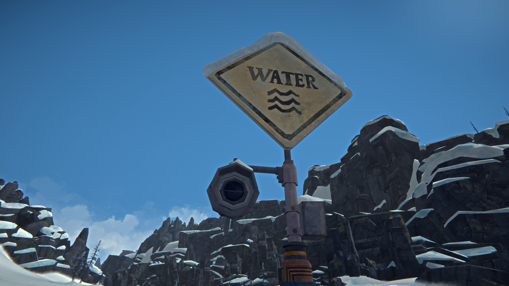
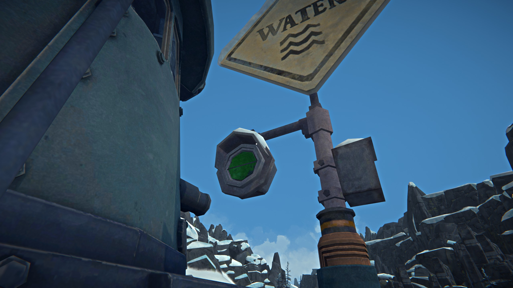

# Oil Tank

**Categories:** DLC Content, Interactable Objects · **Source:** [Fandom](https://thelongdark.fandom.com/wiki/Oil_Tank)

**Oil Tank**

[Whale Oil Refueling](../assets/Whale_Oil_Refueling.jpg)

**General**

**Item Type:** Item

**Wintermute:** No

**Renewable:** Yes

[Seal icon](../assets/Seal_icon.png)

**DLC-Exclusive content.** This content requires the [Iron Road](./Iron%20Road.md) addon to be installed before it can be seen or used in regular gameplay.

 An **Oil Tank** is a stationary interactable object in [_The Long Dark_](./The%20Long%20Dark.md) only found in Railyards on [Cauldron Island](./Cauldron%20Island.md).

## Overview

An **Oil Tank** initially contains 5,000 liters of [Whale Oil](./Whale%20Oil%20Can.md), and is accompanied by two yellow signs labelled "FUEL". When the Survivor pulls up close to the tower, a small sign under the signpost will flip a black panel to green a green one, letting them know that the [train](./Prototype%20Train.md) is in position to be filled (fuel and water caps must be in the middle of the signs to trigger this). Unlike the [Water Tower](./Water%20Tower.md), a vertical gauge is present on the Oil Tank to show its current storage status.

The player can then exit the train and walk over to the valve on the side of the tank to start dispensing oil. If the sign panel is not green, then the option to place oil into the train directly will not appear.

Oil is transferred into the train at a rate of 5.00 liters per minute (20.00 min cap at 5 minutes per increment), meaning that a fully empty locomotive can be refilled with 500.00 L of oil in 1 hour and 40 minutes. Make sure to turn the train Engine off while refueling, as this can burn already stored fuel and not fully refuel the train.

Whale Oil can also be transferred into the Survivor's backpack, 5.00 liters at a time in 1 minute.

- This is most useful for those who are using the [McLeod Ultra-Efficiency Whale Oil Heater](./McLeod%20Ultra-Efficiency%20Whale%20Oil%20Heater.md), and the excess oil can be stored on the train's [Cupboard](./Cupboard.md) for later use.
- Keep in mind that passing time while refueling the train will put the Survivor at risk from the elements, so make sure the weather is warm.
  - Passing time and canceling the refueling process part way will only deposit a partial amount of fuel into the train up until the moment it is canceled. (needs verification).
- Oil Tanks refuel over time, so that the player will never run out of fuel for the train.
  - Unlike the [Water Tower](./Water%20Tower.md), the Oil Tank will not immediately refill as it is emptied, but will gradually replenish over time if you leave the region and return later.

### Locations

Oil Tanks can be found at:

Anna Island:

- [Anna Island -- Track Section 1](./Anna%20Island%20--%20Track%20Section%201.md) ([Railyard Track Section 1](./Railyard%20%28Track%20Section%201%29.md) West)
- [Anna Island -- Track Section 3](./Anna%20Island%20--%20Track%20Section%203.md) ([Railyard (Track Section 3)](./Railyard%20%28Track%20Section%203%29.md))
- [Anna Island -- Track Section 4](./Anna%20Island%20--%20Track%20Section%204.md) ([Railyard (Track Section 5)](./Railyard%20%28Track%20Section%205%29.md) West)
- [Anna Island -- Track Section 5](./Anna%20Island%20--%20Track%20Section%205.md) ([Railyard (Track Section 5)](./Railyard%20%28Track%20Section%205%29.md) West)
