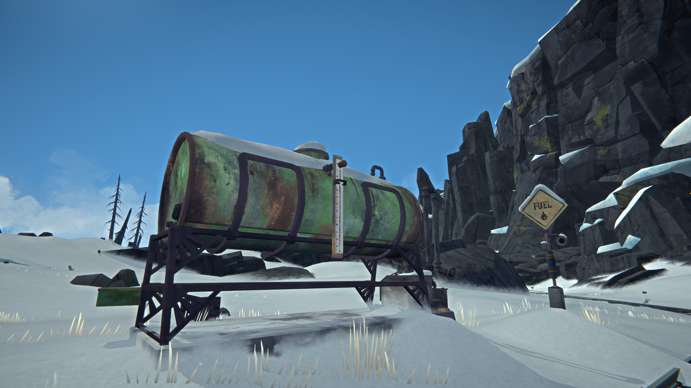

# Oil Tank

**Categories:** DLC Content, Interactable Objects · **Source:** [Fandom](https://thelongdark.fandom.com/wiki/Oil_Tank)

**Oil Tank**

_Whale\_Oil\_Refueling.jpg_

**General**

**Item Type:** Item

**Wintermute:** No

**Renewable:** Yes

_Seal\_icon.png_

**DLC-Exclusive content.** / This content requires the [Iron Road](./Iron%20Road.md) addon to be installed before it can be seen or used in regular gameplay.

_The sign panel displaying that the train is not in position for refueling._

_The panel flipped to green, signaling that refueling is possible._
