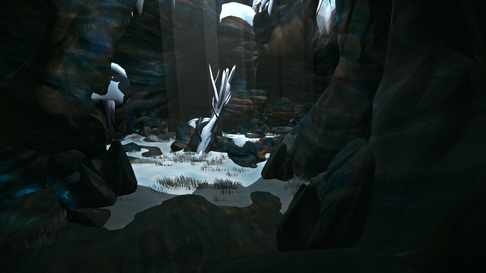

# Old Bear's Den

**Categories:** Locations, Locations in Forlorn Muskeg, Outdoor locations · **Source:** [Fandom](https://thelongdark.fandom.com/wiki/Old_Bear's_Den)

**Old Bear's Den**

_Old\_Bear's\_Den.jpg_

**Location**

**Region:** [Forlorn Muskeg](./Forlorn%20Muskeg.md)

**General**

Has no shelter The **Old Bear's Den** is an unmarked location in [Forlorn Muskeg](./Forlorn%20Muskeg.md) that appears only in [Episode 2: Luminance Fugue](./Episode%202%20-%20Luminance%20Fugue.md). [Will Mackenzie](./Will%20Mackenzie.md) is dragged here by the [Old Bear](./Old%20Bear.md), and the mission [What One Man Can Do](./What%20One%20Man%20Can%20Do.md) takes place entirely within this den. The cave is an [Ice Cave](./Ice%20Cave.md), and is highly linear, ultimately resulting in a cavern with an open ceiling where Mackenzie kills the Old Bear after finding his [Bear Spear](./Bear%20Spear.md).

## Gallery

_The second chamber housing a waterfall_

_The open ceiling of the final chamber_

_The map location of the Old Bear's Den in Episode 2_

_Bear\_lair.jpg_
