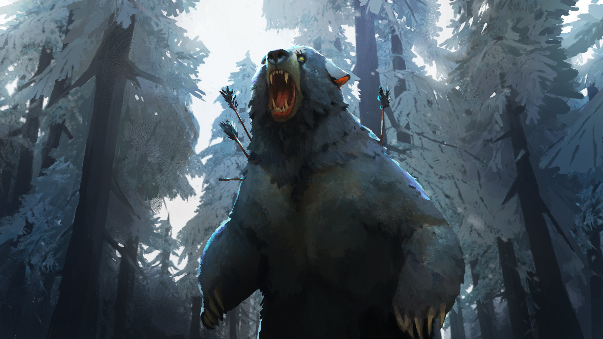
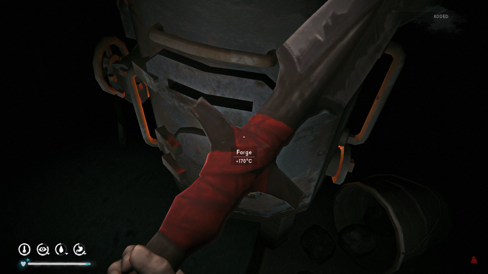
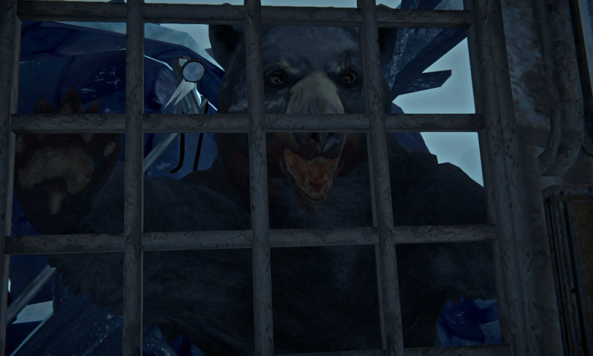
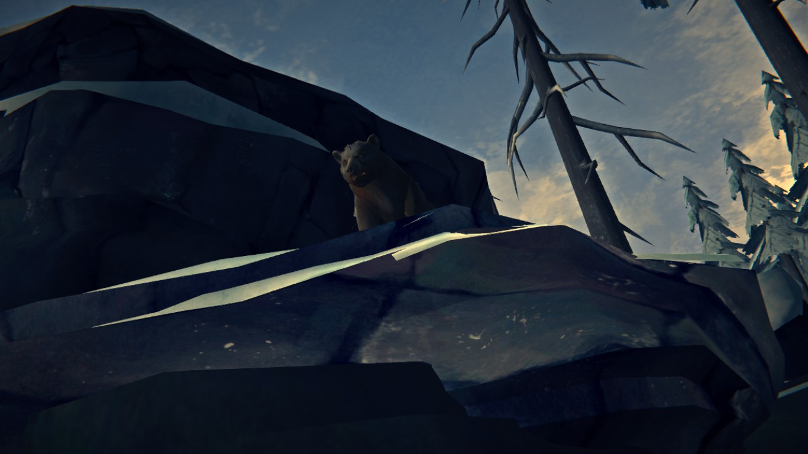
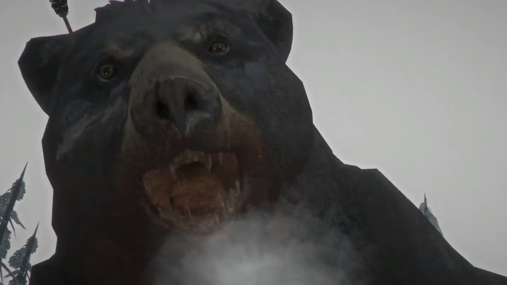
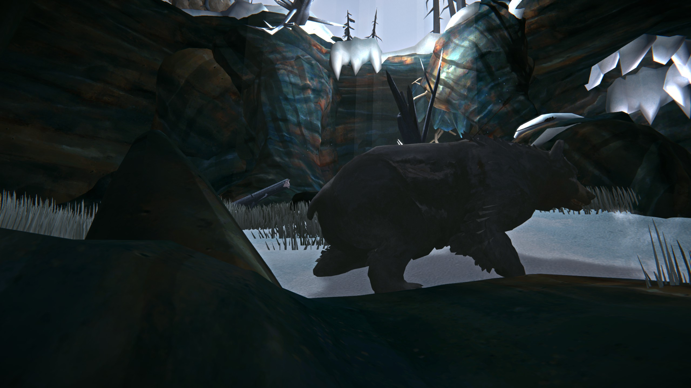
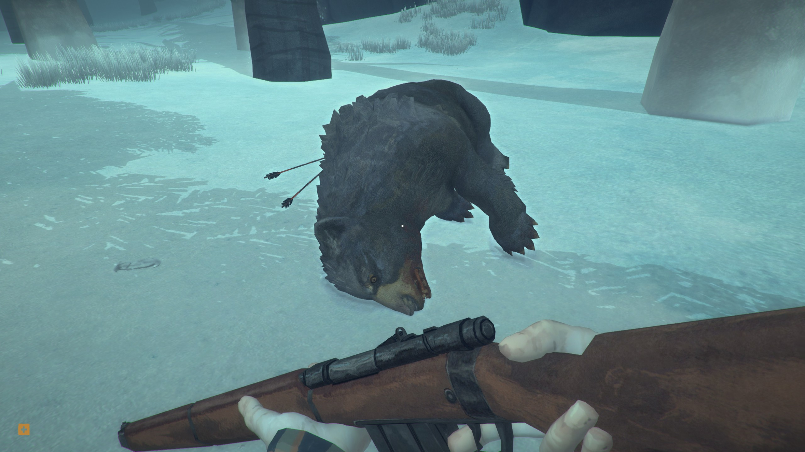
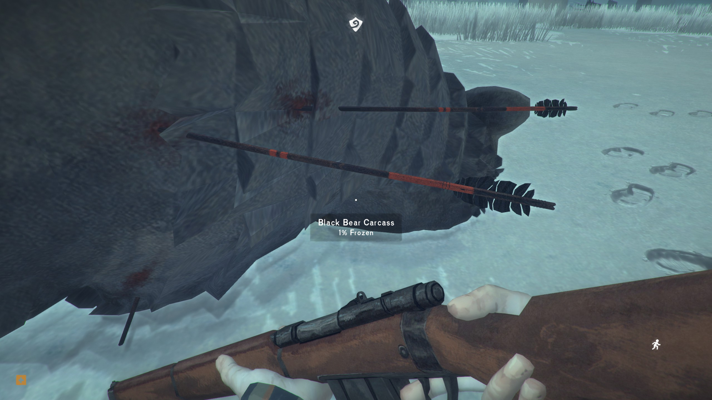
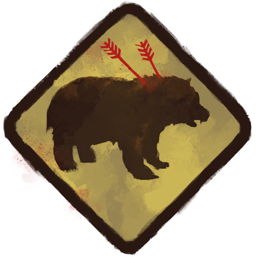
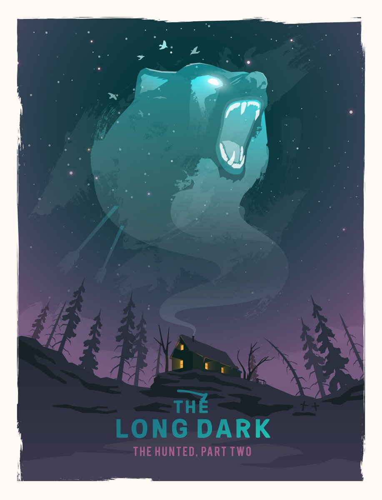

# Old Bear

**Categories:** Characters, Story, Wildlife · **Source:** [Fandom](https://thelongdark.fandom.com/wiki/Old_Bear)

**Contents**

- [Episode 1](#episode-1)
- [Paradise Lost](#paradise-lost)
- [Episode 2](#episode-2)
- [The Wounded Trapper](#the-wounded-trapper)
- [The Best Defense](#the-best-defense)
- [Signal to Noise](#signal-to-noise)
- [What One Man Can Do](#what-one-man-can-do)
- [Challenges](#challenges)
- [Part One](#part-one)
- [Part Two](#part-two)
- [Part Three](#part-three)
- [Gallery](#gallery)
- [Redux Episode 2](#redux-episode-2)
- [Predux Episode 2](#predux-episode-2)
- [The Hunted Challenges](#the-hunted-challenges)
- [Trivia](#trivia)

**Old Bear**

[Old Bear](../assets/Old_Bear.png)

**Basic Information**

**Release:** [21 April 2016](./The%20Long%20Dark%20%E2%80%94%20Changelog.md#0.321)

**Role:** Predator

**Physical Information**

**Color:** Black

**Size:** Large

**Eyes:** Brown

**Spoiler Warning:****This page may contain spoilers from the [story](./Wintermute.md) of The Long Dark.**

> “__M - What's the story with this bear?  
 J - Story's real simple. That bear and me, we have unfinished business...Yeah. You could call it a trade in kind. Every time we meet, we each leave with a little of the other's blood.__”
>
> — [Mackenzie](./Will%20Mackenzie.md) and [Jeremiah](./Jeremiah.md) discussing the Old Bear.

The **Old Bear** is a unique [Bear](./Bear.md) and the primary antagonist of [Episode 2: Luminance Fugue](./Episode%202%20-%20Luminance%20Fugue.md) in [Wintermute](./Wintermute.md). He also appears as the antagonist of [The Hunted Part One](./The%20Hunted%2C%20Part%20One.md), [Part Two](./The%20Hunted%2C%20Part%20Two.md), and [Part Three](./The%20Hunted%2C%20Part%20Three.md) [Challenges](./Challenge.md).

## Episode 1

### [Paradise Lost](./Paradise%20Lost.md)

The Old Bear is first seen in the closing seconds of [Episode 1](./Episode%201%20-%20Do%20Not%20Go%20Gentle.md), where [Will Mackenzie](./Will%20Mackenzie.md) sees him attacking [Jeremiah](./Jeremiah.md), who takes the trapper's rifle to shoot it as the episode ends.

## Episode 2

### [The Wounded Trapper](./The%20Wounded%20Trapper.md)

In [Episode 2](./Episode%202%20-%20Luminance%20Fugue.md), the Old Bear makes his first appearance at the [Carter Hydro Dam](./Carter%20Hydro%20Dam.md), where he charges Mackenzie right as he enters the fenced-in Staging Area. Mackenzie manages to close the gate, stopping the charge but is knocked out. When Mackenzie awakens some time later, the bear is gone.

After finding meds for the old trapper, Jeremiah tells Mackenzie that the bear will hunt them both across the island unless they kill him since the Old Bear has a taste for the blood of men. He recounts a story where a similar Old Bear from 150 years ago was nicknamed the "Demon Bear" after a Hunting party of three members failed to kill him despite allegedly unloading their rifles into him. Jeremiah concludes that the only possible way to kill the bear is with the legendary [Bear Spear](./Bear%20Spear.md), and directs a reluctant Mackenzie to the [Hunting Lodge](./Hunting%20Lodge.md) in [Broken Railroad](./Broken%20Railroad.md) to retrieve it.

### [The Best Defense](./The%20Best%20Defense.md)

The Old Bear is encountered again in Broken Railroad, where he pushes over a [Train Shuttle](./Train%20Shuttle.md) that Mackenzie is inside of, knocking him unconscious. When he awakes, Mackenzie finds the bear missing, replaced instead by [Methuselah](./Methuselah.md) sitting by a fire under an [Aurora](./Aurora.md).

After Mackenzie find and repairs the Bear Spear, the Old Bear is seen keeping his distance from the pilot on a nearby ledge as he makes his way through Forlorn Muskeg back to Mystery Lake. Mackenzie wonders that perhaps the Bear Spear does have some magical protection to it, at least for now, before taunting the retreating Old Bear.

### [Signal to Noise](./Signal%20to%20Noise.md)

In the third mission, the Bear guards one/two of the Shortwave Towers required to get the [Transponder Parts](./Transponder%20Parts.md) to boost Jeremiah's shortwave radio. He can be driven away by using the Bear Spear before struggling with him.

When attempting to return to Mystery Lake after getting all the parts, the Old Bear ambushes Mackenzie and then drags him to his den.

### [What One Man Can Do](./What%20One%20Man%20Can%20Do.md)

The player must navigate through the [Old Bear's Den](./Old%20Bear%27s%20Den.md) while avoiding the bear in order to retrieve the Bear Spear. Mackenzie successfully kills the Old Bear for good with the spear, apologizing to the creature's remains that he did not intend to kill him, but unfortunately "this world will make murders of us all." Mackenzie later returns to the Trapper's Homestead with the Transponder Parts and informs Jeremiah that the bear is dead, before passing out.

## Challenges

As well as his role in the story, the Old Bear appears in [The Hunted, Part One](./The%20Hunted%2C%20Part%20One.md), [The Hunted, Part Two](./The%20Hunted%2C%20Part%20Two.md), and [The Hunted, Part Three](./The%20Hunted%2C%20Part%20Three.md) [Challenges](./Challenge.md). In the first two challenges, the bear is invincible and cannot be killed.

### Part One

The challenge revolves around the bear stalking the player through Pleasant Valley to the Trapper's Homestead so they can get the Hunting Rifle. The Old Bear will hunt the player throughout Pleasant Valley and Mystery Lake until the player reaches the Trapper's Cabin.

### Part Two

After completing part one, part two is unlocked and begins where the first part ended. The roles are switched, with the player hunting the bear as it runs through Mystery Lake back to its den.

### Part Three

The Old Bear is slated to appear in a third challenge.

## Gallery

### Redux Episode 2

### Predux Episode 2

_The Old Bear slain in [Jeremiah's Folly](./Jeremiah%27s%20Folly.md) (Predux)_

_[The Old Bear's Ear](./The%20Old%20Bear%27s%20Ear.md) (Predux)_

### The Hunted Challenges

_[The Hunted, Part One](./The%20Hunted%2C%20Part%20One.md)_

_[The Hunted, Part Two](./The%20Hunted%2C%20Part%20Two.md)_

## Trivia

- Jeremiah constantly refers to the bear as "He" despite no genitals being present on the body.
- The Old Bear differs in appearance from normal bears; having 3 arrows imbedded behind the bear's head (with one broken off), blood all over the mouth, a scar below the right eye, small scars on the muzzle, longer leg and back hair, and 2 scars on the right side of his body above the belly.
- Aside from aesthetics, the bear is mechanically similar to any other bear the player might encounter (albeit immune to being killed). [Wolves](./Wolf.md) will run from the Old Bear.
- The Old Bear's home is situated in [Forlorn Muskeg](./Forlorn%20Muskeg.md), inside the [Old Bear's Den](./Old%20Bear%27s%20Den.md).
- In The Hunted, Part Two, the bear follows a very specific path as it runs across Mystery Lake. If the player doesn't see the old bear, they might need to walk along a certain path to get it to spawn.
- In Episode 2, unlike normal bears The Old Bear when charging at the Mackenzie is unaffected by the [distress pistol](./Distress%20Pistol.md), although in the [Challenge: The Hunted](./The%20Hunted%2C%20Part%20One.md) it is deterred by distress pistol shots.
- Old Bear especially by its other names ("Demon Bear" or "Evil Spirit") and the [The Bear Spear](./Bear%20Spear.md) and [Old Spence's](./Old%20Spence%20Family%20Homestead.md) story are references to the fantasy manga ["Ushio &amp; Tora" (うしおととら)](https://en.wikipedia.org/wiki/Ushio_%26_Tora) written and illustrated by Kazuhiro Fujita. Both stories feature a supernatural spear with red cloth around its neck forged by a character driven mad for revenge to kill "evil spirits".
