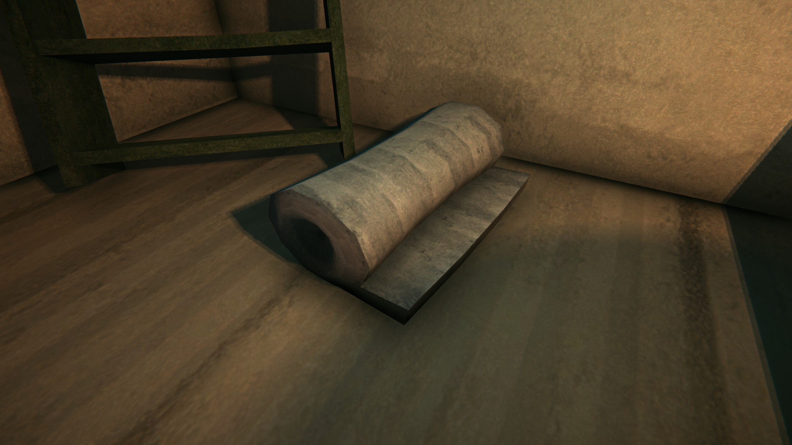

# Old Bedroll

**Old Bedroll**

| Property | Details |
| --- | --- |
|  |  / *OldBedroll.jpg* |
| **General** |  |
| Item Type | Item |
| Wintermute | Yes\|- |
| Harvest | 6 x [Cloth](./Cloth.md) |

An **Old Bedroll** is a harvestable object found in many trailers across the Island often near [Pillows](./Pillow.md). They can be harvested with a [Hunting Knife](./Hunting%20Knife.md) for 27 minutes and provide 6 [Cloth](./Cloth.md).

They cannot be used as a [Bed](./Bed.md). **Lua execution error in Module:Navbox function navbox**
