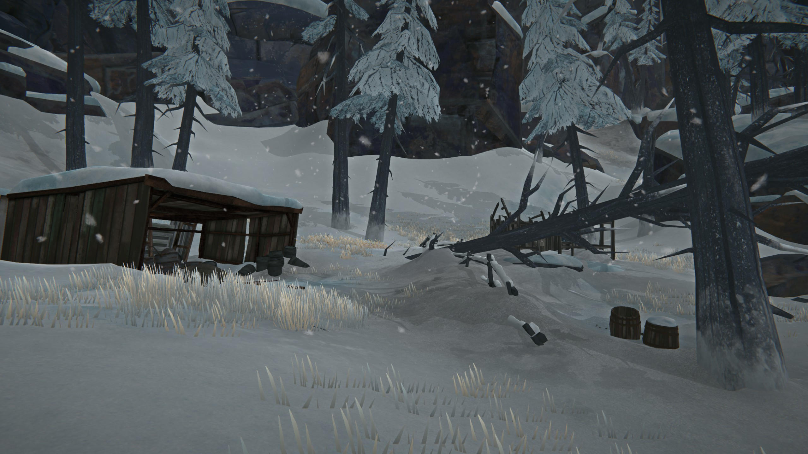

# Old Corral

**Categories:** Locations, Locations in Zone of Contamination, Sheltered locations · **Source:** [Fandom](https://thelongdark.fandom.com/wiki/Old_Corral)

**Old Corral**

| Property | Details |
| --- | --- |
|  |  / _Old\_Corral.jpg_ |
| **Location** |  |
|  |  / _Old\_Corral\_Location.png_ |
| Region | [Zone of Contamination](./Zone%20of%20Contamination.md)\|- |
| **General** |  |
| Firebox | [Fire Barrel](./Fire%20Barrel.md) |
