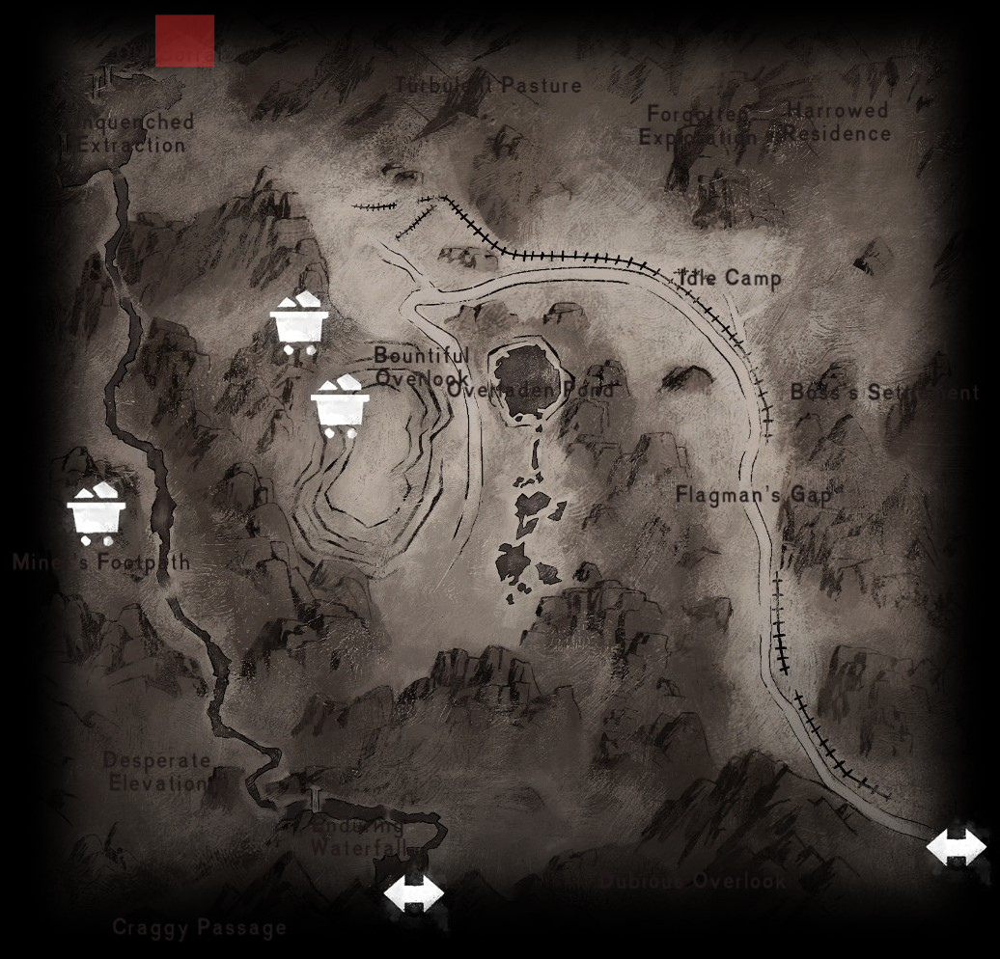

# Old Corral

**Categories:** Locations, Locations in Zone of Contamination, Sheltered locations · **Source:** [Fandom](https://thelongdark.fandom.com/wiki/Old_Corral)

**Old Corral**

**Location**

**Region:** [Zone of Contamination](./Zone%20of%20Contamination.md)

**General**

**Firebox:** [Fire Barrel](./Fire%20Barrel.md)

Provides some shelter **Old Corral** is a location near [Unquenched Extraction](./Unquenched%20Extraction.md) in the [Zone of Contamination](./Zone%20of%20Contamination.md). It is composed of a destroyed building and a small storage shed.

## Overview

This location can be approached by heading slightly north of [Unquenched Extraction](./Unquenched%20Extraction.md). While there are no beds here, the crashed [Helicopter](./Helicopter.md) in the nearby mountains can be used to sleep and can protect from harsh weather. In the small storage building, a [Fire Barrel](./Fire%20Barrel.md) can also be found with some [Cedar Firewood](./Cedar%20Firewood.md) beside it, and a [Cooking Skillet](./Cooking%20Skillet.md) along with a [Cooking Pot](./Cooking%20Pot.md) on top. Several wooden [Barrels](./Barrel.md) can be found nearby and harvested.
