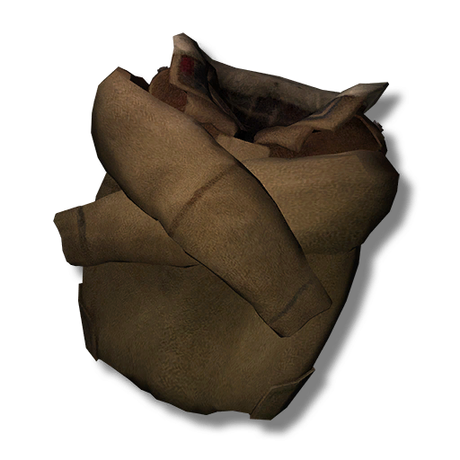
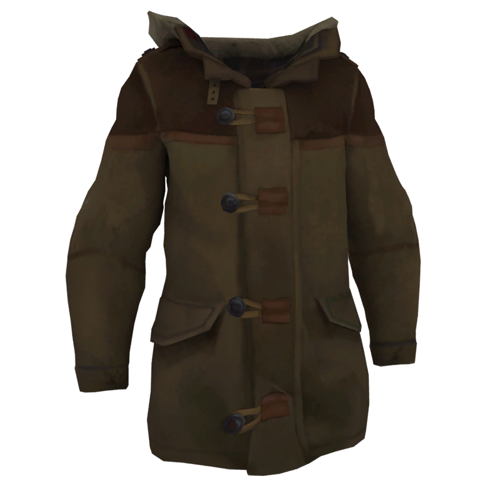
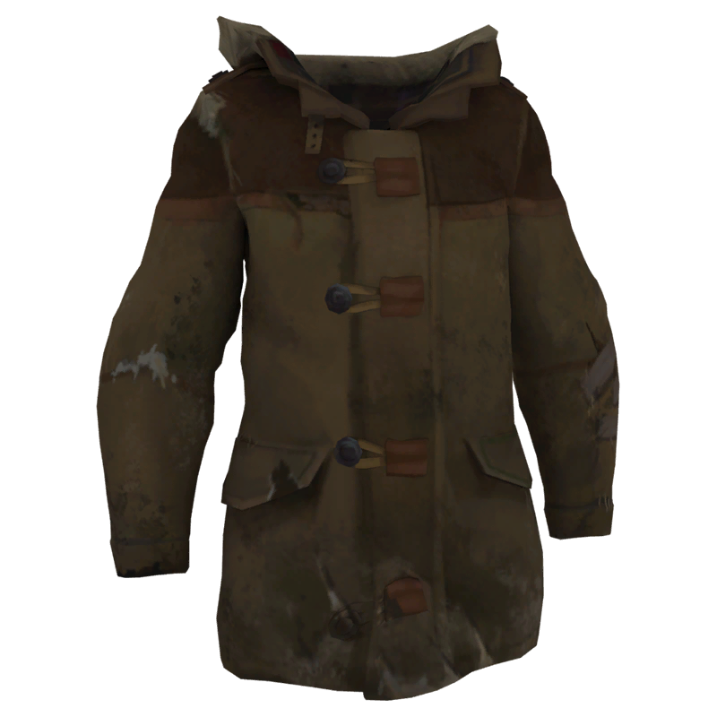

# Old Fashioned Parka

**Old Fashioned Parka**

| Property | Details |
| --- | --- |
|  |  / *Old\_Fashioned\_Parka\_icon.png* |
| **General** |  |
| Item Type | Clothing\|- |
| Clothing Slot | Outer torso |
| **Statistics** |  |
| Weight | 2.00 kg(4.4 lbs) |
| Warmth bonus | 3.0 °C(5.4 °F) |
| Windproof bonus | 3.0 °C(5.4 °F) |
| Waterproof bonus | 20% |
| Protection | 5% |
| Mobility | -7% |
| Harvest | 2 × [Cloth](./Cloth.md) / 20 minutes |
| Repair | 2 × [Cloth](./Cloth.md) / 60 minutes / 30% condition |

> “**Bulky parka that uses old-fashioned materials. What is sacrifices in weight it makes up for in warmth and durability.**”
>
> — In-game description

The **Old Fashioned Parka** is a type of [Clothing](./Clothing.md) in *[The Long Dark](./The%20Long%20Dark.md)*. Typically, the parka is a rare find, but gives off decent stats all around, though it is heavy and expensive to repair. The parka, however, is for the most part inferior to the [Military Coat](./Military%20Coat.md). They share identical weight and warmth statistics, and the former is quicker to repair by 30 minutes, but the latter is 20% more waterproof, offers 3% more protection, and has a 2% lower mobility penalty.

| Column 1 | Column 2 |
| --- | --- |
|  / *Clothing model* |  / *Clothing model damaged* |

## Update history

- UPDATE **19 December 2016 ([Update](./The%20Long%20Dark%20%E2%80%94%20Early%20Access%20Changelog.md#0.386)):**
  - Added to game

**Lua execution error in Module:Navbox function navbox** [ru:Старомодная парка](ru:%D0%A1%D1%82%D0%B0%D1%80%D0%BE%D0%BC%D0%BE%D0%B4%D0%BD%D0%B0%D1%8F_%D0%BF%D0%B0%D1%80%D0%BA%D0%B0)
