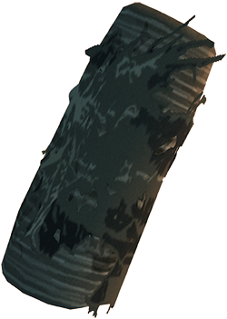

# Old Man's Beard Wound Dressing

**Categories:** Materials, Pages with update history · **Source:** [Fandom](https://thelongdark.fandom.com/wiki/Old_Man's_Beard_Wound_Dressing)

**Contents**

- [Overview](#overview)
- [Tips](#tips)
- [Crafting](#crafting)
- [Trivia](#trivia)
- [Gallery](#gallery)
- [Update history](#update-history)

**Old Man's Beard Wound Dressing**

_Old\_Man's\_Beard\_Wound\_Dressing\_icon.png_

**Release:** [7 February 2015](./The%20Long%20Dark%20%E2%80%94%20Changelog.md#0.192)

**Wintermute:** No

**Properties**

**Item type:** [Materials](./Materials.md)

**Stackable:** Yes

**Examine:** A dressing utilizing Old Man's Beard lichen. Apply to wounds to help prevent infection.

**Values**

**Weight:** 0.10 kg (0.22 lbs)

**Actions**

**Backpack:** Examine

**On ground:** Take It, Leave It

**Old Man's Beard Wound Dressing** is a type of natural [First Aid](./First%20Aid.md) item used to eliminate infection risk.

## Overview

Old Man's Beard Wound Dressing is created with [Old Man's Beard Lichen](./Old%20Man%27s%20Beard%20Lichen.md), which functions as an [Antiseptic](./Antiseptic.md) that will disinfect a single wound, thus removing any chance of [Infection](./Infection.md). They weigh the same as a normal Bandage.

Previously, before release of 0.423, "Faithful Cartographer," Old Man's Beard Wound Dressing functioned as a regular [Bandage](./Bandage.md) combined with an Old Man's Beard Lichen.

## Tips

- Old Man's Beard Lichen can be harvested from low hanging pine branches.
- Old Man's Beard Lichen do not respawn on trees, but are plentiful especially in wilder regions.
- They can be acquired renewably via [Beachcombing](./Beachcombing.md).
- Old Man's Beard Lichen weighs 0.01kg (0.02lbs), but its crafted version "Old Man's Beard Wound Dressing" weighs 0.1kg (0.22lbs). This makes the raw (uncrafted) version far more weight efficient, at the expense of requiring to craft the dressing as needed.
- Antiseptic/Old Man's Beard Wound Dressings do not need to be applied immediately after sustaining an injury to eliminate infection risk; though they should be applied as early as possible, since waiting long periods of time (e.g. 6+ hours) increases the chances of an Infection despite antiseptic being used.

## Crafting

**Old Man's Beard Wound Dressing**

| Property | Details |
| --- | --- |
|  | - |
|  | - |
|  | 15 minutes |
| **Requirements** |  |
| Facility | \[\[File:Anywhere icon.png |
| **Materials** |  |
| **Template:iconlink plain** |  |
| Item | [Old Man's Beard Lichen](./Old%20Man%27s%20Beard%20Lichen.md) |
| Quantity | 3 |

## Trivia

Before release of "Faithful Cartographer" the recipe was:

- 3 × [Old Man's Beard Lichen](./Old%20Man%27s%20Beard%20Lichen.md)
- 1 × [Bandage](./Bandage.md)
- No other tools required

## Gallery

_Old model._

## Update history

- UPDATE **7 February 2015 ([Update](./The%20Long%20Dark%20%E2%80%94%20Early%20Access%20Changelog.md#0.192)):**
  - Added to game.
