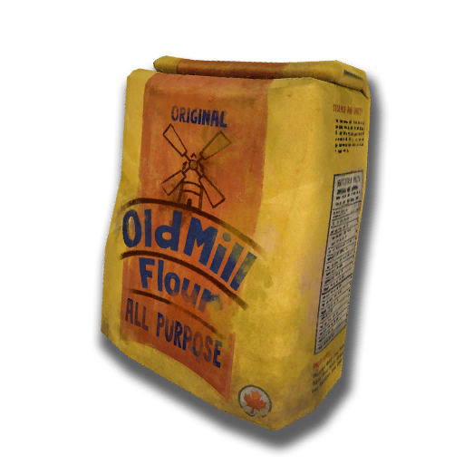

# Old Mill Flour

**Categories:** DLC Content, Food And Drink, Pages with update history · **Source:** [Fandom](https://thelongdark.fandom.com/wiki/Old_Mill_Flour)

**Contents**

- [Overview](#overview)
- [Locations](#locations)
- [Trivia](#trivia)
- [Products](#products)
- [Update history](#update-history)

**Old Mill Flour**

**Release:** [19 June 2023](./The%20Long%20Dark%20%E2%80%94%20Changelog.md#2.17)

**Wintermute:** No

**Renewable:** Yes ([Trader](./Trader.md) only)

**Properties**

**Item type:** [Food And Drink](./Food%20And%20Drink.md)

**Values**

**Weight:** 1.50 kg (3.3 lbs)

**Decay Rate**

**Inside:** 0.250% per day

**Outside:** 0.250% per day

**Advanced data**

**Item key:** GAMEPLAY\_Flour

**DLC-Exclusive content.** This content requires the [Tales from the Far Territory](./Tales%20from%20the%20Far%20Territory.md) addon to be installed before it can be seen or used in regular gameplay.

 **Old Mill Flour** is an [ingredient](./Food%20And%20Drink.md) in [_The Long Dark_](./The%20Long%20Dark.md).

## Overview

Old Mill Flour can often be found alongside other cooking materials such as [Cooking Oil](./Cooking%20Oil.md) and [Salt](./Salt.md).

It can be considered a renewable resource if obtained via the [Trader](./Trader.md).

It is currently impossible to divide a bag of flour into smaller portions, or to consolidate multiple smaller bags.

## Locations

Known spawn locations include:

- [Ash Canyon](./Ash%20Canyon.md)
  - At [Foreman's Retreat](./Foreman%27s%20Retreat.md) on a shelf.
- [Bleak Inlet](./Bleak%20Inlet.md)
  - On the floor under a bed in the [Pensive Lookout](./Pensive%20Lookout.md).
- [Broken Railroad](./Broken%20Railroad.md)
  - The kitchen of the [Hunting Lodge](./Hunting%20Lodge.md)
- [Coastal Highway](./Coastal%20Highway.md)
  - The kitchen on the floor at [Jackrabbit Island](./Jackrabbit%20Island.md) House.
  - The counter of [Quonset Garage](./Quonset%20Garage.md)
- [Desolation Point](./Desolation%20Point.md)
  - On a shelf near the bed of the [Lonely Lighthouse](./Lonely%20Lighthouse.md)
- [Forsaken Airfield](./Forsaken%20Airfield.md)
  - The kitchen of [Mindful Cabin](./Mindful%20Cabin.md)
- [Mountain Town](./Mountain%20Town.md)
  - The kitchen of [Milton House (Grey Mother's)](./Milton%20House%20%28Grey%20Mother%27s%29.md)
  - The kitchen of [Paradise Meadows Farm](./Paradise%20Meadows%20Farm.md)
- [Mystery Lake](./Mystery%20Lake%20%28disambiguation%29.md)
  - Downstairs in [Camp Office](./Camp%20Office.md)
- [Pleasant Valley](./Pleasant%20Valley.md)
  - The kitchen of [Pleasant Valley Farmstead](./Pleasant%20Valley%20Farmstead.md)
- [Zone of Contamination](./Zone%20of%20Contamination.md)
  - 2 in the mess hall kitchen of [Idle Camp](./Idle%20Camp.md).

## Trivia

The side of the bag lists "Ingredients: Bleached Wheat Flour, Malted Barley Flour, Niacim, Reduced Iron, Riboflavin, Folic Acid."

## Products

| Item | Skills | Materials |
| --- | --- | --- |
| [Bannock](./Bannock.md) | None | - 0.15 L × [Water (Potable)](./Water%20%28Potable%29.md) / - 0.05 L × [Cooking Oil](./Cooking%20Oil.md) / - 0.20 kg × [Old Mill Flour](./Old%20Mill%20Flour.md) |
| [Breyerhouse Pie](./Breyerhouse%20Pie.md) | None | - 0.50 kg × [Ptarmigan (Raw)](./Ptarmigan%20%28Raw%29.md) / - 0.50 kg × [Rabbit (Raw)](./Rabbit%20%28Raw%29.md) / - 0.50 kg × [Venison (Raw)](./Venison%20%28Raw%29.md) / - 0.15 L × [Water (Potable)](./Water%20%28Potable%29.md) / - 0.05 L × [Cooking Oil](./Cooking%20Oil.md) / - 0.20 kg × [Old Mill Flour](./Old%20Mill%20Flour.md) |
| [Pancakes](./Pancakes.md) | None | - 0.05 kg × [Maple Syrup](./Maple%20Syrup.md) / - 0.15 L × [Water (Potable)](./Water%20%28Potable%29.md) / - 0.05 L × [Cooking Oil](./Cooking%20Oil.md) / - 0.12 kg × [Old Mill Flour](./Old%20Mill%20Flour.md) |
| [Peach Pie](./Peach%20Pie.md) | None | - 0.50 kg × [Pinnacle Peaches](./Pinnacle%20Peaches.md) / - 0.10 L × [Water (Potable)](./Water%20%28Potable%29.md) / - 0.05 L × [Cooking Oil](./Cooking%20Oil.md) / - 0.20 kg × [Old Mill Flour](./Old%20Mill%20Flour.md) |
| [Ptarmigan Pie](./Ptarmigan%20Pie.md) | None | - 0.50 kg × [Ptarmigan (Raw)](./Ptarmigan%20%28Raw%29.md) / - 0.15 L × [Water (Potable)](./Water%20%28Potable%29.md) / - 0.05 L × [Cooking Oil](./Cooking%20Oil.md) / - 0.20 kg × [Old Mill Flour](./Old%20Mill%20Flour.md) |
| [Ptarmigan Stew](./Ptarmigan%20Stew.md) | None | - 0.50 kg × [Ptarmigan (Raw)](./Ptarmigan%20%28Raw%29.md) / - 0.20 L × [Broth](./Broth.md) / - 0.05 kg × [Old Mill Flour](./Old%20Mill%20Flour.md) |
| [Rabbit Pie](./Rabbit%20Pie.md) | None | - 0.50 kg × [Rabbit (Raw)](./Rabbit%20%28Raw%29.md) / - 0.15 L × [Water (Potable)](./Water%20%28Potable%29.md) / - 0.05 L × [Cooking Oil](./Cooking%20Oil.md) / - 0.20 kg × [Old Mill Flour](./Old%20Mill%20Flour.md) |
| [Rabbit Stew](./Rabbit%20Stew.md) | None | - 0.50 kg × [Rabbit (Raw)](./Rabbit%20%28Raw%29.md) / - 0.20 L × [Broth](./Broth.md) / - 0.05 kg × [Old Mill Flour](./Old%20Mill%20Flour.md) |
| [Ranger Stew](./Ranger%20Stew.md) | None | - 0.50 kg × [Venison (Raw)](./Venison%20%28Raw%29.md) / - 0.50 kg × [Rabbit (Raw)](./Rabbit%20%28Raw%29.md) / - 1 × [Potato](./Potato.md) / - 0.20 kg × [Carrot](./Carrot.md) / - 0.40 L × [Broth](./Broth.md) / - 0.05 kg × [Old Mill Flour](./Old%20Mill%20Flour.md) |
| [Rose Hip Pie](./Rose%20Hip%20Pie.md) | None | - 8 × [Rose Hip](./Rose%20Hip.md) / - 0.10 L × [Water (Potable)](./Water%20%28Potable%29.md) / - 0.05 L × [Cooking Oil](./Cooking%20Oil.md) / - 0.20 kg × [Old Mill Flour](./Old%20Mill%20Flour.md) |
| [Thomson Family Stew](./Thomson%20Family%20Stew.md) | None | - 0.30 kg × [Canned Corn](./Canned%20Corn.md) / - 0.40 kg × [Carrot](./Carrot.md) / - 2 × [Potato](./Potato.md) / - 2 × [Reishi Mushroom](./Reishi%20Mushroom.md) / - 0.40 L × [Broth](./Broth.md) / - 0.05 kg × [Old Mill Flour](./Old%20Mill%20Flour.md) |
| [Trout Stew](./Trout%20Stew.md) | None | - 0.50 kg × [Rainbow Trout (Raw)](./Rainbow%20Trout%20%28Raw%29.md) / - 0.20 L × [Broth](./Broth.md) / - 0.05 kg × [Old Mill Flour](./Old%20Mill%20Flour.md) |
| [Venison Pie](./Venison%20Pie.md) | None | - 0.50 kg × [Venison (Raw)](./Venison%20%28Raw%29.md) / - 0.15 L × [Water (Potable)](./Water%20%28Potable%29.md) / - 0.05 L × [Cooking Oil](./Cooking%20Oil.md) / - 0.20 kg × [Old Mill Flour](./Old%20Mill%20Flour.md) |
| [Venison Stew](./Venison%20Stew.md) | None | - 0.50 kg × [Venison (Raw)](./Venison%20%28Raw%29.md) / - 0.20 L × [Broth](./Broth.md) / - 0.05 kg × [Old Mill Flour](./Old%20Mill%20Flour.md) |

## Update history

- UPDATE **21 June 2023 ([Update](./The%20Long%20Dark%20%E2%80%94%20Changelog.md#2.17)):**
  - Added to game.
