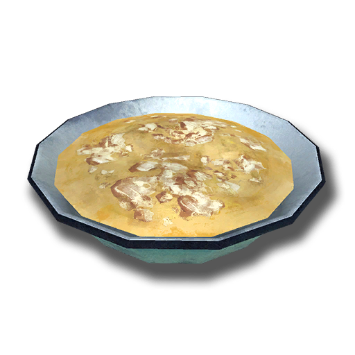

# Old Mill Flour

**Categories:** DLC Content, Food And Drink, Pages with update history · **Source:** [Fandom](https://thelongdark.fandom.com/wiki/Old_Mill_Flour)

**Contents**

- [Overview](#overview)
- [Locations](#locations)
- [Trivia](#trivia)
- [Products](#products)
- [Update history](#update-history)

**Old Mill Flour**

_Old\_Mill\_Flour\_icon.png_

**Release:** [19 June 2023](./The%20Long%20Dark%20%E2%80%94%20Changelog.md#2.17)

**Wintermute:** No

**Renewable:** Yes ([Trader](./Trader.md) only)

**Properties**

**Item type:** [Food And Drink](./Food%20And%20Drink.md)

**Values**

**Weight:** 1.50 kg (3.3 lbs)

**Decay Rate**

**Inside:** 0.250% per day

**Outside:** 0.250% per day

**Advanced data**

**Item key:** GAMEPLAY\_Flour

_Ptarmigan\_icon.png_

**DLC-Exclusive content.** / This content requires the [Tales from the Far Territory](./Tales%20from%20the%20Far%20Territory.md) addon to be installed before it can be seen or used in regular gameplay.

Item

Skills

Materials

 [Bannock](./Bannock.md)

None

- 0.15 L × [Water (Potable)](./Water%20%28Potable%29.md) / - 0.05 L × [Cooking Oil](./Cooking%20Oil.md) / - 0.20 kg × [Old Mill Flour](./Old%20Mill%20Flour.md)

 [Breyerhouse Pie](./Breyerhouse%20Pie.md)

None

- 0.50 kg × [Ptarmigan (Raw)](./Ptarmigan%20%28Raw%29.md) / - 0.50 kg × [Rabbit (Raw)](./Rabbit%20%28Raw%29.md) / - 0.50 kg × [Venison (Raw)](./Venison%20%28Raw%29.md) / - 0.15 L × [Water (Potable)](./Water%20%28Potable%29.md) / - 0.05 L × [Cooking Oil](./Cooking%20Oil.md) / - 0.20 kg × [Old Mill Flour](./Old%20Mill%20Flour.md)

 [Pancakes](./Pancakes.md)

None

- 0.05 kg × [Maple Syrup](./Maple%20Syrup.md) / - 0.15 L × [Water (Potable)](./Water%20%28Potable%29.md) / - 0.05 L × [Cooking Oil](./Cooking%20Oil.md) / - 0.12 kg × [Old Mill Flour](./Old%20Mill%20Flour.md)

 [Peach Pie](./Peach%20Pie.md)

None

- 0.50 kg × [Pinnacle Peaches](./Pinnacle%20Peaches.md) / - 0.10 L × [Water (Potable)](./Water%20%28Potable%29.md) / - 0.05 L × [Cooking Oil](./Cooking%20Oil.md) / - 0.20 kg × [Old Mill Flour](./Old%20Mill%20Flour.md)

 [Ptarmigan Pie](./Ptarmigan%20Pie.md)

None

- 0.50 kg × [Ptarmigan (Raw)](./Ptarmigan%20%28Raw%29.md) / - 0.15 L × [Water (Potable)](./Water%20%28Potable%29.md) / - 0.05 L × [Cooking Oil](./Cooking%20Oil.md) / - 0.20 kg × [Old Mill Flour](./Old%20Mill%20Flour.md)

 [Ptarmigan Stew](./Ptarmigan%20Stew.md)

None

- 0.50 kg × [Ptarmigan (Raw)](./Ptarmigan%20%28Raw%29.md) / - 0.20 L × [Broth](./Broth.md) / - 0.05 kg × [Old Mill Flour](./Old%20Mill%20Flour.md)

 [Rabbit Pie](./Rabbit%20Pie.md)

None

- 0.50 kg × [Rabbit (Raw)](./Rabbit%20%28Raw%29.md) / - 0.15 L × [Water (Potable)](./Water%20%28Potable%29.md) / - 0.05 L × [Cooking Oil](./Cooking%20Oil.md) / - 0.20 kg × [Old Mill Flour](./Old%20Mill%20Flour.md)

 [Rabbit Stew](./Rabbit%20Stew.md)

None

- 0.50 kg × [Rabbit (Raw)](./Rabbit%20%28Raw%29.md) / - 0.20 L × [Broth](./Broth.md) / - 0.05 kg × [Old Mill Flour](./Old%20Mill%20Flour.md)

 [Ranger Stew](./Ranger%20Stew.md)

None

- 0.50 kg × [Venison (Raw)](./Venison%20%28Raw%29.md) / - 0.50 kg × [Rabbit (Raw)](./Rabbit%20%28Raw%29.md) / - 1 × [Potato](./Potato.md) / - 0.20 kg × [Carrot](./Carrot.md) / - 0.40 L × [Broth](./Broth.md) / - 0.05 kg × [Old Mill Flour](./Old%20Mill%20Flour.md)

 [Rose Hip Pie](./Rose%20Hip%20Pie.md)

None

- 8 × [Rose Hip](./Rose%20Hip.md) / - 0.10 L × [Water (Potable)](./Water%20%28Potable%29.md) / - 0.05 L × [Cooking Oil](./Cooking%20Oil.md) / - 0.20 kg × [Old Mill Flour](./Old%20Mill%20Flour.md)

 [Thomson Family Stew](./Thomson%20Family%20Stew.md)

None

- 0.30 kg × [Canned Corn](./Canned%20Corn.md) / - 0.40 kg × [Carrot](./Carrot.md) / - 2 × [Potato](./Potato.md) / - 2 × [Reishi Mushroom](./Reishi%20Mushroom.md) / - 0.40 L × [Broth](./Broth.md) / - 0.05 kg × [Old Mill Flour](./Old%20Mill%20Flour.md)

 [Trout Stew](./Trout%20Stew.md)

None

- 0.50 kg × [Rainbow Trout (Raw)](./Rainbow%20Trout%20%28Raw%29.md) / - 0.20 L × [Broth](./Broth.md) / - 0.05 kg × [Old Mill Flour](./Old%20Mill%20Flour.md)

 [Venison Pie](./Venison%20Pie.md)

None

- 0.50 kg × [Venison (Raw)](./Venison%20%28Raw%29.md) / - 0.15 L × [Water (Potable)](./Water%20%28Potable%29.md) / - 0.05 L × [Cooking Oil](./Cooking%20Oil.md) / - 0.20 kg × [Old Mill Flour](./Old%20Mill%20Flour.md)

 [Venison Stew](./Venison%20Stew.md)

None

- 0.50 kg × [Venison (Raw)](./Venison%20%28Raw%29.md) / - 0.20 L × [Broth](./Broth.md) / - 0.05 kg × [Old Mill Flour](./Old%20Mill%20Flour.md)
