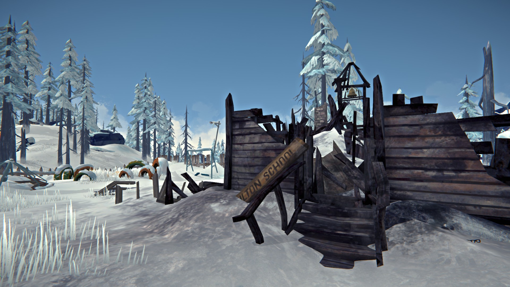

# Old Schoolhouse

**Categories:** Locations, Locations in Mountain Town, Outdoor locations · **Source:** [Fandom](https://thelongdark.fandom.com/wiki/Old_Schoolhouse)

**Old Schoolhouse**

_[Milton](./Milton.md)'s Old Schoolhouse._

**Location**

_Old\_Schoolhouse\_Location.png_

**Region:** [Mountain Town](./Mountain%20Town.md)

**Description:** A destroyed schoolhouse

**General**

**Type:** Outdoors

## Overview

The schoolhouse itself is destroyed, and a sign at the front door reads _Milton School_. On one side of the schoolhouse, there is a small shed containing [coal](./Coal.md) or other fuel. On the other, there are swings and other broken playground equipment. Shoes, glasses, and other personal belongings are scattered around the building's charred remains, as well as a frozen corpse nearby.

## Wintermute
