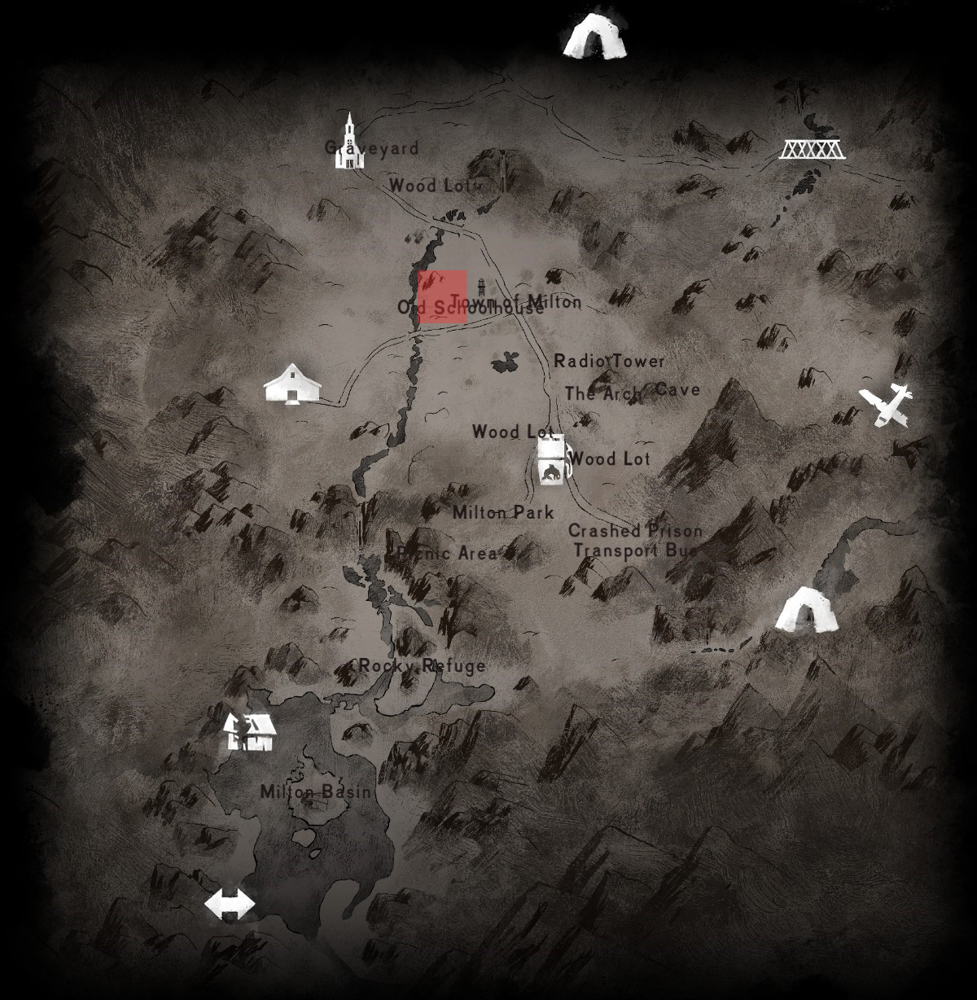

# Old Schoolhouse

**Old Schoolhouse**

| Property | Details |
| --- | --- |
|  |  / *[Milton](./Milton.md)'s Old Schoolhouse.* |
| **Location** |  |
|  |  / *Old\_Schoolhouse\_Location.png* |
| Region | [Mountain Town](./Mountain%20Town.md)\|- |
| Description | A destroyed schoolhouse |
| **General** |  |
| Type | Outdoors\|- |
