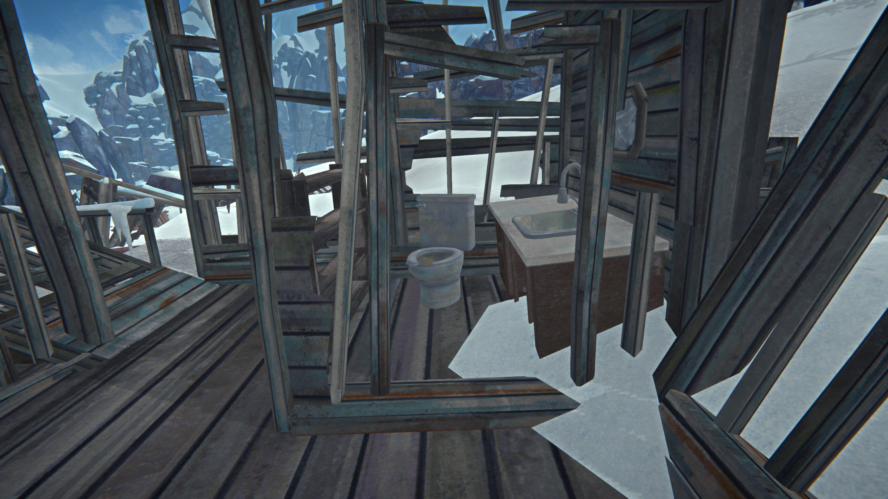

# Old Settlement

**Categories:** Locations, Locations in Sundered Pass, Sheltered locations · **Source:** [Fandom](https://thelongdark.fandom.com/wiki/Old_Settlement)

**Contents**

- [Overview](#overview)
- [Cabin](#cabin)
- [Ruined Buildings](#ruined-buildings)
- [Basement](#basement)
- [Trivia](#trivia)
- [Gallery](#gallery)

**Old Settlement**

_Old\_Settlement\_Close.jpg_

**Location**

_Old\_Settlement\_Location.png_

**Region:** [Sundered Pass](./Sundered%20Pass.md)

**General**

_The cabin with the window leading to the bedroom_

_The bathroom in the ruined building_

_The uncovered Basement_

_The Settlement from the nearby avalanche hill_
