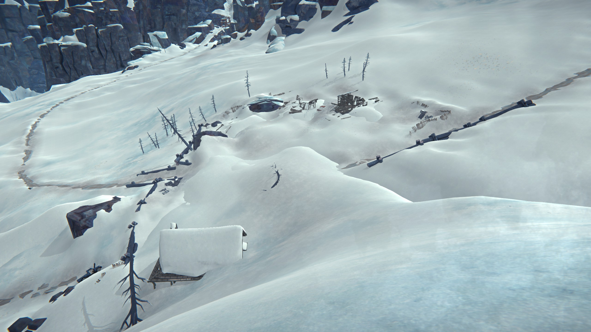

# Old Settlement

**Categories:** Locations · **Source:** [Fandom](https://thelongdark.fandom.com/wiki/Old_Settlement)

**Contents**

- [Overview](#overview)
- [Cabin](#cabin)
- [Ruined Buildings](#ruined-buildings)
- [Basement](#basement)
- [Trivia](#trivia)
- [Gallery](#gallery)

**Old Settlement**

| Property | Details |
| --- | --- |
|  | [Old Settlement Close](../assets/Old_Settlement_Close.jpg) |
| **Location** |  |
|  | [Old Settlement Location](../assets/Old_Settlement_Location.png) |
| Region |  |
| Description | A cluster of destroyed and intact buildings along the road in Sundered Pass |
| **General** |  |

The **Old Settlement** is an unmarked location in [Sundered Pass](./Sundered%20Pass.md).

## Overview

The area consists of 3 ruined buildings and one intact two story cabin. Several wooden fences can be found around the ruined buildings, with the road and nearby cabin blocked/buried by an avalanche. The area around the settlement is patrolled by several large packs of [Timberwolves](./Timberwolf.md), making coming and going very difficult.

## Cabin

The ground floor of the [Cabin](./Cabin%20%28Sundered%20Pass%29.md) is snowed-in, so the two doors are covered by snow and are unusable. Walking behind the cabin and onto the roof the player can find an open window to walk inside.

Stepping inside, the window will place the player on a [Bed](./Bed.md) on the second floor. A [Trunk](./Trunk.md) and several [Crates](./Crate.md) are found on the floor, with a staircase leading downstairs into a kitchen.

The 2 doors on the first floor can be opened, but are blocked by snow, imprinted with the shape of the doors. The Fireplace is also covered in snow, and cannot be used. A small kitchen with [Stored Water](./Stored%20Water.md) and several [Drawers](./Drawer.md) and a [Cupboard](./Cupboard.md).

## Ruined Buildings

3 ruined buildings can be found across the road of the snowed in cabin, with the largest freestanding one containing a [Toilet](./Toilet.md) in a ruined bathroom, but not much else. Further west 2 [Coal Bins](./Coal%20Bin.md) can be found along the 2 other ruined houses with some [Benches](./Bench.md). Careful scrutiny of the area may reveal possible loot, such as a [Wire Bundle](./Wires.md) and [Hatchet](./Hatchet.md).

A [Frozen Corpse](./Frozen%20Corpse.md) in front of the largest ruined building can sometimes contain a [Polaroid](./Polaroids.md).

## Basement

Hidden behind the largest ruined building, a [Basement](./Basement%20%28Sundered%20Pass%29.md) is can be uncovered while following objectives from the [Last Horizon](./Last%20Horizon.md) Tale by following the clue from [Foreman's Polaroid 2](./Foreman%27s%20Polaroid%202.md). The basement cannot be used to escape [Insomnia Risk](./Insomnia%20Risk.md) when [Glimmer Fog](./Glimmer%20Fog.md) arrives in the region, despite being underground.

## Trivia

- Hiding in the bathroom of the ruined building near the Basement will not completely stop Timberwolf attacks, as they will attack you through the nearby [Shelf](./Shelf.md) next to the toilet.

## Gallery

