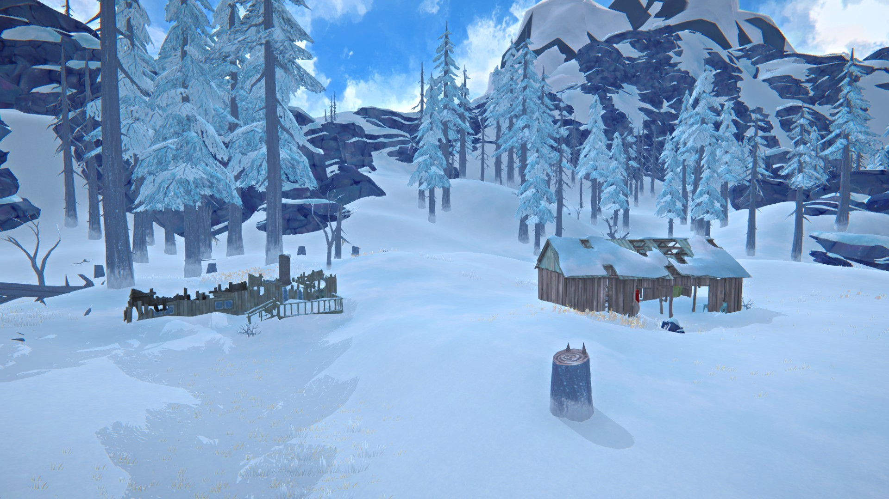
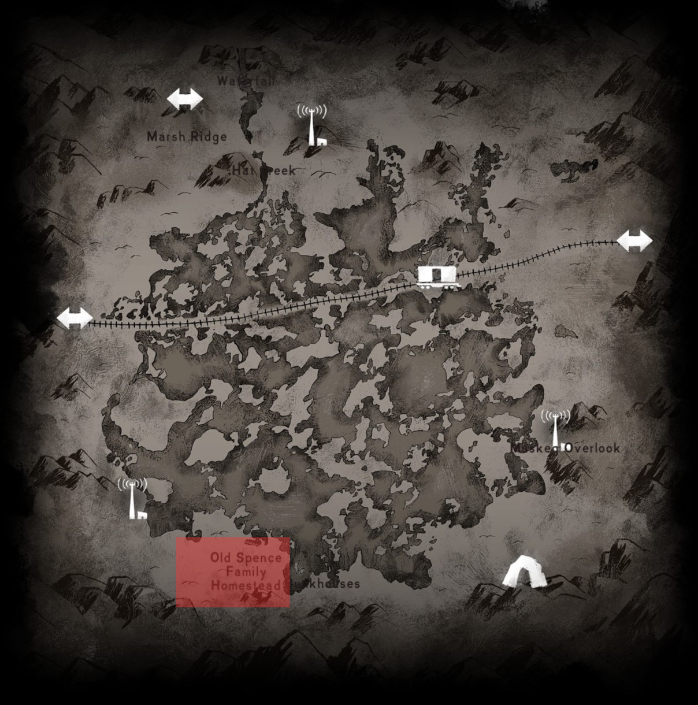

# Old Spence Family Homestead

**Categories:** Industrial locations, Locations, Locations in Forlorn Muskeg, Locations with a forge, Locations with a workbench, Sheltered locations · **Source:** [Fandom](https://thelongdark.fandom.com/wiki/Old_Spence_Family_Homestead)

**Old Spence Family Homestead**

_20170304095533\_1.jpg_

**Location**

_Old\_Spence\_Family\_Homestead\_Location.png_

**Region:** [Forlorn Muskeg](./Forlorn%20Muskeg.md)

**General**

**Type:** Industrial

_bed\_icon.png_

Has a bed

_forge\_icon\_green.png_

Has a forge
