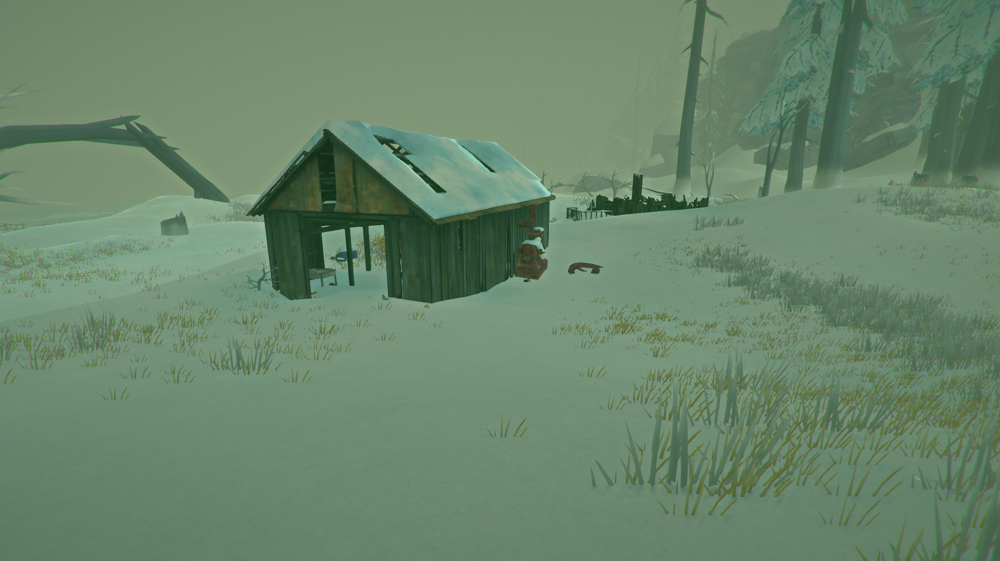
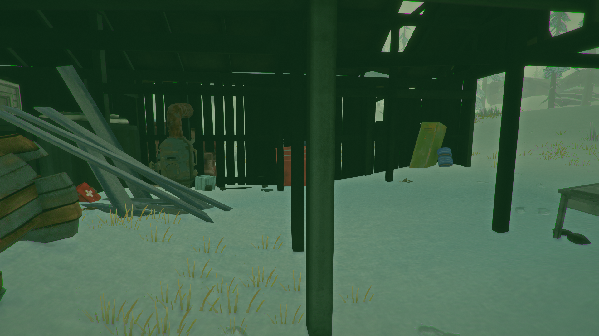
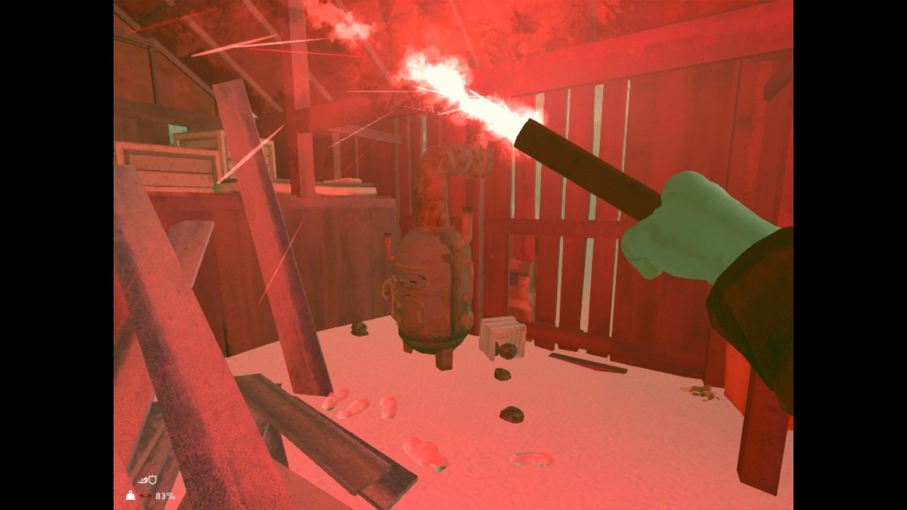

# Old Spence Family Homestead

**Categories:** Industrial locations, Locations, Locations in Forlorn Muskeg, Locations with a forge, Locations with a workbench, Sheltered locations · **Source:** [Fandom](https://thelongdark.fandom.com/wiki/Old_Spence_Family_Homestead)

**Contents**

- [Overview](#overview)
- [Signal Void](#signal-void)
- [Trivia](#trivia)
- [Gallery](#gallery)

**Old Spence Family Homestead**

| Property | Details |
| --- | --- |
|  | [20170304095533 1](../assets/20170304095533_1.jpg) |
| **Location** |  |
|  | [Old Spence Family Homestead Location](../assets/Old_Spence_Family_Homestead_Location.png) |
| Region | [Forlorn Muskeg](./Forlorn%20Muskeg.md) |
| Description | A small structure offering little protection from the elements |
| **General** |  |
| Type | Industrial |
| Firebox | [Furnace](./Furnace.md) |
| [Bed icon](../assets/Bed_icon.png) | Has a bed |
| [Forge icon green](../assets/Forge_icon_green.png) | Has a forge |
| [Workbench icon green](../assets/Workbench_icon_green.png) | Has a workbench |
|  | Provides some shelter |

**Old Spence Family Homestead** is a derelict farming area found within [Forlorn Muskeg](./Forlorn%20Muskeg.md).

## Overview

Old Spence Family Homestead is surrounded by a thicket on one side and fields of snowbanks and weak ice on the other. It consists mostly of buildings in various degrees of disrepair, but one of the main buildings generally contains useful items such as [Fir Firewood](./Fir%20Firewood.md), [Coal](./Coal.md), a [Heavy Hammer](./Heavy%20Hammer.md), [Food And Drink](./Food%20And%20Drink.md), and [Scrap Metal](./Scrap%20Metal.md), as well as the second [forge](./Forge.md) to appear in the game. The main building also contains a work bench, a [safe](./Safe.md) (hidden behind several crates) and a [bed](./Bed.md).

The player may need a [fire](./Fire.md) to safely sleep, as there are holes in the roof and on the sides. If you have good clothing such as [Deerskin Boots](./Deerskin%20Boots.md), a [Wolfskin Coat](./Wolfskin%20Coat.md), and [Deerskin Pants](./Deerskin%20Pants.md), a fire may not be needed.

In the morning deer may spawn in the area but if you are using a [Survival Bow](./Survival%20Bow.md), they can run away onto the thin ice and it can be difficult to reach the carcass. There is a lot of wood to be harvested in the vicinity, and more coal can be harvested in nearby caves for crafting tools in the forge. A rifle may be found on a body northwest of the homestead on a small snow island.

A wolf pack tends to patrol near the fence on the side closest to the ice, so take caution. There may also be a [bear](./Bear.md) wandering northwest of the camp. If you want to travel to other locations on the map, analyze the weather as disorienting fog can be a serious danger due to thin ice, and predators. Cold winds can also be deadly, as there are not many places with wind protection. Mornings are very cold, so wait a bit for the sun and temperature to rise.

With the Redux update (December 2018), another forge has been added to the [Maintenance Yard](./Maintenance%20Yard.md) in the [Broken Railroad](./Broken%20Railroad.md) region. Consider traveling a little farther to reach the Maintenance Yard if you don't have enough equipment to protect against the harsh weather conditions in Forlorn Muskeg.

## Signal Void

Some [Replacement Fuses](./Replacement%20Fuse.md), along with some [Wire Bundle](./Wires.md), may be found here, which can prove helpful to players who wish to repair the transmitter tower near [Muskeg Overlook](./Muskeg%20Overlook.md).

## Trivia

- One of the large crates near the bed in the main building always contains 3 accelerants under it when destroyed.
- The Safe may contain high rarity items based on [survival mode](./Survival%20Mode.md) such as: Gauntlets, Mukluks, Gunpowder, Rabbitskin Mitts, Cash, etc.
- The docks contains several pieces of loot.
- Old Spence Family Homestead in [Wintermute (Story Mode) Episode 2: Luminance Fugue](./Episode%202%20-%20Luminance%20Fugue.md) is a references the fantasy manga ["Ushio & Tora" (うしおととら)](https://en.wikipedia.org/wiki/Ushio_%26_Tora) written and illustrated by Kazuhiro Fujita. Both stories involve characters driven driven mad for revenge to kill 'evil spirits' with [similar weapons](./Bear%20Spear.md).

## Gallery

