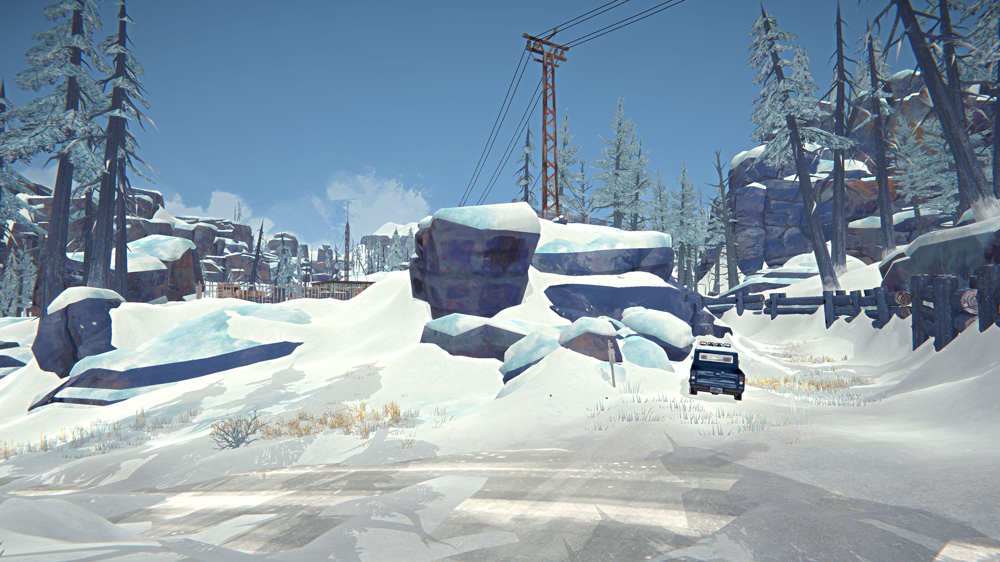
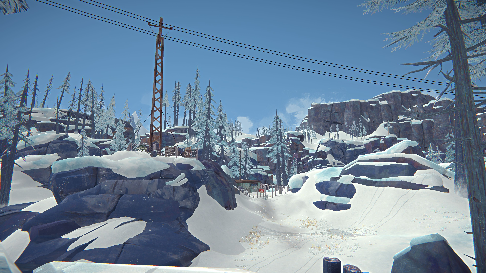
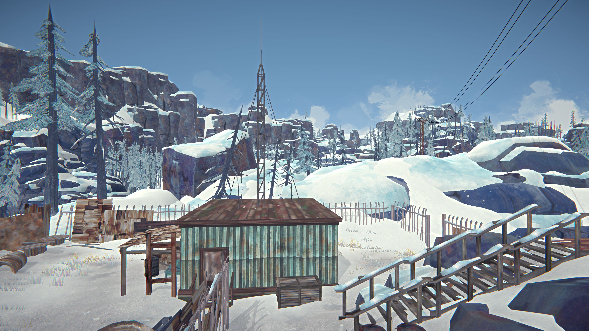
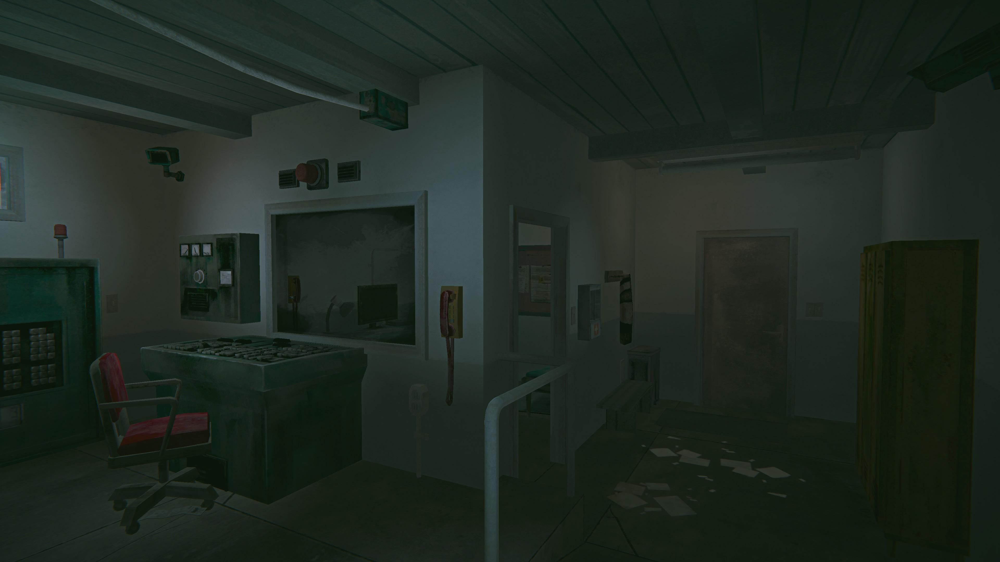

# Old Substation

**Categories:** Blackrock, Indoor locations, Industrial locations, Locations, Locations in Blackrock, Locations with a workbench · **Source:** [Fandom](https://thelongdark.fandom.com/wiki/Old_Substation)

**Contents**

- [Overview](#overview)
- [Wildlife](#wildlife)
- [Gallery](#gallery)
- [References](#references)

**Old Substation**

_Old\_Substation.jpg_

**Location**

_Old\_Substation\_Location.png_

Region

**Location:** Close to Narrow Bridge in the southwest of the region

**General**

**Type:** Industrial

_bed\_icon.png_

Has a bed

_workbench\_icon\_green.png_

Has a workbench

## Overview

With its strategic location between [Narrow Bridge](./Narrow%20Bridge.md) and [Blocked Bridge](./Blocked%20Bridge.md), it is a major feature in this region and a possible long-term base.

The interior layout is very similar to the Radio Control Hut at [Signal Hill](./Signal%20Hill.md). A small office with a bed is inside the Old Substation. A workbench is located next to a fire barrel behind the building. There is ample storage space in containers both inside and outside. Two outdoor caves are very close ([Lineworker's Hideout](./Lineworker%27s%20Hideout.md) to the south and an unnamed cave to the north), in addition to an abandoned car, allowing [Cabin Fever](./Cabin%20Fever.md) to be slept off.

## Wildlife

[Timberwolves](./Timberwolf.md) are often nearby and can go inside the fenced perimeter around the building. However, they may not be able to reach the power line pylon on the adjacent hilltop.[¹](#fn1) Aside from the Timberwolves, there is limited game in the area, though [Deer](./Deer.md) can be found by [crossing the nearby river](./Narrow%20Bridge.md) and heading for [Creek Bed Cave](./Creek%20Bed%20Cave.md).

## Gallery

_Old Substation perimeter fence_

_Old Substation from the main road, looking northwest_

_Old Substation from the access road, looking southwest_

_Old Substation overview, looking west_

_Old Substation interior_

## References

## Notes

---

1. [https://steamcommunity.com/app/305620/discussions/0/3280321473010347352/](https://steamcommunity.com/app/305620/discussions/0/3280321473010347352/) (as of game version 2.00)[↩︎](#fnref1)
