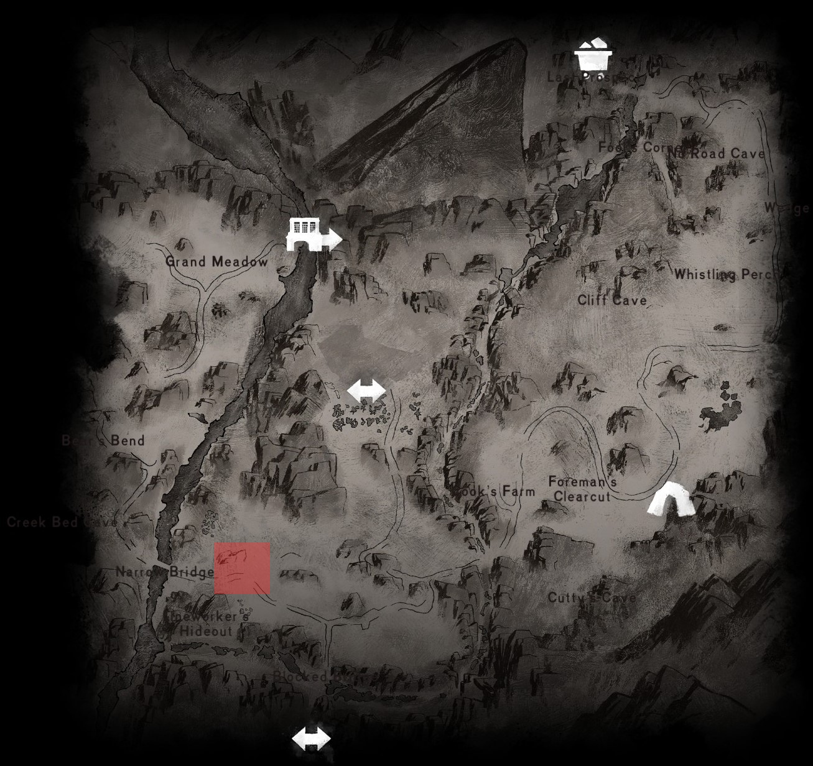

# Old Substation

**Old Substation**

| Property | Details |
| --- | --- |
|  |  / *Old\_Substation.jpg* |
| **Location** |  |
|  |  / *Old\_Substation\_Location.png* |
| Region |  |
| Location | Close to Narrow Bridge in the southwest of the region |
| **General** |  |
| Type | Industrial\|- |
|  / *bed\_icon.png* | Has a bed |
|  / *workbench\_icon\_green.png* | Has a workbench\|- |
