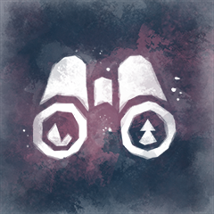
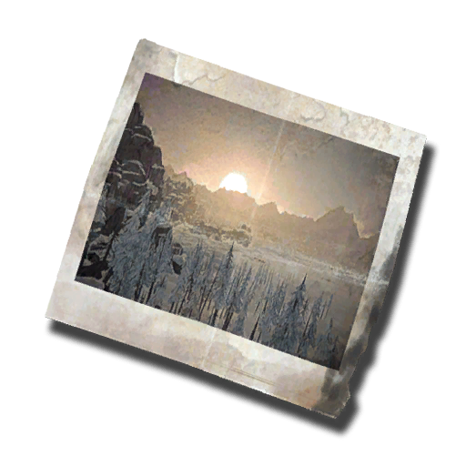
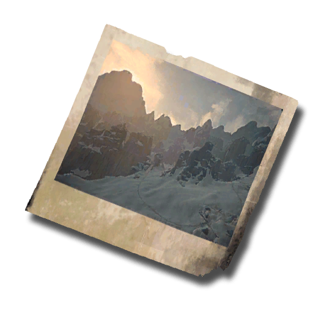
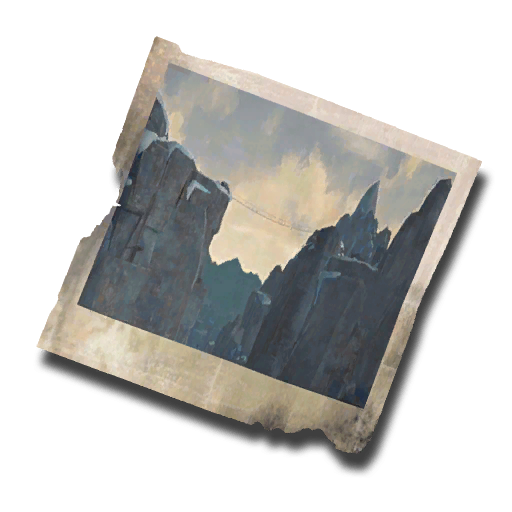
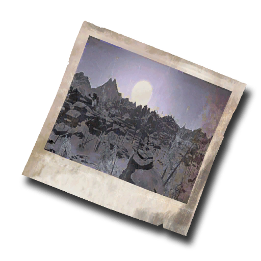
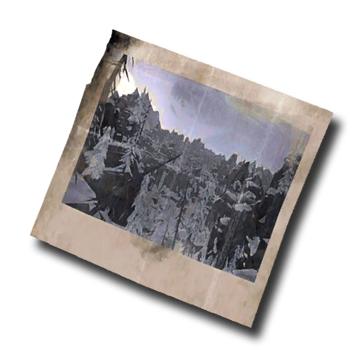

# On the Lookout

<table class="infobox">
<caption>On the Lookout</caption>
<colgroup>
<col style="width: 50%" />
<col style="width: 50%" />
</colgroup>
<tbody>
<tr>
<td colspan="2"><figure>

<figcaption>On_the_Lookout_icon.png</figcaption>
</figure></td>
</tr>
<tr>
<td colspan="2"></td>
</tr>
<tr>
<td>
Description
</td>
<td>
Reach all 6 Vista locations in the Far Territory (single game).
</td>
</tr>
</tbody>
</table>

**On the Lookout** is an <a href="./The%20Long%20Dark%20%E2%80%94%20Achievements.md" class="wikilink" title="achievement">achievement</a> in *<a href="./The%20Long%20Dark.md" class="wikilink" title="The Long Dark">The Long Dark</a>*.

## Guide

This achievement is easiest to unlock when playing on <a href="./Pilgrim.md" class="wikilink" title="Pilgrim">Pilgrim</a>.

The player must find all 6 <a href="./Polaroids.md" class="wikilink" title="Polaroids">Polaroids</a> in The Far Territory in a single <a href="./Survival%20Mode.md" class="wikilink" title="Survival Mode">Survival Mode</a> game and then visit these places (a message will be displayed on the screen at the moment of the visit to the bottom right stating that this is a special place). You can use charcoal to sketch these places on the map, this will help you track your progress and unlock most of the location, but this is not necessary to complete the achievement.

<table>
<colgroup>
<col style="width: 25%" />
<col style="width: 25%" />
<col style="width: 25%" />
<col style="width: 25%" />
</colgroup>
<thead>
<tr>
<th>
Polaroid
</th>
<th>
Region
</th>
<th>
Locations
</th>
<th>
Vista
</th>
</tr>
</thead>
<tbody>
<tr>
<td>
[Missing image: FA_Polaroid.png]
</td>
<td>
Forsaken Airfield
</td>
<td><ul>
<li>On a table in <a href="./Island%20Cottage.md" class="wikilink" title="Island Cottage">Island Cottage</a></li>
<li>In a car's visor near <a href="./Junker%27s%20Paddock.md" class="wikilink" title="Junker&#39;s Paddock">Junker's Paddock</a></li>
</ul></td>
<td>
Cliffside south of <a href="./Field%2031.md" class="wikilink" title="Field 31">Field 31</a>, <a href="./Mindful%20Cabin.md" class="wikilink" title="Mindful Cabin">Mindful Cabin</a>
</td>
</tr>
<tr>
<td>

</td>
<td>
Sundered Pass
</td>
<td><ul>
<li>On the bunk/shelf of <a href="./Final%20Refuge.md" class="wikilink" title="Final Refuge">Final Refuge</a></li>
<li>Under a tarp on the upper floor of the <a href="./Cabin%20%28Sundered%20Pass%29.md" class="wikilink" title="Cabin (Sundered Pass)">Cabin (Sundered Pass)</a> at the Old Settlement</li>
<li>On a Frozen Corpse close to the ruined <a href="./Basement%20%28Sundered%20Pass%29.md" class="wikilink" title="Basement (Sundered Pass)">Basement (Sundered Pass)</a> building at the Old Settlement</li>
</ul></td>
<td>
Cliff near <a href="./Prayerful%20Window.md" class="wikilink" title="Prayerful Window">Prayerful Window</a> overlooking the <a href="./Old%20Settlement.md" class="wikilink" title="Old Settlement">Old Settlement</a>, Cliff overlooking <a href="./Perilous%20Crossing.md" class="wikilink" title="Perilous Crossing">Perilous Crossing</a> and <a href="./Ogre%27s%20Teardrop.md" class="wikilink" title="Ogre&#39;s Teardrop">Ogre's Teardrop</a>
</td>
</tr>
<tr>
<td>

</td>
<td>
Zone of Contamination
</td>
<td><ul>
<li>On the train station office corkboard in <a href="./Indolent%20Hoppers.md" class="wikilink" title="Indolent Hoppers">Indolent Hoppers</a></li>
<li>On the dashboard of an <a href="./Haul%20Truck.md" class="wikilink" title="Haul Truck">Haul Truck</a> parked in the mining pit.</li>
</ul></td>
<td>
Cliff near <a href="./Boss%27s%20Settlement.md" class="wikilink" title="Boss&#39;s Settlement">Boss's Settlement</a>, Cliff near <a href="./Welkin%27s%20Window.md" class="wikilink" title="Welkin&#39;s Window">Welkin's Window</a>
</td>
</tr>
</tbody>
</table>

## Trivia

This achievement is a pun on how Vistas are always found in high "lookout" locations and how the player must stand on said lookouts to survey the map.**Lua execution error in Module:Navbox function navbox**

